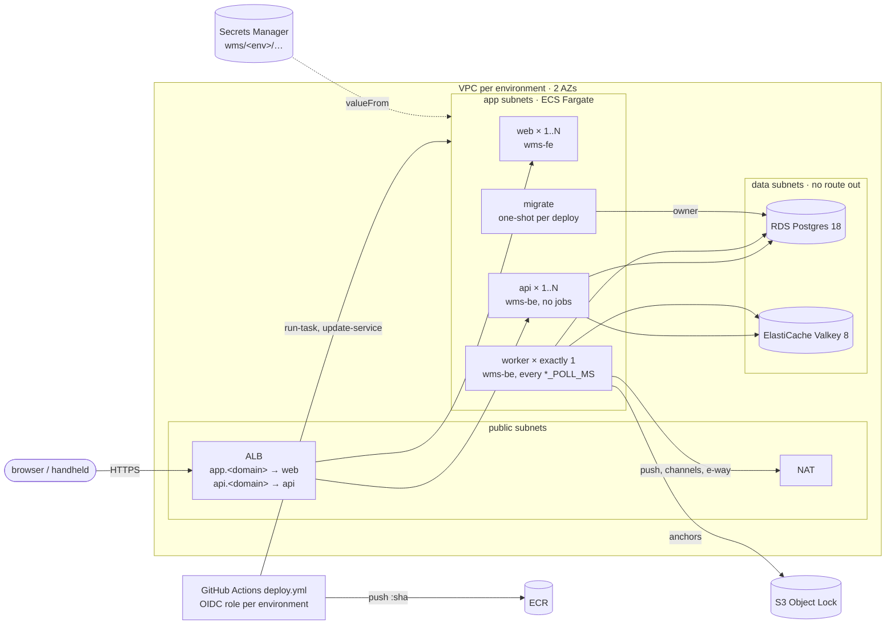

# System design (high level)

How the pieces fit. Decisions and their rationale live in `ARCHITECTURE-SPINE.md` (AD-1…AD-25); this describes the shape those decisions produced.

Companions: `IMPLEMENTATION-GUIDE.md` (the patterns to code by), `../repos/wms-be/README.md` (the API contract).

---

## Three repositories

| Repo | What it is | Who uses it |
|---|---|---|
| **wms-be** | NestJS + Drizzle + Postgres + Valkey. Owns all state and all rules | everything |
| **wms-fe** | Next.js + shadcn/ui. Web dashboard | Owner, Ops Manager, Accountant |
| **wms-mobile** | Expo/RN. Offline-first scan client | Operators on the floor |

Both clients consume a **generated** API client — no hand-written request types (AD-8). The backend is the only thing that decides anything.

---

## The one idea the system is built on

**The ledger is the only stock truth** (AD-1). Nothing anywhere mutates a quantity directly. Every movement is an append-only `ledger_events` row, and `stock_on_hand` / `batch_on_hand` are **projections** folded forward from it.

That single decision produces most of the architecture:

- **Corrections are new events**, never edits — so history is complete by construction
- **A projection can be rebuilt** by replaying the ledger, which makes it a cache rather than a second source of truth
- **Divergence is detectable**: a background job continuously replays and compares, and quarantines what disagrees (story 2.2)
- **Anything derived is derived the same way** — registers (AD-21), billing (AD-25), reporting. Nothing keeps a parallel book

When something new needs to be counted, the first question is "which existing ledger events say this?" — usually the answer is all of them.

---

## Request lifecycle

```
HTTP → Controller (api shell)  ── thin: auth guard, tenant match, DTO validation, idempotency header
         ↓
     Facade (AD-6 seam)         ── the ONLY thing a sibling module may import
         ↓
     Command service (AD-10)    ── the whole transaction: authority, replay, lock, guard, write,
         ↓                         outbox, audit (every keyed command — 9-3a), idempotency key
     Postgres (RLS behind it)   ── tenant_id on every row; RLS is defence in depth, not the gate
         ↓
     post-commit                ── Valkey counter mirrors, never throwing
```

**Controllers are deliberately thin** — they map DTOs and read the idempotency header. The intent is that they hold no rules; it is not uniformly true. `catalog/import.command.ts:152-155` parses the uploaded file *before* the `catalog.import` check at `:170`, which inverts authority-before-validation (`PENDING.md`, verified finding 2). Treat "thin" as the rule to code to, not a property you may assume when reading. Story 10.2 moved quantity conversion *out* of controllers into commands, because anything in front of the command runs before the replay lookup — and a refusal in front of a replay answers 400 to an op that already committed.

---

## Modules (AD-6)

Thirteen modules, each owning its tables exclusively. **Siblings communicate only through a facade or an event — never by touching another module's tables.** The 3PL client dimension (Epic 21, story 21-1) adds the fourteenth: `clients`. Its table is written only inside the module — registration reaches it through `ensureSelfClientInTx`, and since 21-2b the owner's admin commands create and rename clients. The other modules never write it: they **read** it through `clients.facade.ts`, and documents and ledger rows **derive** their `client_id` from their SKUs (`assertSingleClientInTx`) rather than stamping `self` (`modules/clients.md`). Story 21-3 adds the fifteenth, `billing`: it owns the rate-card tables, reads (and locks) the client row only through `clients.facade.ts`, and writes no stock (`modules/billing.md`). Story 13-1 adds `returns` (`modules/returns.md`). Story 5-1a adds `mail` — the email queue and its sender (`modules/mail.md`).

`test/architecture.spec.ts` scans source for writes and past-the-facade imports, but **it covers eleven module table-sets, not fifteen**: stock/ledger (inventory), order/wave/pick (outbound), catalog identity (10.3 — batches, serials, handling units; not the SKU table itself), carriers, clients (21-1), transfers (movements), replenishment, channels, invoices (invoicing), rate cards (21-3 billing: only billing writes or even reads `rate_cards`/`rate_card_lines`, it writes no stock/client/order table, siblings import only its facade) and the notification panel (9-2: only notifications writes `notifications`/`notification_reads` — and, 9-2b, `push_deliveries`; it imports no sibling's table; only the api shell, root and — 9-2b, through the facade — the jobs shell import it; the push enqueue, an outbox handler, makes no network call) — plus the `int4` guard, the 7-2 ingest/writeback seams and the 9-1 reporting block (reporting writes nothing and only the api shell imports it), the 9-3b audit-export block (tenancy) and the 9-3c ledger-integrity block (inventory: each of the three integrity tables written only by its named inventory files; the WORM copies never updated or deleted), and the 13-1 returns block (only returns writes its four tables since 13-2, it imports no sibling's table nor names one in raw SQL, and it reaches tenancy only through an allowlist of exported helpers — tenancy never imports returns), and the 5-1a mail block (only mail writes `email_messages`, other modules import only `mail.facade`, mail imports nothing from tenancy, and `EMAIL_SEAL_KEY` is named in one file). **`tenancy`, `inbound`, `putaway` and `compliance` table ownership is unenforced** (and the `skus` table only partly — its client column has its own 21-2b guard), and `bins` — the one table deliberately shared by column between tenancy and putaway — is the least-guarded case of all. Adding a module block when you add a module is the standing rule; the unenforced ones predate it.

| Module | Owns |
|---|---|
| `tenancy` | tenants, users, roles, warehouses, zones, bins, devices — including the handheld's push registration (9-2b: token + warehouse, written only by the device's own PUT/DELETE, cleared by revoke; read by notifications only through the push-target functions) |
| `clients` | the client dimension (AD-23): the `self` client per tenant, `client_id` on `skus`/`orders`/`purchase_orders`/`ledger_events` — 21-1 |
| `catalog` | SKUs, batches, serials, UoM vocabulary |
| `inventory` | **the ledger**, projections, reservations, ATP, reconciliation; (9-3c) the ledger's integrity record — the scheduled anchoring, the pre-0026 baseline, chain breaks and their acknowledgement, the anchors' WORM copies (`ledger_integrity_state`, `ledger_chain_breaks`, `ledger_anchor_worm_copies`, written only by three named inventory files) |
| `partners` | the business partner master (story 1-3): `business_partners` (the renamed `vendors` — one row per GST registration, roles vendor / consignee / transporter) and `partner_client_links` (which client trades with which vendor or consignee; the client's default vendor). Read by inbound's PO guard and replenishment's default pick through `partners.facade.ts` (`modules/partners.md`) |
| `inbound` | purchase orders, advance shipment notices (21-6 — receiving books against a PO, an ASN, or neither, in one `grn.submit`), receiving, GRNs, QC holds; **the gate-in (2-3a)** — one inbound vehicle visit (`gate_ins`, `gate_in_documents`): recorded and gated out at the gate desk (web), unloaded at the dock (the handheld's `gate-in.unload`, first-writer-wins per column), receipts linked optionally and never refused for a bad link |
| `putaway` | directed putaway, bin administration |
| `outbound` | orders, waves, picklists, picks, pack, dispatch; the wave cutoff sweep (9-2b — `wave.cutoff_at_risk` once per planned wave per IST date inside 60 minutes of its cutoff) |
| `carriers` | carrier registry, tenant credential vault |
| `compliance` | temperature excursions (FR-44): record → per-scope QC holds + zero-delta ledger events, resolve (the review flip) — 12-5 |
| `movements` | counts, variances, stock adjustments' review, moves/transfer orders (epics 5, 15+) |
| `replenishment` | the stock-intelligence spine (epic 6): the breach sweep + suggested-PO drafts (6-1, FR-22) and the expiry/aging batch-alert scan on the SAME tick (6-2, FR-23) — alerts are evidence; only a human submit orders |
| `channels` | sales-channel connections, standing buffers, availability sync (7-1), webhook ingest + fulfillment writeback (7-2) |
| `invoicing` | GST invoices (8-1): one per dispatched order, derived from dispatch facts over `order.dispatched`, exact paise/bps math, per-tenant FY numbering (per supplier GSTIN since 8-1b); the HSN summary shipped in 8-2a — a read model over issued invoices (`issued_at`, `invoice_lines.uom`) with one catalog read, via `CatalogFacade`, for the current-HSN hint; e-way bills (8-2b) queue off `invoice.issued`, export as NIC bulk JSON or generate through the `EwayGateway` port (unconfigured in production) |
| `reporting` | the operational dashboard (9-1, FR-27): a read model with **no tables** — ten per-warehouse KPI tiles computed live over the owning modules' records (a named read-only exception to the facade rule, decision 6 — `IMPLEMENTATION-GUIDE.md` §7a), each figure carrying the list route behind it; plus the per-client service report (21-8, `service.ts`, the second named exception — ratified at the epic-21 retro, 2026-10-10), served to operator and client portal alike; plus the owner's **audit trail** read (9-3a, FR-28, `audit.ts` — the third named exception: `audit_events` only, owner-only `audit.view`, a facade guard in its own transaction, cursor-paged on `created_at`). Async export (9-3b) joins it next. Story 5-3a adds the **operational registers** (stock on hand, inbound, outbound, ledger, batch ageing — CSV/XLSX downloads) — NOT a read-model exception: their rows come from reads on the inventory, inbound, outbound, catalog and tenancy facades, under two process-wide slots and a 15 s whole-read deadline (`modules/reporting.md`) |
| `billing` | client billing (AD-25), story 21-3: **rate cards** — a client brand's versioned prices (`rate_cards`, `rate_card_lines`), drafted then activated from an IST-midnight date and frozen after (DB triggers); a later card supersedes from its own date, a scheduled one can be cancelled (reopening its predecessor). The facade answers "in force at an instant" and "which cards cover a period" (segments — 21-5's invoice-line input). Story 21-4 adds **metering** (a client's usage per card segment, priced — the `usage` read) and the **daily storage snapshots** (`storage_snapshots`, a projection folded from the ledger under a commit guarantee), reading the ledger, GRN lines and picks only through the inventory, inbound and outbound facades. Story 21-5 adds **client invoices** (`client_invoices`, `client_invoice_lines`, `client_invoice_series`): a monthly services (SAC) tax invoice per client brand and supplying GSTIN, drafted from the metering read, frozen at issue by database triggers, numbered in its own series; it reads the e-invoicing flag and the state codes through `InvoicingFacade`. It writes no stock |
| `returns` | Epic 13's reverse flow — 13-1: return authorizations (`return_authorizations`, `return_authorization_lines`): an operator authorizes part of a dispatched order for return (`returns.manage`), bounded by what was dispatched minus uncancelled authorizations, computed through the outbound, inventory and catalog facades under a per-order advisory lock. 13-2: return receipts (`return_receipts`, `return_receipt_lines`) — the handheld's `return.receive` grades each unit and books the units that match into the system **RETURNS** bin (`return.received`, outside ATP — "awaiting disposition"); the rest go to the existing review queue (Discard only). It reaches tenancy only through tenancy's exported helpers (`modules/returns.md`) |
| `mail` | the email queue (5-1a): `email_messages`, one row per message a committed command wants sent, **written in that command's own transaction** (`queueEmailInTx` — never the outbox), with a send-time secret (an invite's raw token) sealed under `EMAIL_SEAL_KEY` and wiped on every final status. A worker renders a code-defined template and sends it through the `EmailGateway` port (SES v2 in ap-south-1, or the capturing `log` provider, or `off`) — at most once. The first mail is the user invitation (invite, reactivation of a never-accepted invitee, resend). Imports nothing from tenancy (`modules/mail.md`) |
| `notifications` | the web notification panel (9-2): a **projection** (`notifications`, `notification_reads`) filled by idempotent outbox subscribers — six modules' raise events insert an entry keyed by the occurrence's own id, their resolve events mark it resolved (a resolve before its raise leaves a tombstone the late raise fills, still resolved). Routed by the capability the source's resolving command enforces (`ROLE_CAPABILITIES` via tenancy — never the payloads' `notifyRole`); reads no sibling's table. The bell shows a dot, never a count: an open visible entry surfaced since the member's last panel open. **Mobile pushes (9-2b):** a second subscriber queues `push_deliveries` rows (new work, approval waiting, wave cutoff at risk) for the eligible handhelds — never a network call in the relay — and a worker sends them through the `PushGateway` port (`unconfigured` by default, `expo` when configured); at most once per (event, device) (`modules/notifications.md`) |

**`src/shared/labels` (story 2-10a)** is the label renderer, outside every module: pure functions with no DB — an in-house Code 128 subset-B encoder (and decoder, for tests), ASCII folding and ZPL escaping, the label geometry and barcode fit check, and the ZPL and PDF (`pdf-lib`) renderers. Tenancy's `BinLabelsService` feeds it bin labels; 2-10b (LPN labels) and later documents reuse it.

The api shell (`src/api/`) is where two modules' reads are joined — the device catalog snapshot composes across `inbound` and `outbound` there rather than making one module import the other.

---

## Inventory: the core

**Reservations** (AD-12) are durable records with a lifecycle `held → committed → released/expired`, plus a TTL and a reaper. ATP is always read net of live reservations, which is what makes oversell protection real rather than advisory.

**The decision point is split, deliberately.** Postgres is the truth; Valkey holds a counter mirror for the hot path. A grant runs a Lua script against the counter, then journals in Postgres. The counter can drift; the journal cannot. A parity pass reconciles them, and **failure is always fail-closed** — a missing counter refuses the grant rather than granting blind.

**Quantities** are scaled integers in milli-units (AD-9 as amended, story 10.1), with each UoM declaring its precision (10.2). No decimals exist below the HTTP edge.

---

## Offline: the floor's constraint

The mobile client is offline-first (AD-4). Scan decisions run **on-device**; only persistence waits for the network.

- Ops queue FIFO and replay idempotently, exactly once
- Replay re-authorises against **the badge-in session that created the op** — shared devices never launder authority
- A queued op the server later rejects surfaces as a **retraction** in the sync summary, never a silent correction
- The scan banner has exactly four states, and **"Recorded · queued" is never shown as green-accepted** — the UI does not claim server truth it does not have

This is why the catalog snapshot exists: the device carries enough to decide locally (bins, SKUs, UoM precision, tasks). Anything the device must refuse in under 500 ms has to be in that snapshot.

---

## Integration: the outbox

Every integration crossing goes through a transactional outbox (AD-7). The state change and the event commit in **one** Postgres transaction; a relay drains them with a 5-attempt budget, exponential backoff and quarantine past budget.

So a carrier API being down never rolls back a dispatch. Domain state lands first; the integration catches up.

**Email is not on the outbox (5-1a).** The outbox is at-least-once and its payloads are plain jsonb many subscribers read; an invite's raw token there would be a secret at rest in a shared queue. A command that wants a mail writes an `email_messages` row in its **own** transaction instead (`mail.facade`'s `queueEmailInTx`): exactly one row per committed command, none on a rollback or a replay, the secret sealed. The mail worker is the integration that catches up (`modules/mail.md`).

---

## Background work

| Job | Does |
|---|---|
| Outbox relay | drains integration events, backs off, quarantines |
| Reconciliation | replays the ledger, compares to projections, quarantines divergence |
| Reservation reaper | expires TTL'd holds, runs the counter parity pass |
| Storage snapshots (21-4) | writes each client brand's daily closing stock per warehouse and base UoM, once the day is provably complete; drift-checks the last 7 days (`STORAGE_SNAPSHOT_POLL_MS`) |
| Push sender (9-2b) | `PushSenderWorker`: per due tenant, `NotificationsFacade.sendDuePushes` — claim ≤ 100 queued pushes, one `PushGateway` call, write the outcomes (`PUSH_SENDER_POLL_MS`; the gateway by `PUSH_GATEWAY`, `EXPO_ACCESS_TOKEN`, `PUSH_HTTP_TIMEOUT_MS`) |
| Wave cutoff sweep (9-2b) | `WaveCutoffSweepWorker`: per tenant with a planned cut-off wave, `OutboundFacade.sweepCutoffRisk` — raises `wave.cutoff_at_risk`, the at-risk push's source (`WAVE_CUTOFF_SWEEP_POLL_MS`) |
| Ledger integrity (9-3c) | `LedgerIntegrityWorker`: per warehouse (≤ `MAX_LEDGER_INTEGRITY_SCOPES_PER_TICK`, default 50, a rotating window), `InventoryFacade.runLedgerIntegrity` — baseline the pre-0026 prefix once, anchor the hash chain's tail in bounded chunks (`LEDGER_ANCHOR_MAX_RANGE` × `LEDGER_ANCHOR_CHUNKS_PER_TICK`), re-verify one anchored range in rotation, copy anchors to S3 Object Lock (`LEDGER_ANCHOR_WORM=s3`). A break is a severity-1 log and one owner panel entry (`LEDGER_INTEGRITY_POLL_MS`, recommended hourly) |
| Email sender (5-1a) | `EmailSenderWorker`: per tenant with mail work (a due or expired pending row, a stale sending row, or a final row past 90 days — its own arm, so idle tenants are purged), `MailFacade.sendDue` — fail stale sends (never re-sent), expire pending mail after 24 h, purge, claim and send at most `EMAIL_MAX_PER_TICK` messages per tick across every tenant through the `EmailGateway` port; config faults logged once per tick (`EMAIL_SEND_POLL_MS`; the provider by `EMAIL_PROVIDER`) |
| Audit export (9-3b) | `AuditExportWorker`: per tenant with export work, `TenancyService.runDueAuditExports` — re-queue or fail stale runs, expire finished exports after 7 days, prove the snapshot (§7d), claim one queued export, write its gzipped CSV page by page, finish it `ready` or `failed` and notify the requester (`AUDIT_EXPORT_POLL_MS`) |

All poll on configurable intervals and **take explicit tenant context** — AD-3's scoping covers background work too, not just the API.

**They are sheddable** (AD-17): under load they yield to the scan path and order acceptance. The floor scanning is the thing that must never slow down.

---

## Processes, readiness and deploys (story 6-2a)

The backend is **one image** (`wms-be/Dockerfile`, Bun, non-root) run as three kinds of process that differ only by environment (`DEPLOY.md` §1):

| Process | What it runs |
|---|---|
| **migrate** (one-shot per deploy) | `db:migrate:deploy` — the guarded migrator — then `db:provision-roles`, as the database owner |
| **api** (1..N) | the HTTP surface; every `*_POLL_MS` unset, so no background job |
| **worker** (exactly one) | the same process with the jobs above switched on by their `*_POLL_MS`; deployed stop-then-start, because seven jobs are not proven safe twice |

The web is its own image (`wms-fe/Dockerfile`, the Next standalone server on Node); its API base is read at **run time** (`WMS_API_BASE_URL`, served as `/runtime-config.js`), so one image serves every environment.

- **Liveness** is `GET /health` (touches nothing). **Readiness** is `GET /health/ready`: both Postgres pools, Valkey `PING`, and the schema **at or after** the image's bundled journal (`max(__drizzle_migrations.created_at)` ≥ the last `when`) — never "equal", so the old tasks stay ready while the migrator moves the schema ahead of them. Migrations are additive by assumption; that is what makes "ahead" safe.
- **Graceful shutdown** follows Nest's hook order (`src/shared/lifecycle/shutdown.ts`): stop accepting → workers await their in-flight tick and in-flight requests finish (one 20 s drain deadline) → the server closes → the pools close; a 25 s force exit bounds it under a 30 s stop timeout.
- **The deploy migrator** (`src/shared/db/migrate-deploy.ts`) wraps drizzle's own runner: one migrator at a time (a session advisory lock on a reserved connection), and a refusal of any pending index build on a large existing table unless the index was pre-built `CONCURRENTLY` and is valid — the runbook in `DEPLOY.md` §5, enforced rather than trusted. `db:migrate` (dev, the tests' template) is unchanged.

### Where it runs (story 6-2b)

AWS Mumbai (`ap-south-1`), one account, two environments — staging and production — built from one Terraform module (`infra/`), deployed by a meta-repo GitHub Actions workflow. Runbook: `DEPLOY.md` §8.



- **One image per commit, promoted.** Staging builds `wms-be:<sha>` / `wms-fe:<sha>` (immutable tags); production deploys only the SHAs staging last deployed (`/wms/staging/deployed`), never rebuilding.
- **Terraform owns the shape, the pipeline owns the image.** Task definitions (env, secrets, sizes, roles) are Terraform's; the pipeline copies the base revision Terraform names in SSM `/wms/<env>/deploy`, swaps only the image, runs the migrate task, then rolls api → readiness gate → worker → web, each verified by its own bounded poll.
- **Health:** the ALB checks liveness (`/health`); readiness (`/health/ready`) is the pipeline's gate after the api roll — on the target group it would recycle every task in a shared-dependency outage.
- **Secrets:** generated credentials (DB, Valkey) are Terraform's; the JWT secret and encryption keys are set out of band and never in state. The migrate task alone can read the owner URL and the role passwords.

---

## Where state lives

| | |
|---|---|
| **Postgres** | everything durable. 96 tables (93 with RLS), 74 migrations (0000–0073, as of 13-2) |
| **Valkey** | ATP counters only — a rebuildable mirror, never a source of truth |
| **Device cache** | encrypted catalog snapshot + the outbound op queue |

---

## Testing shape

27 e2e suites, each on its own cloned database, driving **real HTTP** against a real Nest app. Plus `architecture.spec.ts`, a static scan that fails when the design erodes rather than when the code breaks — over the four blocks it actually covers (see Modules above).
