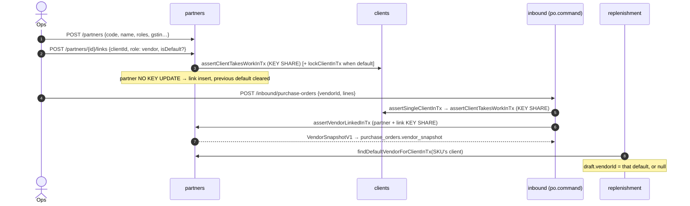

# Partners module

> The business partner master (story 1-3, roadmap D3): one record per real company **registration** — vendor, consignee, transporter — and the many-to-many **client links** that say which client trades with which vendor or consignee. The PO vendor guard and the replenishment default-vendor pick read it.

Paths are relative to `workspace/core/backend/wms-be`. Read [`../IMPLEMENTATION-GUIDE.md`](../IMPLEMENTATION-GUIDE.md) first — the command skeleton, the migration checklist and the vocabulary pattern are assumed here.

Files: `src/modules/partners/partners.command.ts`, `partners.facade.ts`, `partners.dto.ts`, `partners.module.ts`; HTTP shell `src/api/partners.controller.ts`; migration `drizzle/0079_business_partners.sql`; the shared registered-address rule `src/shared/primitives/registered-address.ts` (moved out of `clients.command.ts`, which re-exports it).

---

## Owns

| Table | Holds | Key invariants (all CHECKs in 0079 only) |
|---|---|---|
| `business_partners` (`schema.ts`, `businessPartners`) — the Story 3.1 `vendors` table **renamed in place** | `code`, `name` (display), `legal_name`, `gstin`, `pan`, `roles text[]`, the **registered** and **dispatch** address groups (`line1, line2?, city, state_code, pincode` — the clients' registered shape), `contact_name/phone/email`, `status` (`active`/`inactive`), `inactive_reason` | `business_partners_tenant_id_code_unique`; `business_partners_tenant_gstin_unique (tenant_id, gstin) WHERE gstin IS NOT NULL`; GSTIN `^[0-9]{2}[A-Z0-9]{13}$`; PAN `^[A-Z]{5}[0-9]{4}[A-Z]$`; **`pan_matches_gstin`**: a GSTIN implies PAN = `substr(gstin, 3, 10)`; **`gstin_matches_state`**: `left(gstin,2) = registered_state_code` when both set; each address group all-or-none; roles non-empty ⊆ {vendor, consignee, transporter}, no duplicate, no NULL; status/reason: reason only while inactive, 1..200 trimmed |
| `partner_client_links` | `partner_id`, `client_id`, `role` (vendor/consignee), `client_code` (the client's own code — trimmed, case kept), `active`, `is_default` | unique `(tenant, partner, client, role)`; unique `(tenant, client, role, client_code) WHERE client_code IS NOT NULL` (inactive links included); **`one_default_unique (tenant, client) WHERE is_default`**; `default_check`: `is_default ⇒ role = vendor AND active`; RLS = the tenant arm **plus the 0041 `app.client_id` clause** (decision 8 — no portal route reads it yet) |

`purchase_orders.vendor_snapshot jsonb` is inbound's column but this module's shape (`VendorSnapshotV1`, below).

Vocabularies (`schema.ts`): `PARTNER_ROLES`, `PARTNER_LINK_ROLES` (vendor, consignee — **a transporter is never linked**), `PARTNER_STATUSES` — pinned against the CHECKs by `test/business-partners.spec.ts`.

**Decisions.** A partner is **one GST registration** — a company registered in two states is two partners; PAN is not unique (decision 5). Status is `active | inactive` plus a reason; D3's "blocked" is the same thing for new documents, and open POs keep receiving (decision 1). One contact and two addresses sit on the row; contact lists and several consignee ship-tos wait for roadmap 4.2 (decision 3). The capability stays `vendor.manage` (decision 4). Consignees and transporters are master records only — orders and e-way bills keep their free fields until 4.1 / 4.2 / 4.9 add pickers (decision 6); **the gate-in (2-3a) is the first document to pick a transporter** (`assertTransporterInTx`, below), with a typed name as the alternative. Nothing is ever deleted.

## API

| Route | Capability | Arms |
|---|---|---|
| `GET /tenants/{t}/partners?role&clientId&status&q&cursor&limit` | staff read | keyset on `(code, id)`; links inline; `clientId` = an `EXISTS` over ACTIVE links (in `role` when given); `q` = escaped `ILIKE` over code, name, legal name, GSTIN; `400 invalid-cursor` |
| `POST /tenants/{t}/partners` | `vendor.manage` | 201 `{partner}`; 400 `validation-failed` naming the field / `pan-gstin-mismatch` / `gstin-state-mismatch`; 409 `partner-code-taken`, `partner-gstin-taken` (naming the holder) |
| `PATCH /tenants/{t}/partners/{id}` | `vendor.manage` | tri-state (absent unchanged, `null` clears); every rule on the MERGED row; 409 `partner-role-in-use`; an unchanged patch stores the key (`partners.update:unchanged`) |
| `PATCH /tenants/{t}/partners/{id}/status` | `vendor.manage` | `{status, reason?}`; reason only with `inactive` (400); deactivating clears every `is_default` of the partner; reactivating clears the reason and restores no default; same status with the same reason, or with no reason (the stored one is kept), = no-op storing the key (`partners.status:unchanged`); a new reason on an inactive partner audits `partner.updated`; the shape checks run before the lock |
| `POST /tenants/{t}/partners/{id}/links` | `vendor.manage` | `{clientId, role, clientCode?, isDefault?}` → 201 `{partner}`; 400 `link-role-invalid` (transporter, or a role the partner lacks), 400 a default on a non-vendor link; 404 client; 409 `client-departed`, `partner-inactive`, `link-exists` (`extensions.linkId`), `link-client-code-taken`, `default-vendor-conflict` |
| `PATCH /tenants/{t}/partners/{id}/links/{linkId}` | `vendor.manage` | `{clientCode?, active?, isDefault?}`; `active:false` clears the default; reactivating needs an active partner holding the role and a non-departed client; a default needs an active vendor link of an active partner and clears the client's previous one; unchanged = no-op (`partners.linkUpdate:unchanged`) |

There is no `/vendors` alias and no portal route. Every mutation answers the whole partner (`PartnerDto`, links inline).

## Commands, locks, idempotency

Hash discriminators: `arm: 'partner-create' | 'partner-update' | 'partner-status' | 'link-create' | 'link-update'`. Create hashes every key (null when absent); PATCH bodies hash only present keys.

**Lock order, always client → partner → link.**

| Command | Locks |
|---|---|
| create | none (the unique indexes settle a concurrent duplicate); replays once |
| update | partner `FOR NO KEY UPDATE` → replay again |
| updateStatus | partner `FOR UPDATE` → replay again |
| createLink | client `FOR KEY SHARE` (`assertClientTakesWorkInTx`, 409 `client-departed`); a default also `FOR NO KEY UPDATE` (`lockClientInTx`) → partner `FOR NO KEY UPDATE` → replay again |
| updateLink | an unlocked read learns the client → client (`KEY SHARE` when `active:true`, `NO KEY UPDATE` when `isDefault:true`) → partner `NO KEY UPDATE` → link `FOR UPDATE` when `active` or `isDefault` is named, else `NO KEY UPDATE` → replay again; `client-departed` is judged on the real transition (a reactivation or a new default), so a no-op request on a departed client's link takes the no-op path |

**Why those modes.** The PO guard takes `FOR KEY SHARE` on the partner and the link. That conflicts only with `FOR UPDATE` — which a plain `UPDATE` of a non-key column does **not** take (it takes `NO KEY UPDATE`). So the status flip and a link's active/default flip lock `FOR UPDATE` explicitly: a deactivation and a PO create serialise (the PO commits first, or it reads the inactive row and is refused). An edit of non-key columns (name, addresses, contact) never queues a PO; a **code** change rewrites a unique-index column, which Postgres locks as `FOR UPDATE`, so it does queue behind (and block) an in-flight PO create — briefly, by design. Role removal and link create/update share the partner `NO KEY UPDATE`, so a role cannot vanish under a link being created for it. Set-default serialises per client on the client row (`NO KEY UPDATE` — it never queues that client's order creates, which take `KEY SHARE`); a leftover 23505 maps to `default-vendor-conflict`.

**Pre-checks name the holder.** Code and GSTIN uniqueness, the triple and the client code are checked with a `SELECT` first (a 23505 cannot name who holds the value; the late 23505 maps to the same code without the name).

**Audit** (`partner` / `partner_link` targets; `AUDIT_NEW_ACTIONS`): `partner.created | updated | deactivated | reactivated`, `partner.linked | link_updated | link_deactivated | link_reactivated`. One row per key. The Story 3.1 `vendor.created` audit action and the `vendor` target left the write registry; the audit read's `targetType` filter still accepts `vendor` for historical rows (`AUDIT_READ_TARGET_TYPES` = written ∪ `RETIRED_AUDIT_TARGET_TYPES`).

**Outbox:** `vendor.created` `{vendor: {id, tenantId, code, name, createdAt}}` — only when a partner is **created** holding the vendor role; adding the role later emits nothing.

## The seam (`partners.facade.ts`)

- `assertVendorLinkedInTx(tx, tenant, vendorId, clientId)` → `VendorSnapshotV1` — the PO guard (below).
- `findDefaultVendorForClientInTx(tx, tenant, clientId)` → `{id, code, name} | null` — the active partner holding the vendor role whose active vendor link is the client's default.
- `partnerNamesInTx` — the device snapshot's fallback name read.
- **`assertTransporterInTx(tx, tenant, partnerId)` → `TransporterSnapshotV1` (story 2-3a)** — the gate-in's transporter guard: the partner row `FOR KEY SHARE` (no link — a transporter is shared by every client); unknown 404 · `409 partner-not-transporter` · `409 transporter-inactive`; returns `vendorSnapshotOf`'s v1 shape (`TransporterSnapshotV1` is an alias), frozen on `gate_ins.transporter_snapshot`. A gate-in amend re-runs it only when the transporter changes.
- `PartnersFacade.list`.

Architecture guard (`test/architecture.spec.ts`, "business partners are partners-module-owned"): only `src/modules/partners` writes either table (Drizzle or raw SQL, `vendors` included); siblings import only the facade, module or DTO; the command writes and never deletes; the PO command and the sweep go through the facade.

## Flows

## The PO vendor guard and the snapshot

Guard order in `PurchaseOrderCommand.createInTx`: permission → replay → warehouse → SKUs → single client → client takes work → **vendor**. The vendor moved last on purpose: with both an unknown vendor and an unknown SKU, the SKU's 404 now wins. Refusals: unknown 404 · `partner-not-vendor` · `vendor-inactive` · `vendor-not-linked` (naming the client's label). The suggested-PO submit rides it through `createInTx`. A close successor copies `vendor_id` **and** `vendor_snapshot` without the guard (an open PO carries on whatever happened to the partner).

**`VendorSnapshotV1`** `{v: 1, code, name, legalName, gstin, stateCode, registeredAddress, dispatchAddress}` — every key always present, null where empty; `stateCode` = the registered state, else the GSTIN prefix. Frozen at create; a partner edit never rewrites it. The 2.9 GRN header, the inward e-way bill and return-to-vendor print it. It is nullable in the schema and optional on `PurchaseOrderSnapshot` / `PurchaseOrderDto` (stored replies predate it); 0079 backfilled every PO and its probe refuses a PO without one.

The device catalog snapshot's `openPurchaseOrders[].vendorName` is the snapshot's `name` (live name only as a fallback): required on the backend, optional on the handheld.

## The default vendor

On the link (decision 2): at most one per client. The sweep caches the pick per client per scope. A client with no default gets drafts with `vendorId: null` (decision 10 — the old tenant-wide default stays default only where it was linked). `SuggestedPoDto.clientId` (the SKU's client, stitched by the list through `CatalogFacade.skuClientIdsInTx`) lets the web picker list only that client's active linked vendors; a stale draft (its vendor's link switched off) is refused at submit `409 vendor-not-linked` and stays a draft.

## Migration 0079 (hand-written)

Rename in place (table, pkey, indexes, policy — ids and `created_at` survive, so the keyset order holds) → the partner columns and CHECKs → the links table + RLS → **links from history**: `DISTINCT (vendor, client)` over `purchase_orders` ∪ open `suggested_pos` drafts ⋈ `skus.client_id` (decision 7 — a vendor with no history migrates unlinked) → **defaults**: per client, the linked `is_default` vendor with the lowest `(created_at, id)` → the full v1 snapshot on every PO → the probe (no unresolved vendor, no PO without a full v1 snapshot, every PO pair linked, ≤ 1 default per client, every CHECK refuses its named bad shape and admits a good one) → drop `vendors.is_default`. A fail-fast guard refuses a second run; a pre-flight lists every PO whose `vendor_id` resolves to nothing. The drizzle snapshot was hand-edited; `db:generate` reports "No schema changes". Proven against a populated 0078 database by `test/business-partners-migration.spec.ts`.

## Gotchas

- **A plain `UPDATE` does not conflict with `FOR KEY SHARE`.** Any new command that flips something the PO guard reads (status, `active`, `is_default`) must lock `FOR UPDATE` first, or a PO commits against a partner deactivated under it.
- **PAN follows the GSTIN.** A PATCH with a new GSTIN and no PAN re-derives the PAN when the stored one was the old GSTIN's (characters 3–12); a PAN the request names that differs from the new GSTIN's is `400 pan-gstin-mismatch`.
- **`createLinkedVendor`** (`test/support/linked-vendor.ts`) is the suites' vendor fixture — a PO needs an active vendor link to its client now, so a suite that creates a client after its vendor must `linkVendor` it.
