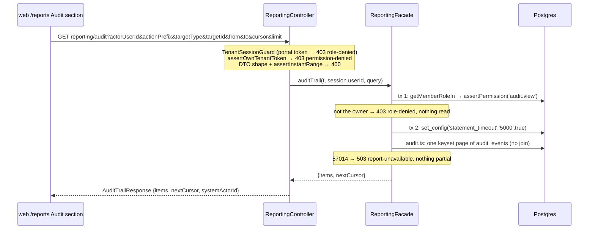

# Reporting module

> The operational dashboard (FR-27, story 9-1): a per-warehouse read model that computes ten KPI tiles as projections over the owning modules' records, served by one Overview endpoint, with every figure naming the exact list behind it. Story 21-8 adds the **per-client service report** (CAP-10) — one read behind an operator route and a portal route. Story 9-3a adds the **audit trail read** (FR-28) — the owner's filterable, cursor-paged view of `audit_events`, the module's third read-only exception. The async **export** of that trail (9-3b) is tenancy's, not this module's: its three routes sit beside the trail in the api shell's `ReportingController`, which calls `TenancyService` — reporting gains no code and no fourth exception (§The audit trail → *The export*). Story 5-3a adds the **operational registers** — stock on hand, the inbound and outbound registers, the ledger and batch ageing as client-filtered CSV/XLSX downloads behind one route. They are **not** a read-model exception: every row comes from a read on the owning module's facade (§The operational registers).

Source: `workspace/core/backend/wms-be/src/modules/reporting/`. Every `file:line` below is relative to `wms-be/`. Read `../IMPLEMENTATION-GUIDE.md` first — and its §7a, the read-only exception this module exists under.

---

## Owns

**No tables.** The module is a read model: `kpis.ts` (one function per tile), `window.ts` (the IST windows), `sql.ts` (the SQL helpers `rowsOf`/`n`/`nf`/`ratio`/`ts`/`countingSinceInTx`, moved out of `kpis.ts` by 21-8), `service.ts` (21-8 — the service report's period guard and queries), `audit.ts` (9-3a — the audit trail read, `audit_events` only), `reporting.facade.ts` (the warehouse check, the best-effort runner, the service reads, the audit guard and read, and — 5-3a — the register download), `registers.ts` (5-3a — the register registry: columns, period rule and facade read per register; the slots class). It exports `ReportingFacade` alone; the api shell is its only consumer — `ReportingController` (`src/api/reporting.controller.ts`, DTOs in `src/api/reporting.dto.ts`) and, since 21-8, `PortalController`'s `GET portal/service`.

The two facts the dashboard needed that nothing stored before are **outbound-owned**, not reporting's (see `outbound.md`):

| Table | Written by | Feeds |
|---|---|---|
| `pack_verification_failures` | `PackCommandService.packOrder` — after the pack transaction rolled back, fresh tenant tx, best-effort | SM-3 order accuracy |
| `ingest_backorder_refusals` | `OrderCommandService.createOrder`'s reject-policy arm — after `releaseAll`, outside any tx, `ON CONFLICT DO NOTHING`, best-effort | SM-4 "prevented" |

Both were added by `drizzle/0058_reporting_facts.sql`, which also stamped `app_metadata.reporting_facts_since` (the tiles' `countingSince`) and built `ledger_events (tenant_id, warehouse_id, type, recorded_at)`. **No backfill**: the facts are counted from that instant on. **The migration and the code that writes the facts ship in ONE release** — `countingSince` is the migration's own `now()`, so it is exact only because no writer can run before the tables exist and no release runs the migration without the writers. Splitting them would make `countingSince` claim coverage the writers did not give.

Retries never inflate the facts: a failed pack records its attempt's idempotency key (the route's `Idempotency-Key`, or the sync-report op's ULID), and a partial unique `(tenant_id, idempotency_key) WHERE idempotency_key IS NOT NULL` with `ON CONFLICT DO NOTHING` makes a same-key retry — or a repeated sync-report apply — one row. Refusals dedupe on `(tenant, integration, external event)`.

## Decision 6 — the named read-only exception

Everywhere else a module reads a sibling's state only through its facade (AD-6). Reporting's tiles read the owning modules' tables **directly, read-only**, by human decision (9-1, decision 6): ten aggregate counts through ten facades would be ten bespoke "count my rows in this window" methods with one consumer each — a second definition of every KPI, free to drift from the one here.

**The second exception (21-8, ratified at the epic-21 retro, 2026-10-10).** `service.ts` — the per-client service report — reads `putaway_placements`, `goods_receipt_notes`, `orders`, `picklist_lines`, `pack_verification_failures` and `ledger_events` the same way, on stricter terms: every query inner-joins a client-policied table and carries an explicit `client_id` predicate, and the dispatched-order population reuses `dispatchedOrderEventsPredicate` from `inventory.facade`, so `ordersDispatched` equals the invoiced count (`test/service-report.spec.ts`). The directory-wide guards below cover it.

**The third exception (9-3a, human decision 2, 2026-10-12).** `audit.ts` reads tenancy's `audit_events` — and only that table — for the owner's audit trail. Its own guard block is below (§The audit trail). A fourth read model still needs its own human decision (`IMPLEMENTATION-GUIDE.md` §7a).

The exception is bounded by guards in `test/architecture.spec.ts` ("reporting is a read-only exception…"):

1. nothing under `src/modules/reporting` writes any table — no Drizzle `.insert/.update/.delete`, no raw `INSERT INTO` / `UPDATE … SET` / `DELETE FROM` / `TRUNCATE` (detectors pinned against counterexamples);
2. nothing imports the reporting module except the api shell (`src/api/**`) and the root composition (`app.module.ts`);
3. the module exports only `ReportingFacade`, and both fact tables are in the **outbound** ownership list.

**Do not copy this into another module.** A new read model that wants the same freedom needs its own human decision and its own guard.

## Public seam

| Method | Shape | Does | Called by |
|---|---|---|---|
| `overview` | `(tenantId, warehouseId, now = new Date()) → Overview` | Warehouse check, then the ten tiles under the runner | `GET /tenants/{t}/warehouses/{w}/reporting/overview` |
| `serviceReport` | `(tenantId, clientId, {from, to, warehouseId?}, now = new Date()) → ServiceReport` | 21-8: period guard (400), client (404), warehouse (404), then the figures — one transaction, 5 s `statement_timeout` | `GET /tenants/{t}/reporting/clients/{c}/service` |
| `portalServiceReport` | same | 21-8: the same read, its transaction stamped `{ clientId }` (the `PORTAL_READS` architecture scan reads this body) | `GET /tenants/{t}/portal/service` (client from `PortalSession`) |
| `auditTrail` | `(tenantId, actorUserId, AuditTrailQuery) → Page<AuditTrailEntry>` | 9-3a: `audit.view` guard in its own transaction (403 `role-denied`), then one page of `audit_events` under a 5 s budget (503 `report-unavailable`) | `GET /tenants/{t}/reporting/audit` — **never a portal read** |
| `auditRead` | `(tx, tenantId, query) → Page` | a plain field set to `readAuditPageInTx`, so a suite can force a statement timeout without a second production path (the `serviceRead` precedent) | `auditTrail` only |
| `register` | `(tenantId, warehouseId, {report, format, clientId, from?, to?}, now = new Date()) → RegisterFile` | 5-3a: the period rule (400), a slot (503), then ONE repeatable-read, read-only transaction under a 15 s whole-read deadline: warehouse (404 `unknown-warehouse`), the register's facade reads, the 50,000-row cap (422); then the file is built (CSV or XLSX) | `GET /tenants/{t}/warehouses/{w}/reports/{report}` |
| `registerSlots` / `registerDeadlineMs` / `registerMaxRows` / `registerRead` | plain fields | 5-3a: the process-wide slots, the budget, the cap and the read — a suite holds the slots, shrinks the budget or the cap, or forces a timeout without a second production path | `register` only |

`Overview` = `{asOf, stale, window: {todayFrom, d7From, to}, tiles: {dockToStock, pickRate, shortPicks, grnVariances, orderAccuracy, oversell, expiryAlerts, syncHealth, dispatchPipeline, sm8}}`. Each tile carries `state: 'ok' | 'unavailable'`. Every figure is `{value: number | null, drill: {apiPath, query, reconciles}}`; a windowed figure is `{today, d7}` of those. `value` is null when the tile is unavailable **or** the figure has no data (an empty median or ratio) — never a fake 0. `drill` is always present, unavailable tiles included.

Member-open, except the audit trail: the Overview, the service report and the registers (5-3a) are not capability-gated; `auditTrail` is owner-only (`audit.view`, 9-3a).

## The flow

```mermaid
sequenceDiagram
  participant W as web (OverviewDashboard)
  participant C as ReportingController
  participant F as ReportingFacade
  participant PG as Postgres

  W->>C: GET …/warehouses/{w}/reporting/overview
  C->>F: overview(t, w)
  F->>PG: tx: assertWarehouseInTenant → 404 BEFORE any tile
  Note over F: asOf = now; IST windows fixed once (window.ts)
  par at most 3 tiles at a time
    F->>PG: tile tx: set_config('statement_timeout','1500',true); tile SQL
  end
  Note over F: at 1.8 s: assemble from what finished.<br/>still running / never started → unavailable<br/>57014 or deadline → silent; any other error → logged with the tile name
  F-->>C: {asOf, stale, window, tiles}
  C-->>W: 200
```

## The runner (AD-17 — tiles are sheddable)

- **Concurrency 3, process-wide** (`TILE_CONCURRENCY`) — one semaphore shared by every concurrent Overview read, so N viewers still hold at most 3 tile transactions between them; the pool is `max: 10` (`shared/db/db.ts`) and the scan path must never queue behind dashboards. A tile waiting for a slot gives up at the deadline (`unavailable`, no connection taken).
- **Each tile in its own tenant read transaction**, and **every statement** re-arms `set_config('statement_timeout', min(1500 ms, time left), true)` first — transaction-local, so it dies with the transaction, and no straggler outlives the deadline by more than a round trip.
- **Overall deadline 1.8 s** (`OVERVIEW_DEADLINE_MS`): workers start a tile only while the budget lasts; at the deadline the response is assembled from a snapshot of finished results. A straggler's late result is ignored.
- **Silent vs logged:** a statement timeout (SQLSTATE `57014`, found by walking drizzle's `cause` chain) or the deadline yields `unavailable` silently; **any other error is logged** (`Reporting tile "<name>" failed …`) and also yields `unavailable` — one broken tile never 500s the page.
- **`stale: true`** whenever any tile is unavailable.
- `facade.tiles` is a plain field — a suite substitutes one definition to force a deadline or a fault without a second production code path.

## Windows (`window.ts`)

IST calendar days computed in TS (`IST_OFFSET_MS`, now in `shared/primitives/time.ts`) and bound as `timestamptz` — never `now()` or a session-zone `date_trunc` in SQL. One `asOf` fixes every bound of a read.

| Window | Bounds |
|---|---|
| today | `[IST midnight of asOf, asOf)` |
| 7d | `[IST midnight 6 days before, asOf)` — today plus the six days before it |
| last hour | `[asOf − 1 h, asOf)` (pick rate) |
| last 24 h | `[asOf − 24 h, asOf)` (sync failures) |

**Server-stamped columns only** (`created_at`, `recorded_at`, `updated_at`, `requested_at`, `issued_at`, integration `at`) — never a device `occurred_at`, so an offline op replayed tomorrow never revises "today". A row stamped 18:29:59.999 UTC is yesterday (IST); 18:30:00 is today.

## The tiles

| # | Tile | Figure | Source & definition | Drill | Reconciles |
|---|---|---|---|---|---|
| 1 | dockToStock | `medianMinutes` {today, d7} | median of `putaway_placements.created_at − goods_receipt_notes.created_at` (minutes) over placements in the window; negative intervals excluded | ledger `type=putaway.placed` | no (a median) |
| | | `awaitingPutaway` (live) | GRN lines with putaway units (`applied_qty` + Σ APPROVED over-receipt excess — story 21-9 — minus the line's units on an OPEN receipt QC hold — story 1-2b) whose (sku, batch) still has on-hand in the system Receiving bin — `PutawayFacade.getPutawayTasksInTx`'s derivation in one statement | `GET /putaway/tasks?warehouseId` | **yes** |
| 2 | pickRate | `pickLines` {today, d7}, `lastHour` | `picks` rows by `created_at` — one per pick line (a 10-serial line is ONE line; the ledger has ten draws) | ledger `type=pick.picked` | no (units differ) |
| 3 | shortPicks | `shortLines` {today, d7} | `picklist_lines.status = 'short'` by `updated_at` (the terminal flip), via `picklists` for the warehouse — **zero-unit shorts included** (they write no `picks` row and no event) | `…/outbound/picklist-lines?status=short` (window on `updated_at`, keyset on the immutable `(created_at, id)`) | **yes** |
| 4 | grnVariances | `overReceipts` {today, d7} | `over_receipts.requested_at` in the window | `/receiving/over-receipts?warehouseId` | **yes** |
| | | `pendingOverReceipts` (live) | `status = 'pending'`, requested before `asOf` | `?warehouseId&status=pending&to` | **yes** |
| | | `blindGrns` {today, d7} | `goods_receipt_notes.blind_reason_code IS NOT NULL` by `created_at` — **21-6: blind is the reason, not the absent PO** (an ASN receipt has `po_id IS NULL` and is not blind) | `/receiving/goods-receipts?warehouseId&blind=true` (21-6 — `poless` stays accepted as its alias) | **yes** |
| 5 | orderAccuracy (SM-3) | `defectsPer1000` {today, d7} | **The PRD's SM-3 formula** (decision 5): `(short-picked lines + failed pack verifications) × 1000 ÷ dispatched lines`, one decimal; null with no dispatched line. Not a redefinition — "mis-picks" is measured as short-picked lines because a wrong-item scan is refused at pick and never stored (PENDING) | ledger `type=dispatch.dispatched` | no (a rate) |
| | | `shortLines`, `packFailures`, `dispatchedLines` | as tile 3; `pack_verification_failures.created_at`; distinct `referenceDoc.orderLineId` of `dispatch.dispatched` by `recorded_at` (one event per line, so the event count is the line count) | picklist-lines; `…/outbound/pack-failures`; ledger | **yes** |
| | | `countingSince` | `app_metadata.reporting_facts_since` | — | — |
| 6 | oversell (SM-4) | `backorderedOrders` {today, d7} | `orders.source = 'ingested'` by `created_at` with **any** line `status = 'backordered'` (set only at acceptance) — counted per ORDER, so a kit's parent and children never double-count | `…/outbound/orders?source=ingested&backordered=true` | **yes** |
| | | `prevented` {today, d7} | `ingest_backorder_refusals.created_at`, **excluding** a refusal whose `(integration_id, external_event_id)` now has an order — a redelivery accepted once stock arrived was not prevented. The drill list applies the same exclusion | `…/outbound/backorder-refusals` | **yes** |
| 7 | expiryAlerts | `openExpiryUpcoming`, `openAged` (live) | open `batch_alerts` by kind, raised before `asOf` | `/replenishment/batch-alerts?warehouseId&kind&status=open&to` | **yes** |
| | | `raised` {today, d7} | alerts of either kind by `created_at` | `?warehouseId&from&to` | **yes** |
| 8 | syncHealth | `connections[]` | every connection (connected **or disconnected**) whose `ingest_warehouse_id` is this warehouse **or unset**. Health, most severe first: disconnected → `error`/`disconnected`; unset ingest warehouse → `error`/`ingest-warehouse-unset`; then **`/channels`' own rule, reused — `connectionHealth()` via the channels facade, never re-derived**: breaker open → `error`/`breaker-open`; half-open, last delivery failed, never synced, or lag over the 60 s SLO → `degraded` (`breaker-half-open`/`last-delivery-failed`/`never-synced`/`sync-lag`); finally a genuine `order-ingest` failure in 24 h → `degraded`/`ingest-failures`. Failure = `INGEST_CALL_OUTCOMES`, a `Record` over every `INTEGRATION_CALL_STATUSES` member (a new status fails the build until classified); a policy refusal (`rejected` — a prevented oversell), settled cancellations (`released`, `ignored`) and successes are NOT failures | `/channels/connections` | no |
| 9 | dispatchPipeline | `accepted`, `readyToDispatch` (live) | `orders.status`, created before `asOf` | `…/outbound/orders?status=…&to` | **yes** |
| | | `labelledNotManifested` (live) | `shipments.status = 'labelled'` — no list of its own | orders `?status=ready_to_dispatch` | no |
| | | `ordersDispatched` {today, d7} | distinct `referenceDoc.orderId` of `dispatch.dispatched` | ledger | no (events per line) |
| 10 | sm8 (SM-8) | `eligible` {today, d7} | `eway_bills.created_at` in the window for this warehouse's invoices (a bill has no warehouse — joined through `invoice_id`), excluding `dismissed` bills and `voided` invoices | `/eway/bills?warehouseId` | no (the list cannot exclude dismissed) |
| | | `gatewayGenerated` {today, d7} | of those, `status = 'generated' AND source = 'gateway'` | `?warehouseId&source=gateway` | **yes** (a gateway source exists only on a generated bill; no code path writes `voided` today) |
| | | `gatewayShare` {today, d7} | `gatewayGenerated ÷ eligible`, 0–1; null with none eligible. **Reads 0 until a live gateway adapter exists** — deliberately (decision 5): it shows the real gap | as above | no |
| | | `invoicesIssued`, `noManualPricingShare` {today, d7} | invoices of the warehouse by `issued_at`; the share with **no** `invoice_lines.rate_source = 'manual'` | `/invoices?warehouseId` | issued: **yes**; share: no |

Every windowed drill carries `from` (today's or the 7-day start) and `to = asOf`; live drills carry `to = asOf` where the list has the filter (the putaway task list has none — it is live by construction).

### The web click-through (story 9-1b — done)

Every linked figure lands on a screen that lists **exactly** its drill's rows, filtered server-side. The web side is described in `../frontend/IMPLEMENTATION-GUIDE.md` §1.6; what matters from here:

- **The link names the list and the warehouse.** `wms-fe/src/lib/drill-routes.ts` adds `list` (the target section — three `/compliance` drills share identical keys, and the putaway drill's one key is a subset of the blind-GRN drill's) and, for a path-scoped drill (ledger, orders), `warehouseId` taken from `apiPath`. The path warehouse is the figure's warehouse. If the query names a different one, the figure gets no link. The ledger drills land on the web Ledger page, `/inventory/ledger`.
- **The drilled request is the drill, byte for byte.** Each key and value in the URL is sent unchanged (instants are not re-formatted, `list` is dropped), with the opaque cursor passed back as received. No screen adds its own status, kind or tab to a drilled read. This keeps the "paged to exhaustion equals the figure" claim true on the web: `wms-fe/src/lib/drill.test.ts` checks the href → parse → request round trip for every linked drill shape built here.
- **Capability.** The over-receipt drills link only for a role holding `review.decide` (the `/conflicts` tab's gate). The Overview itself stays member-open.
- **Unlinked, as before:** picklist lines, pack failures and backorder refusals have no web screen. The channel-connections drill links bare `/channels`.

A new drill shape must have a `parseDrill` field for each of its keys (`wms-fe/src/lib/drill.ts` `SPECS`). Without one, the link is `unsupported` and the screen shows its normal view plus a notice.

## Invariants

| Invariant | Enforced by |
|---|---|
| A `reconciles: true` figure equals its drill paged to exhaustion | `test/reporting.spec.ts` pages every one at `limit=2` (so the cursor walks). The drills' lists carry full-precision cursors (`fullPrecisionInstant`) — a millisecond-truncated cursor skips the rest of a same-transaction tie group (a wave writes all its picklist lines at one `now()`, a GRN all its over-receipts) |
| The warehouse is checked before any tile runs | `overview()` asserts first, in its own short transaction; a spec spies `runTiles` and asserts it was never called on a 404 |
| A tile never 500s the page | the runner maps every error to `unavailable` |
| Reporting writes nothing; only the api shell imports it | `test/architecture.spec.ts` |
| The audit read touches `audit_events` only, and the role check happens before it | `test/architecture.spec.ts` (the third-exception block); a spec asserts an ops manager is 403 `role-denied` |
| Paging the audit trail to its end yields every row once, ties included | `test/audit-trail.spec.ts` — 120 rows, many sharing one `created_at` |
| Fact writes never change a refusal | both writers run after the refused work rolled back / released, inside `try/catch` that logs; a spec renames both tables away and asserts the 422 / 409 stand |

## Events

None produced, none consumed. The dashboard is pull-only and the web reloads it only on a warehouse switch or Refresh — no polling (UX-DR19).

## The service report (story 21-8, CAP-10)

**The 21-8 hook is done — differently from how it was sketched.** The Overview tiles still take `ReportingScope {…, clientId: null}` and their figures are unchanged; slicing the ten warehouse tiles by client would have changed their meaning. Instead a separate read, `service.ts`, computes three figures for **one client** over an **inclusive IST date period**, behind two routes so the operator and the client see the same truth (two queries would drift):

```mermaid
sequenceDiagram
  participant O as web /reports (operator)
  participant P as web /portal/service (client)
  participant C as ReportingController / PortalController
  participant F as ReportingFacade
  participant PG as Postgres

  O->>C: GET reporting/clients/{c}/service?from&to[&warehouseId]
  P->>C: GET portal/service?from&to[&warehouseId] (client = session)
  C->>F: serviceReport / portalServiceReport
  Note over F: assertServicePeriod → 400 before any read
  F->>PG: ONE tx (portal: stamped { clientId }); a 5 s WHOLE-read deadline — each statement re-arms statement_timeout to the time left
  F->>PG: client 404 → warehouse 404 → the four queries
  Note over F: 57014 → 503 report-unavailable, nothing partial
  F-->>C: ServiceReport (no client id)
  C-->>O: ServiceReportDto (rebuilt key by key)
```

**Period.** `assertServicePeriod` — `assertMeteringPeriod`'s detail strings (real dates, `from ≤ to`, ≤ 366 days), checked in the facade so both routes refuse identically. Window `[istMidnightOf(from), min(istMidnightOf(to + 1), asOf))`, server-stamped columns only; a `from` after today is an empty window (0s and nulls).

**Definitions** (*c* the client, *wh* the optional warehouse). Every query **inner-joins a client-policied table** (`skus`, `orders` or `ledger_events`) **and** carries `client_id = c` — the stamp protects only those tables, and the other rows (placements, GRNs, picklist lines, pack failures) are reached only through one of them.

| Figure | Definition | Population (named on the web tile) |
|---|---|---|
| `dockToStock.medianMinutes`, `placements` | The 9-1 tile SQL: `putaway_placements` recorded in the window, `join skus s … s.client_id = c`, GRN `created_at` → placement `created_at`, negatives excluded | placements made in the period |
| **the dispatched CTE** | `dispatchedOrderEventsPredicate` (billing's — imported from `inventory.facade`; an order counts in the window of its FIRST dispatch), grouped by `reference_doc->>'orderId'`, `min(recorded_at)` = dispatched at, inner-joined `orders o … o.client_id = c` | — |
| `pickAccuracy.linesDispatched` | the DISTINCT order lines of the CTE orders' `dispatch.dispatched` events (one event per line is the command's shape, not a constraint — the count does not rely on it) | lines dispatched in the period |
| `linesShortPicked`, `accuracy` | of those lines, the ones with ANY `picklist_lines` row with `reason_code is not null` (written only on a short; survives the wave-cancel flip). `accuracy = (dispatched − short) ÷ dispatched`. A short later recovered still counts against the line, once | |
| `packFailures`, `packFailuresCountingSince` | `pack_verification_failures` in the window `join orders o … o.client_id = c`; the 0058 stamp. Shown beside the ratio, never folded in | |
| `dispatchTimeliness.ordersDispatched` | `count(*)` of the CTE — **equals `countDispatchedOrdersInTx`** (the count the client is invoiced for), pinned in `test/service-report.spec.ts` for the facade's clipped window | orders dispatched in the period |
| `onTime`, `onTimeRate`, `medianMinutes` | interval `dispatchedAt − o.created_at` clamped at 0; on time ≤ 24 h (`SERVICE_TARGET_HOURS`, fixed); the median over ORDERS | |
| `lateNotDispatched` | orders of c (+ wh) received in the window, not `cancelled`, received ≤ `asOf − 24 h`, with no `dispatch.dispatched` event before `asOf` (the 0039 `orderId` index) | orders received in the period |

Ratios 0–1 to 4 dp, null with an empty denominator; medians minutes to 1 dp.

**Dock-to-stock includes QC dwell (story 1-2b, decided).** A QC-on-receipt client's units wait on a receipt hold before they can be placed; the median still measures placement minus the GRN's creation, so the hold's time counts. It is real time to stock — the client's own policy put it there. A hold-free variant would subtract each line's hold interval (PENDING if asked for).

**What reconciles to the ledger.** Every timeliness figure and the accuracy denominator come from `dispatch.dispatched`. Dock-to-stock and short picks are projections over rows written in the same transaction as their ledger events (9-1's argument). Pack failures come from a fact table not backfilled before 0058 — hence `packFailuresCountingSince`.

**Why accuracy windows on dispatch.** The dispatch event is immutable and client-stamped, so last month's figure cannot change; `picklist_lines.updated_at` is rewritten by a wave cancel (the rejected design windowed on it, double-counting a recovered short as a miss plus a hit).

**Isolation.** Two layers: `portalServiceReport` stamps the transaction `{ clientId }` (`test/architecture.spec.ts` `PORTAL_READS`), and every query carries the predicate. `test/client-isolation.spec.ts` runs each query shape as `wms_rls_probe` under one client's stamp with only the `client_id = c` literals removed (joins kept) and gets that client's rows only.

**Member-open** on the operator route (floor-performance figures, no money), like the Overview. Any client of the tenant is reportable — a suspended one and `self` included; the portal refuses a suspended client at its guard.

## The audit trail (story 9-3a, FR-28)

**What it is.** The owner's view of every state-changing action — who, what, when, and the thing it changed — over `audit_events` (tenancy's table, written at step 10 of every keyed command; `IMPLEMENTATION-GUIDE.md` §1). One route, `GET /tenants/{t}/reporting/audit`; the web's Audit section on `/reports` is its only consumer. **The trail is complete from 9-3a onward:** about twenty keyed commands wrote no audit row before it, and no backfill reconstructs them (no trustworthy actor exists for past actions).



**Access.** `TenantSessionGuard` (the client-portal fence) and `assertOwnTenantToken` in the controller, then the facade's guard **in its own transaction** — `assertPermission(await getMemberRoleIn(tx, tenantId, actorUserId), 'audit.view')`, the `channels.facade` gated-read shape — before the read transaction opens. Keeping the role read out of `audit.ts` is what lets the read model touch `audit_events` and nothing else. `audit.view` is the 42nd capability, **owner-only** (human decision 3: the trail names every member's actions — the user-management rationale), the second gated read after the channel mappings (`permissions.ts`'s header comment says so).

**Filters** (all optional, AND-ed; `AuditTrailQueryDto`, `src/api/reporting.dto.ts`):

| Filter | Shape | SQL |
|---|---|---|
| `actorUserId` | uuid | `actor_user_id = $` — the system's actions by sending `systemActorId` |
| `actionPrefix` | `^[a-z][a-z_.-]{0,63}$` (`AUDIT_ACTION_PREFIX_RE`; the read re-checks it) | `action LIKE escape($p) \|\| '%' ESCAPE '\'`, where `escapeLikePrefix` escapes `\` first, then `%` and `_` — so `stock_adjustment.` never matches `stockXadjustment.y`. A `%` in the input is a 400 at the DTO |
| `targetType` | one of `AUDIT_TARGET_TYPES` (45 values at 9-3a, 46 since 9-3b), published as the query enum in `openapi.json` | `target_type = $` |
| `targetId` | uuid | `target_id = $` |
| `from` / `to` | ISO-8601 instants with a zone (`@IsInstant`); `from ≥ to` → 400 (`assertInstantRange`) | half-open `[from, to)` on **`created_at`** |

**Ordering and paging on `created_at`, never `occurred_at`.** `created_at` is the server's commit stamp. Putaway, a sync-resolved op and an excursion stamp `occurred_at` from device or command time, which can be hours old; ordering or paging on it would put an action out of place and break the cursor. Order `created_at DESC, id DESC`; the cursor is `{createdAt: created_at::text, id}` (the `inventory.facade` precedent — every row a transaction writes shares its `now()` to the microsecond, and a millisecond-truncated cursor would skip the rest of that tie group), validated on decode (`invalid-cursor` 400). `limit` 1–200, default 50.

**Rows.** `AuditEventDto {id, recordedAt (created_at), occurredAt, actorUserId, actorKind: 'user' | 'system', action, targetType, targetId}`. `reference` is never returned — it holds idempotency keys, which mean nothing to an owner; the **target** is the document. `actorKind` is `system` when the actor is `SYSTEM_ACTOR_ID` (`shared/primitives/audit.ts`, moved there from replenishment so reporting need not import a sibling). The response also carries **`systemActorId`**, published as a one-value enum, so a client filters on the system actor without hard-coding the uuid (the web types its constant to that generated literal — a backend change fails the web's compile).

**The 503.** The whole read runs in one transaction under a transaction-local `statement_timeout` of 5 s (`AUDIT_STATEMENT_TIMEOUT_MS`, `armAuditDeadline`); a timeout (SQLSTATE `57014`) answers `503 report-unavailable` — "narrow the filters or the dates" — never a partial page. It is the **expected** answer for a broad filter over a very large history (the 21-8 pattern). The test forces it through the `auditRead` field and pins the armed 5 s setting.

**Indexes (migration 0069).** The read's four shapes: `audit_events_tenant_created_idx (tenant_id, created_at DESC, id DESC)` (the unfiltered page), `audit_events_tenant_actor_created_idx (tenant_id, actor_user_id, created_at DESC)`, `audit_events_tenant_target_idx (tenant_id, target_type, target_id)` and `audit_events_tenant_action_created_idx (tenant_id, action text_pattern_ops, created_at DESC)` (a prefix `LIKE` uses it under any collation). The old `audit_events_tenant_id_occurred_at_idx`, which nothing read, is dropped.

**Guards** (`test/architecture.spec.ts`, "the audit read is reporting's THIRD read-only exception"): `audit.ts` imports only `auditEvents` from the schema; no raw `sql` template names another table after `from`/`join`/`into`/`update`; the file contains no `join`; it never names `getMemberRoleIn`, `assertPermission` or `users`; the facade carries the guard line verbatim. The portal block pins that `auditTrail` is not on `PORTAL_READS`, not a delegation, and never called by `portal.controller.ts`. The directory-wide reporting guards (writes nothing, owns no table, only the api shell imports it) cover the file too.

**The export (9-3b) — tenancy's, routed here.** `POST /tenants/{t}/reporting/audit/exports` (queue an export of the applied filters; owner-only, keyed, audited, always 202), `GET …/reporting/audit/exports` (the caller's own last 20, unpaged) and `GET …/exports/{id}/file` (the gzipped CSV, requester-only) are declared on the api shell's `ReportingController` but call `TenancyService` — tenancy owns `audit_events`, `users` and the export tables, so the export needs no read exception, and **nothing under `src/modules/reporting` names the export** (pinned in `test/architecture.spec.ts`, "the audit exports are tenancy-owned"). The trail's FILTER moved to `src/shared/db/audit-filter.ts` so both readers use one definition (the `warehouse-filter.ts` precedent; tenancy may not import reporting): `audit.ts` calls `auditFilterSql` and re-exports `escapeLikePrefix`, `AUDIT_ACTION_PREFIX_RE` and `AuditFilters`, and this section's guard block now covers that file with the same rules. `AuditTrailQueryDto`'s filter fields moved to `AuditFilterBaseDto`, which the export body and its stored `filters` share — the trail's query parameters are unchanged. Details: `tenancy.md` §The async audit export.

**Not here (PENDING):** anchoring and chain alerts in the export (9-3c), retention (9-3d); deep links from a target to its document; a portal audit read or a `client_id` on `audit_events`.

## The operational registers (story 5-3a)

**What they are.** The files operations, accounts and clients ask for — what is in stock, what came in, what went out, every movement, what is ageing or near expiry — as one read-only download, `GET /tenants/{t}/warehouses/{w}/reports/{report}?format=csv|xlsx[&clientId][&from&to]`. The web's Operational reports section on `/reports` is the only consumer. 5-3b (space utilisation, operator productivity, count accuracy) is not here (PENDING).

```mermaid
sequenceDiagram
  participant W as web /reports Operational reports
  participant C as ReportingController
  participant F as ReportingFacade.register
  participant M as owning facades (inventory, inbound, outbound, catalog, tenancy)
  participant PG as Postgres

  W->>C: GET warehouses/{w}/reports/{report}?format&clientId&from&to (parseAs blob)
  Note over C: TenantSessionGuard (portal → 403)<br/>own tenant → 403; uuid / report name / format → 400
  C->>F: register(t, w, query)
  Note over F: period rule → 400 (dated: required + assertServicePeriod; snapshot: none)
  Note over F: registerSlots.tryAcquire() — full → 503 report-unavailable, nothing read
  F->>PG: BEGIN REPEATABLE READ, READ ONLY; setTxDeadline(15 s)
  F->>PG: warehouse code → 404 unknown-warehouse
  F->>M: the register's …RegisterInTx reads (each statement re-arms statement_timeout to the time left)
  Note over F: row 50,001 → 422 report-too-large; 57014 → 503 report-unavailable
  F-->>C: RegisterFile (the whole CSV / XLSX buffer)
  C-->>W: 200 + headers, res.end(buffer)
```

**Not a read-model exception.** Unlike the tiles, the service report and the audit read, the registers read **through the owning modules' facades** (AD-6). `ReportingModule` imports `InventoryModule`, `InboundModule`, `OutboundModule` and `CatalogModule` (nothing imports reporting back), and reporting itself runs no register SQL:

| Register | Rows | Facade reads | Period |
|---|---|---|---|
| `stock-on-hand` | bin × batch, non-zero | `InventoryFacade.stockOnHandRegisterInTx` (ONE statement: `batch_on_hand` ∪ `stock_on_hand` of **non**-batch-tracked SKUs — never both arms for one SKU, design review B3), `CatalogFacade.batchFactsByIdsInTx` | as of now (a `from`/`to` is 400) |
| `inbound-register` | GRN line | `InboundFacade.inboundRegisterInTx` (the GRN `(tenant, warehouse, created_at, id)` keyset walk + that page's lines, PO `vendor_snapshot`, ASN, gate-in and its LINKED documents), catalog batch facts, tenancy display names | required |
| `outbound-register` | order line | `OutboundFacade.outboundRegisterInTx` (the orders keyset walk + lines, the lateral latest shipment by `(labelled_at, id)`), `InventoryFacade.firstDispatchByOrderInTx` | required |
| `ledger` | event | `InventoryFacade.ledgerRegisterInTx` (the `(tenant, [client,] warehouse, created_at, id)` keyset walk), `InboundFacade.grnCodesByIdsInTx`, catalog batch facts, tenancy display names | required |
| `batch-ageing` | bin × batch with stock | `InventoryFacade.batchAgeingRegisterInTx` (ONE statement), catalog batch facts; sorted expiry ascending, none last, in TS | as of now |

Every register also reads client codes through `clients.facade` `getClientsInTx`. The columns are the registry's (`registers.ts`; the header golden is `test/registers.spec.ts`).

**Bounds (decision 2).** At most `REGISTER_MAX_ROWS` = 50,000 rows: each read is limited to 50,001 and the 50,001st is **422 `report-too-large`** ("narrow the filters"), thrown as soon as the facade read returns — before any lookup and before any byte. A **whole-read deadline** of `REGISTER_DEADLINE_MS` = 15 s: `setTxDeadline` (`shared/db/tx-deadline.ts`) registers it on the transaction and `rearmTxDeadline` — called by **every** facade register read before **every** statement — re-arms the transaction-local `statement_timeout` to the time left (`statement_timeout` is per statement — design review B2); a 57014 anywhere is **503 `report-unavailable`**, nothing partial. **Two process-wide slots** (`RegisterSlots`, the `TileSlots` idea without waiting): a third concurrent request is 503 `report-unavailable` **before** it opens a transaction. Every 503 sets `Retry-After: 5`; the 422 carries the cap as `maxRows` and advice per register (a snapshot: "pick a client"). The keyset walks take a page size (default the constant; `test/registers.spec.ts` walks each at 1 over `created_at` ties), and each page's line query is bounded to the rows still wanted + 1. Async export above 50k and per-tenant quotas are PENDING.

**One snapshot (decision 5).** The whole read is ONE `REPEATABLE READ, READ ONLY` tenant transaction (`withTenantTransaction`'s new `accessMode: 'read only'`): the two snapshot registers are one statement each, the dated ones walk their keyset page by page (full-precision `::text` cursors) and every page — and every lookup after — sees the same snapshot.

**Periods (decision 4).** `from`/`to` are inclusive IST dates under `assertServicePeriod` (the service report's rules and details — real dates, `from ≤ to`, ≤ 366 days); the window is `serviceWindow`'s `[istMidnightOf(from), min(istMidnightOf(to + 1), now))`, computed here and handed to the facades as instants, on each source's indexed `created_at` (GRN, order, ledger event). An event at 23:59:59 IST on `to` is in; 00:00 IST the day after is out (pinned). The ledger's `recorded_ist` column prints `recorded_at` while the window is on `created_at` (the transaction's start — the two differ by the command's own duration).

**Client attribution and filter (decision 6).** `clientId` is the 1-5a rule (the shared `client-filter.ts` predicates — `skuOfClient` for stock and ageing, `orderOfClient` for outbound), compared lower-case — an unknown or another tenant's id is an **empty file** (the header only; filename segment `client-unknown`), a malformed one 400. Stock and ageing: the SKU's client. Inbound: the **line** SKU's client (`skuOfClient`) — a blind GRN with a null `client_id` is still attributed through its lines. Ledger: `ledger_events.client_id`. Outbound: `orders.client_id`.

**Formats (decision 3).** Typed cells (`shared/export/cells.ts`: `text | number | instant | date`, asserted per column). **CSV** (`shared/export/csv.ts`): UTF-8 BOM, RFC 4180, the formula guard (`csvCell`) on **text only** — a negative quantity is the number `-5`, never `'-5` (design review B1). `csvCell` and `UTF8_BOM` moved here from `tenancy/audit-export.csv.ts`, which re-exports them (the audit export's bytes are unchanged — its suite passes). **XLSX** (`shared/export/xlsx.ts`): exceljs' streaming `WorkbookWriter` (`useSharedStrings: false`, `useStyles: true`) into a buffer; strings are inline strings (a `=…` string is never a formula), numbers numeric, instants and dates date cells shifted by `IST_OFFSET_MS` (exceljs writes a `Date`'s UTC fields as the wall clock) with `yyyy-mm-dd hh:mm:ss` / `yyyy-mm-dd`. **IST everywhere:** instants through the new `istWallClock` (`YYYY-MM-DD HH:mm:ss`), calendar dates (expiry, mfg — stored at IST midnight) through `istDateOf`, so an expiry prints its own date, never the UTC day before.

**Privacy (decision 7).** No emails: actors print through `memberDisplayNamesInTx` (`tenancy.service.ts`). Members have no name column, so the display name is the **email's local part** (`ravi.kumar@acme.in` → `ravi.kumar`); two members sharing a local part each get `-user-<last 8 hex>`, an empty local part or an id with no member row reads `user-<last 8 hex>`, the system actor `System`. **Member-open bulk export — a recorded risk** (PENDING, 6.4). Access: any staff role (the lists behind them are member-open); a portal token is fenced (403). No capability and **no audit row** — download auditing is roadmap 6.4 (PENDING).

**The columns, in brief** (quantities in base units of the SKU's `uom`, which every register prints):

- `stock-on-hand`: warehouse, zone, bin, `system_bin` (`yes`/`no` — RECEIVING, QC-HOLD, IN-TRANSIT, RETURNS are listed and flagged), SKU code and name, HSN, client code, uom, batch code, `expiry_date`, quantity. A serial-tracked SKU is one row per bin; catch weight is units only; a kit never appears (it holds no stock).
- `inbound-register`: GRN code, `created_ist` (the period's basis), `recorded_ist`, document (`po:<code>` / `asn:<code>` / `blind:<reason>`), vendor name (the PO's frozen `vendor_snapshot` — legal name, else name), client code, gate-in code, `supplier_documents` (`<kind> <number>`), `supplier_document_dates`, `eway_bill_numbers` (each `; `-joined in position order, ALIGNED — one slot per document in all three lists, `-` where a document has no date or e-way bill — **only the gate-in documents that name this receipt's PO or ASN**: a truck carries several clients' goods, so an unlinked document is never printed beside a line; a blind receipt prints none), SKU code and name, uom, batch code, qty, applied qty, `recorded_by`.
- `outbound-register`: order id, `created_ist`, status, source, `channel_order_ref` (`external_event_id`, ingested orders only), client code, consignee legal name and GSTIN, destination city, state and pincode, SKU code and name, `kit_of` (an exploded component names its kit line's SKU — never sum the two), uom, `ordered_qty`, `first_dispatched_ist`, carrier, AWB — a PAIR: the FIRST `dispatch.dispatched` event's reference when it named either, else the latest shipment's (`''` is absent; never one from each source). A second shipment row never duplicates a line (lateral `limit 1`).
- `ledger`: `created_ist` (the period's basis), `recorded_ist`, `occurred_ist`, type, SKU code, client code, uom, from-bin, to-bin, batch code, signed quantity, `reference` (an **exhaustive** switch over the `LedgerReferenceDoc` union with a `never` check — `referenceSummary`; GRN codes looked up; a kind this build does not know prints the kind), actor.
- `batch-ageing`: SKU code and name, client code, bin, batch code, mfg date, expiry date, `days_to_expiry` (IST dates, negative once expired), `batch_created_ist` and `days_since_batch_created` — the batch's first appearance **in the tenant** (a batch is per (tenant, SKU, code)), uom, quantity. No untracked-age column: `stock_on_hand.created_at` is the bin's first-ever stock, not the current stock's age (PENDING: age per receipt).

**The dispatch lookup** (`firstDispatchByOrderInTx`) states `reference_doc ? 'orderId'` beside the `->> 'orderId' = any($ids)` equality, so 0039's partial `ledger_events_order_ref_idx` applies — pinned by an `EXPLAIN` of the real statement (`firstDispatchQuery`) in `test/registers.spec.ts`.

**The route** is the §6 binary pattern: the facade builds the whole buffer, so every refusal (400, 404 `unknown-warehouse`, 422 `report-too-large`, 503 `report-unavailable`) is problem+json; then `Content-Type` (`text/csv; charset=utf-8` or the xlsx type), `Content-Length`, `Content-Disposition: attachment; filename="<report>-<WH>[-<client>]-<from>_<to>|asof-<date>.<ext>"` (unreadable cross-origin — the web names its own), `Cache-Control: no-store`, `res.end(buffer)`. `@ApiProduces('text/csv', <xlsx>)`; the generated client types the 200 `Blob | File`.

**Measured** (`bun scripts/smoke-register-xlsx.ts --rows 50000`, Bun 1.4.0, 2026-10-22): the smoke (every cell kind written, parsed back with exceljs) passes under Bun; a 14-column ledger-shaped sheet of **50,000 rows → 4.4 MB XLSX in ~0.9 s** (RSS +161 MB, heap +37 MB while building) and **10.0 MB CSV in ~60 ms**. Two slots bound the process to two such buffers at once. The database side of a 50k register is unmeasured at production volume; the register indexes are PENDING.

## Gotchas

1. **The ledger is not the pick count.** `pick.picked` is one event per (sku, batch) arm and per serial unit, and a zero-unit short pick writes none. Pick lines come from `picks`, short picks from `picklist_lines`; the ledger drill for pick rate says `reconciles: false` for this reason.
2. **`count(*)::bigint` is a string** through postgres.js (IMPLEMENTATION-GUIDE §2) — every tile coerces at `n()`.
3. **A refused command moved no stock** — that is why the two facts are tables, not ledger events. The ledger is stock movements under a hash chain; non-movements would distort replay and reconciliation.
4. **The 0058 index is a plain build.** drizzle's migrator runs every pending migration in one transaction, where `CREATE INDEX CONCURRENTLY` is illegal. For a live deploy follow the runbook in `PENDING.md` (reporting).
5. **`countingSince` is when 0058 ran, not when the tenant began.** A figure over a window that starts before it is a partial count; the web says so.

## Load

`bun scripts/loadtest-overview.ts` seeds ~25k ledger events over 7 days for one warehouse (through `InventoryFacade.appendLedgerEventInTx` in batches) plus, at volume, every relational source a tile reads (picks, GRNs/putaways/over-receipts, orders/lines with ingested and backordered slices, waves/picklists/lines with short slices, batch alerts, invoices/lines/e-way bills, both fact tables), then reads the Overview 40 times and reports p95 overall and per tile. Reported, not a CI gate. Measured 2026-10-06 (local compose Postgres 18): **p95 ≈ 25 ms** overall, slowest tile `orderAccuracy` (p95 ≈ 10 ms), 0 stale reads — against the 2 s NFR-6 budget.

**Service report (21-8).** After the Overview reads, the script gives every seeded dispatch event its `orders` row (received 6 h earlier) and a short-picked picklist line for every fourth line, then reads the service report for the seeded (self) client over a **366-day** period ending today `--reads` times. Measured 2026-10-10 (local compose Postgres 18, 25k events, 5,000 dispatched orders/lines, ~500 placements, 250 pack failures, 836 undispatched orders): **p95 ≈ 40 ms** (median 37 ms) against the read's 5 s whole-read budget. **The seed covers ~7 days of volume** — a 366-day window over it — so this proves the 366-day *window* is admitted and cheap at that density, **not year-scale cost**; a year of real volume (~50× the rows) is unmeasured. (21-8 also repaired the seed for 0064's GRN and over-receipt document-pairing CHECKs, which had broken it since 21-6.)
