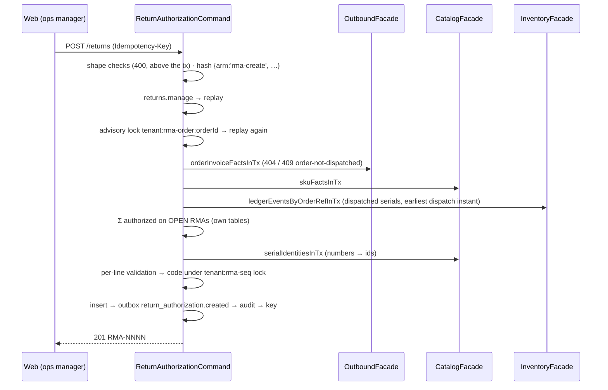

# Returns module

> Epic 13's reverse flow. Story 13-1 stands it up with **return authorizations (RMAs)**: an operator authorizes part of a *dispatched* order for return, naming the expected units and a reason (FR-46). 13-2 receives against the authorization, 13-3 dispositions, 13-4 builds the web queue, 13-5 the mobile Return task.

Paths are relative to `workspace/core/backend/wms-be`. Read [`../IMPLEMENTATION-GUIDE.md`](../IMPLEMENTATION-GUIDE.md) first — the command skeleton, migration checklist and vocabulary pattern are assumed, not repeated.

**An authorization moves no stock.** 13-1 writes no ledger event, touches no stock table and changes no ATP. The first return ledger arms (`return.received`, …) are 13-2's and 13-3's.

---

## Owns

| Table | Holds | Key invariants (0072) |
|---|---|---|
| `return_authorizations` | One RMA: `client_id` and `warehouse_id` (the order's), `order_id`, `order_reference` (snapshot of the order's `external_event_id`, nullable), `code` (`RMA-0001`), `external_reference` (a channel's/customer's RMA number, nullable, **not unique**), `status`, `order_dispatched_at`, `created_by`, the cancel columns | `status` CHECK `open\|cancelled` (13-2/13-3 widen it — drop and re-add); `cancel_shape`: `cancelled` ⇔ `cancelled_by`, `cancelled_at`, `cancel_reason` all set (and all null otherwise); `cancel_reason` 1–500 and `external_reference` 1–64, trimmed; unique `(tenant_id, code)`; index `(tenant_id, order_id)`; indexes `(tenant_id, warehouse_id, created_at, id)` and `(tenant_id, created_at, id)` for the warehouse and tenant-wide lists |
| `return_authorization_lines` | One order line of an RMA: `line_no` (1..n, request order — the read order, never inferred from uuidv7 ids), `order_line_id`, `sku_id`, `authorized_qty` (milli), `received_qty` (milli, 13-2 writes it), `reason_code`, `reason_note`, `serial_ids uuid[]` (catalog serial ids — the ledger's `serial_ref` form) | `authorized_qty > 0`; `received_qty ≥ 0`; `reason_code` ∈ the six codes; `reason_note` 1–500 trimmed; `reason_code <> 'other' OR reason_note IS NOT NULL`; unique `(rma_id, order_line_id)` and `(rma_id, line_no)`; `line_no ≥ 1` |

**RLS** — the client-scoped document pattern: the header carries the `advance_shipment_notices` tenant + client policy, the lines the `asn_lines` parent-EXISTS shape. No portal route reads them yet; the policy is defence in depth (`test/returns.spec.ts` probes it as `wms_rls_probe`; `test/client-isolation.spec.ts` pins the policy text and count). No FKs.

**Guards** (`test/architecture.spec.ts`, "return authorizations are returns-module-owned"): only `src/modules/returns` writes the two tables; the module imports from the schema only its own tables, `idempotencyKeys` and `auditEvents`; no raw `sql` in it names `orders`, `order_lines`, `picks`, `ledger_events`, `serials`, `skus` or `handling_units`; only the api shell and the root import it, and only through the facade/module/DTO. The detectors are proved by self-tests.

## Public seam

`ReturnsFacade` (`returns.facade.ts`) is the module's only export. It delegates the two commands to `ReturnAuthorizationCommand` and serves three member-open reads. The module reads other modules **only** through:

- `OutboundFacade.orderInvoiceFactsInTx` — status, warehouse, client, `externalEventId` (13-1 added `clientId` and `externalEventId` to `OrderInvoiceFacts`), per line `parentLineId`, `skuId`, `uom`, `dispatchedQtyMilli` (Σ `picks.qty` — the one definition, reused);
- `InventoryFacade.ledgerEventsByOrderRefInTx` — the order's `pick.picked` (one per serial unit, `serialRef` + `orderLineId` in the doc) and `dispatch.dispatched` events;
- `CatalogFacade.skuFactsInTx` (new) — `serialTracked`, `catchWeightTracked`, `uom`, `uomPrecision`; `CatalogFacade.serialIdentitiesInTx` (new) — one SKU's serials by number or by id.

## API

| Route | Capability | Arms |
|---|---|---|
| `POST /tenants/{t}/returns` `{orderId, externalReference?, lines: [{orderLineId, qty, reasonCode, reasonNote?, serialNumbers?}]}` | `returns.manage` (owner + ops manager) | 201 `ReturnAuthorizationDto`; 400 `validation-failed` / `line-not-of-order` / `kit-parent-not-returnable`; 404 `not-found` (order); 409 `order-not-dispatched` / `exceeds-returnable` / `serial-not-dispatched` / `serial-already-authorized` / `conflict`; 422 `idempotency-key-reuse` |
| `POST /tenants/{t}/returns/{rmaId}/cancel` `{reason}` | `returns.manage` | 200 DTO; 400; 404; 409 `rma-transition-invalid`; 422 |
| `GET /tenants/{t}/returns/returnable?orderId=` | member-open | `{orderId, status, warehouseId, orderReference, dispatchedAt, lines: [{orderLineId, parentLineId, skuId, kitParent, dispatchedQty, authorizedQty, returnableQty, serialTracked, returnableSerials}]}`; a non-dispatched order answers its status with zero everywhere; 404 unknown order |
| `GET /tenants/{t}/returns?warehouseId&status&orderId&cursor&limit` | member-open | newest first, keyset `(created_at, id)` DESC on the full-precision `::text` instant; tenant-wide without `warehouseId`; `limit` 1–100 (default 50); 400 `invalid-cursor` |
| `GET /tenants/{t}/returns/{rmaId}` | member-open | the DTO, or 404 |

The literal `returnable` route is declared **before** `:rmaId` (IMPLEMENTATION-GUIDE §6), pinned by the method order on the controller prototype. Refusals carry extension members the web reads: `orderLineId` on the line codes, `returnableQty` on `exceeds-returnable`, `serialNumber` on the serial codes. Quantities are JSON numbers in base units.

## Flows

### Create

**Shape (above the transaction, 400 naming the line):** 1–200 lines with distinct `orderLineId`s; `qty > 0`; `reasonCode` in the list; a non-blank note for `other`; `serialNumbers` distinct and non-blank, count = `qty`, ≤ 500 per line and ≤ 500 per request. Text is trimmed; blank = absent.

**The hash:** `{arm: 'rma-create', tenantId, orderId, externalReference, lines: [{orderLineId, qty, reasonCode, reasonNote, serialNumbers (sorted) | null}]}` — lines in request order. Pinned by a golden in `test/returns.spec.ts`.

**Line validation (behind the lock, in order):** the line is on the order (400 `line-not-of-order`) → not a kit parent (400 `kit-parent-not-returnable`) → `qty` at the SKU's UoM precision (400) → a catch-weight SKU in whole cases (400, the pick's own rule) → `qty ≤ returnable` (409 `exceeds-returnable`, naming it) → serial-tracked: numbers required, each dispatched on this line (409 `serial-not-dispatched`) and not on an open RMA (409 `serial-already-authorized`); any other SKU: no numbers (400). Catch-weight lines name no cases and batch-tracked lines name no batch — 13-2 binds both at receipt. An empty `serialNumbers` reads as absent.

**Returnable** (computed, never stored): `dispatched` = Σ `picks.qty` on a `dispatched` order (0 otherwise, and 0 for a kit parent); `authorized` = Σ `authorized_qty` over the line on OPEN RMAs; `returnable = max(0, dispatched − authorized)`; `returnableSerials` = the line's dispatched `serial_ref`s minus those on open RMAs. The per-order advisory lock is what makes the computed bound safe: two creates on one order serialise, and the replay under the lock turns a parked same-key duplicate into a replay.

**Code:** `RMA-<n>` zero-padded to 4, max numeric tail (`[0-9]{1,9}`) + 1 under `pg_advisory_xact_lock(hashtextextended(tenant || ':rma-seq', 0))` — the `allocateGrnCode` copy. Lock order: the order lock, then the sequence lock; no other path takes either. The lock key texts are exported (`rmaOrderLockKey`, `rmaSequenceLockKey`) for the race tests.

### Cancel

`{reason}` (1–500 after trim) · hash `{arm: 'rma-cancel', tenantId, rmaId, reason}` → `returns.manage` → replay → lock the RMA `FOR UPDATE` (404 only — the lock helper never checks status, the `loadOpenPo` lesson) → replay again → only `open` with every line at `received_qty = 0`, else 409 `rma-transition-invalid` → set `cancelled` + its columns (conditional on `status = 'open'`) → outbox `return_authorization.cancelled` → audit → key. Its quantity and serials become returnable again. Cancel does not take the order lock: a create that read the RMA as open before the cancel committed refuses conservatively (409), never over-authorizes.

## Vocabulary

- Capability `returns.manage` (the 44th) — owner + ops manager (decision 1: operators only; no client-held capability).
- Audit: target type `return_authorization`; actions `return_authorization.created` / `.cancelled` (both in `AUDIT_NEW_ACTIONS`, pinned by `expectAuditRow`), actor the requester, reference the key.
- Outbox: `return_authorization.created` / `.cancelled` (`returns/events.ts`), payload `{rmaId, code, orderId, warehouseId, clientId}`. Nothing subscribes in 13-1 (no notification source).
- `RMA_STATUSES`, `RETURN_REASON_CODES` (`return-authorization.command.ts`) pinned against their CHECKs by `test/returns.spec.ts`.
- A client's suspension does not block an authorization (21-10's "operator work unaffected", `clients.md`).

## Gotchas

1. **Problem extension members are flattened to the top level on the wire** (`ProblemDetailsFilter`); the web reads them as `ApiProblem.extensions`. A test that expects `body.extensions.x` fails — read `body.x`.
2. **The serial cap is per request, not only per line**: two lines of 250 pass, 250 + 251 fail (`normalizeCreate`).
3. **Uuids are lowercased** at the DTO edge (`@Transform`) and again in the command before hashing and lock-keying: the order lock key, the ledger's `reference_doc->>'orderId'` text match and the line map compare ids as TEXT, so an uppercase `orderId` once took a different lock (concurrent over-authorization) and missed the ledger rows.
