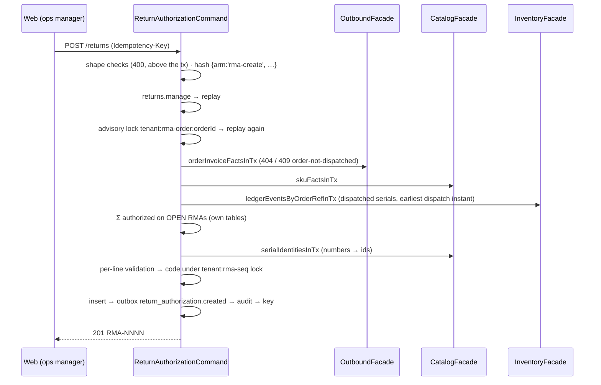

# Returns module

> Epic 13's reverse flow. Story 13-1 stands it up with **return authorizations (RMAs)**: an operator authorizes part of a *dispatched* order for return, naming the expected units and a reason (FR-46). 13-2 receives against the authorization on the handheld (`return.receive`, a condition grade per unit, the units held in the system RETURNS bin awaiting disposition), 13-3 dispositions, 13-4 builds the web queue, 13-5 the mobile Return task.

Paths are relative to `workspace/core/backend/wms-be`. Read [`../IMPLEMENTATION-GUIDE.md`](../IMPLEMENTATION-GUIDE.md) first — the command skeleton, migration checklist and vocabulary pattern are assumed, not repeated.

**An authorization moves no stock.** 13-1 writes no ledger event, touches no stock table and changes no ATP. **13-2's receipt does:** each received unit that matches its authorization line is one registered `return.received` intake into the warehouse's system **RETURNS** bin — "received, awaiting disposition", on-hand but **outside ATP** (`returnsAwaitingUnits`) until 13-3 dispositions it. Nothing leaves RETURNS before 13-3.

---

## Owns

| Table | Holds | Key invariants (0072) |
|---|---|---|
| `return_authorizations` | One RMA: `client_id` and `warehouse_id` (the order's), `order_id`, `order_reference` (snapshot of the order's `external_event_id`, nullable), `code` (`RMA-0001`), `external_reference` (a channel's/customer's RMA number, nullable, **not unique**), `status`, `order_dispatched_at`, `created_by`, the cancel columns | `status` CHECK `open\|cancelled` (13-2/13-3 widen it — drop and re-add); `cancel_shape`: `cancelled` ⇔ `cancelled_by`, `cancelled_at`, `cancel_reason` all set (and all null otherwise); `cancel_reason` 1–500 and `external_reference` 1–64, trimmed; unique `(tenant_id, code)`; index `(tenant_id, order_id)`; indexes `(tenant_id, warehouse_id, created_at, id)` and `(tenant_id, created_at, id)` for the warehouse and tenant-wide lists |
| `return_authorization_lines` | One order line of an RMA: `line_no` (1..n, request order — the read order, never inferred from uuidv7 ids), `order_line_id`, `sku_id`, `authorized_qty` (milli), `received_qty` (milli, 13-2 writes it), `reason_code`, `reason_note`, `serial_ids uuid[]` (catalog serial ids — the ledger's `serial_ref` form) | `authorized_qty > 0`; `received_qty ≥ 0`; **0073: `received_qty ≤ authorized_qty`**; `reason_code` ∈ the six codes; `reason_note` 1–500 trimmed; `reason_code <> 'other' OR reason_note IS NOT NULL`; unique `(rma_id, order_line_id)` and `(rma_id, line_no)`; `line_no ≥ 1` |
| `return_receipts` (13-2, 0073) | One `return.receive` op that applied at least one entry: `client_id`/`warehouse_id` (the RMA's), `rma_id`, `code` (`RRN-0001`, per tenant under `hashtextextended(tenant ‖ ':rrn-seq', 0)`), `device_id`, `received_by` (the badge-in operator), `idempotency_key` (the op's ULID), `occurred_at` (device time) | unique `(tenant_id, code)`; index `(tenant_id, rma_id)` |
| `return_receipt_lines` (13-2, 0073) | One applied entry: `rma_line_id`, `sku_id`, `line_no` (request order among the applied entries), `qty` (milli), `condition` (the inspection grade), `note`, `batch_id`, `serial_id`, `handling_unit_id` (a returned case), `ledger_event_id` (its `return.received`) | `qty > 0`; `condition` ∈ `resaleable\|opened\|damaged\|missing-parts`; `note` 1–200 trimmed; at most one of `serial_id`/`handling_unit_id`; `serial_id` set ⇒ `qty = 1000`; unique `(rma_line_id, serial_id) WHERE serial_id IS NOT NULL`; unique `(return_receipt_id, line_no)` |

**0073 also widens** `return_authorizations_status_check` to `open | partially_received | received | cancelled` (DROP and re-ADD; `RMA_STATUSES` with it — the DTO enum and the list filter follow), and `handling_units` (catalog's) gains return provenance — see `catalog.md`.

**RLS** — the client-scoped document pattern: the header carries the `advance_shipment_notices` tenant + client policy, the lines the `asn_lines` parent-EXISTS shape (13-2: `return_receipts` / `return_receipt_lines` the same two shapes; `test/return-receipts.spec.ts` probes them as `wms_rls_probe`; the `client-isolation` policy count is 111). No portal route reads them yet; the policy is defence in depth (`test/returns.spec.ts` probes it as `wms_rls_probe`; `test/client-isolation.spec.ts` pins the policy text and count). No FKs.

**Guards** (`test/architecture.spec.ts`, "return authorizations are returns-module-owned"): only `src/modules/returns` writes its four tables; the module imports from the schema only its own tables, `idempotencyKeys` and `auditEvents`; no raw `sql` in it names `orders`, `order_lines`, `picks`, `ledger_events`, `serials`, `skus`, `handling_units` — nor (13-2) `devices`, `users`, `bins`, `zones`, `rejected_ops`, `stock_on_hand`; only the api shell and the root import it, and only through the facade/module/DTO. **13-2:** returns reaches tenancy only through its exported in-transaction helpers (`assertDeviceOperatorInTx`/`touchDeviceInTx` in `device-operator.ts`, `ensureReturnsBinInTx`, `recordServerRejectedOpInTx` in `server-rejected-op.ts`, `userEmailsInTx`) plus the pre-13-1 permission/idempotency imports — an allowlist; **tenancy never imports returns**; `handling_units` is written only through `CatalogFacade.createHandlingUnits`. The detectors are proved by self-tests.

## Public seam

`ReturnsFacade` (`returns.facade.ts`) is the module's only export. It delegates the two commands to `ReturnAuthorizationCommand` and serves three member-open reads. The module reads other modules **only** through:

- `OutboundFacade.orderInvoiceFactsInTx` — status, warehouse, client, `externalEventId` (13-1 added `clientId` and `externalEventId` to `OrderInvoiceFacts`), per line `parentLineId`, `skuId`, `uom`, `dispatchedQtyMilli` (Σ `picks.qty` — the one definition, reused);
- `InventoryFacade.ledgerEventsByOrderRefInTx` — the order's `pick.picked` (one per serial unit, `serialRef` + `orderLineId` in the doc) and `dispatch.dispatched` events;
- `CatalogFacade.skuFactsInTx` (new) — `batchTracked` (13-2), `serialTracked`, `catchWeightTracked`, `uom`, `uomPrecision`; `CatalogFacade.serialIdentitiesInTx` (new) — one SKU's serials by number or by id.
- 13-2: `CatalogFacade.getBatchesForSkusInTx` (batch codes), `createHandlingUnits` (a returned case, status `returned`), `handlingUnitsByIdsInTx` (new — a returned case's weight on the detail read); `InventoryFacade.lockSerialsInTx`, `serialsInStockInTx` (new — the serial guard's "latest event is an intake" read, asked up front), `appendLedgerEventInTx` (`return.received`).

`ReturnsFacade` (13-2) also serves `receive` (the device op, delegated to `ReturnReceiptCommand`) and `getOpenReturns(tenantId, warehouseId)` — the catalog snapshot's `openReturns` arm, a plain facade call in its own transaction that the api shell's `ReceivingController` composes beside the task lists. `get` now carries the RMA's **receipts** (detail only).

## API

| Route | Capability | Arms |
|---|---|---|
| `POST /tenants/{t}/returns` `{orderId, externalReference?, lines: [{orderLineId, qty, reasonCode, reasonNote?, serialNumbers?}]}` | `returns.manage` (owner + ops manager) | 201 `ReturnAuthorizationDto`; 400 `validation-failed` / `line-not-of-order` / `kit-parent-not-returnable`; 404 `not-found` (order); 409 `order-not-dispatched` / `exceeds-returnable` / `serial-not-dispatched` / `serial-already-authorized` / `conflict`; 422 `idempotency-key-reuse` |
| `POST /tenants/{t}/returns/{rmaId}/cancel` `{reason}` | `returns.manage` | 200 DTO; 400; 404; 409 `rma-transition-invalid`; 422 |
| `GET /tenants/{t}/returns/returnable?orderId=` | member-open | `{orderId, status, warehouseId, orderReference, dispatchedAt, lines: [{orderLineId, parentLineId, skuId, kitParent, dispatchedQty, authorizedQty, returnableQty, serialTracked, returnableSerials}]}`; a non-dispatched order answers its status with zero everywhere; 404 unknown order |
| `GET /tenants/{t}/returns?warehouseId&status&orderId&cursor&limit` | member-open | newest first, keyset `(created_at, id)` DESC on the full-precision `::text` instant; tenant-wide without `warehouseId`; `limit` 1–100 (default 50); 400 `invalid-cursor` |
| `GET /tenants/{t}/returns/{rmaId}` | member-open | the DTO **plus `receipts`** (13-2, oldest first: `{id, code, occurredAt, operatorEmail, lines: [{rmaLineId, skuId, qty, condition, note, batchCode, serialNumber, weightGrams}]}` — the operator email resolved by the server), or 404. The list and the command responses carry no `receipts` key (optional on `RmaDetail`, so a pre-13-2 snapshot still serves) |
| `POST /tenants/{t}/returns/receipts` (13-2) `{warehouseId, rmaId, occurredAt, entries: [{rmaLineId \| null, skuId, qty, condition, note?, batchCode?, serialNumber?, weightGrams?}]}` | **device** — `DeviceSessionGuard`, badge-in required; floor roles | 201 `{returnReceiptId \| null, code \| null, rmaStatus, applied: [{entryIndex, rmaLineId, qty}], refused: [{entryIndex, reason}], reviewOpId \| null}`; 400 `validation-failed`; 401 badge-in; 403 `device-revoked` / `role-denied`; 404 `not-found` (RMA); 409 `document-warehouse-mismatch` / `rma-not-receivable` / `returns-bin-conflict` / `conflict`; 422 `idempotency-key-reuse`. Refusal reasons per entry: the nine of `RETURN_ENTRY_REFUSALS` |

The literal `returnable` route is declared **before** `:rmaId` (IMPLEMENTATION-GUIDE §6), pinned by the method order on the controller prototype. Refusals carry extension members the web reads: `orderLineId` on the line codes, `returnableQty` on `exceeds-returnable`, `serialNumber` on the serial codes. Quantities are JSON numbers in base units.

## Flows

### Create



**Shape (above the transaction, 400 naming the line):** 1–200 lines with distinct `orderLineId`s; `qty > 0`; `reasonCode` in the list; a non-blank note for `other`; `serialNumbers` distinct and non-blank, count = `qty`, ≤ 500 per line and ≤ 500 per request. Text is trimmed; blank = absent.

**The hash:** `{arm: 'rma-create', tenantId, orderId, externalReference, lines: [{orderLineId, qty, reasonCode, reasonNote, serialNumbers (sorted) | null}]}` — lines in request order. Pinned by a golden in `test/returns.spec.ts`.

**Line validation (behind the lock, in order):** the line is on the order (400 `line-not-of-order`) → not a kit parent (400 `kit-parent-not-returnable`) → `qty` at the SKU's UoM precision (400) → a catch-weight SKU in whole cases (400, the pick's own rule) → `qty ≤ returnable` (409 `exceeds-returnable`, naming it) → serial-tracked: numbers required, each dispatched on this line (409 `serial-not-dispatched`) and not on an open RMA (409 `serial-already-authorized`); any other SKU: no numbers (400). Catch-weight lines name no cases and batch-tracked lines name no batch — 13-2 binds both at receipt. An empty `serialNumbers` reads as absent.

**Returnable** (computed, never stored): `dispatched` = Σ `picks.qty` on a `dispatched` order (0 otherwise, and 0 for a kit parent); `authorized` = Σ `authorized_qty` over the line on OPEN RMAs; `returnable = max(0, dispatched − authorized)`; `returnableSerials` = the line's dispatched `serial_ref`s minus those on open RMAs. The per-order advisory lock is what makes the computed bound safe: two creates on one order serialise, and the replay under the lock turns a parked same-key duplicate into a replay.

**Code:** `RMA-<n>` zero-padded to 4, max numeric tail (`[0-9]{1,9}`) + 1 under `pg_advisory_xact_lock(hashtextextended(tenant || ':rma-seq', 0))` — the `allocateGrnCode` copy. Lock order: the order lock, then the sequence lock; no other path takes either. The lock key texts are exported (`rmaOrderLockKey`, `rmaSequenceLockKey`) for the race tests.

### Cancel

`{reason}` (1–500 after trim) · hash `{arm: 'rma-cancel', tenantId, rmaId, reason}` → `returns.manage` → replay → lock the RMA `FOR UPDATE` (404 only — the lock helper never checks status, the `loadOpenPo` lesson) → replay again → only `open` with every line at `received_qty = 0`, else 409 `rma-transition-invalid` → set `cancelled` + its columns (conditional on `status = 'open'`) → outbox `return_authorization.cancelled` → audit → key. Its quantity and serials become returnable again. Cancel does not take the order lock: a create that read the RMA as open before the cancel committed refuses conservatively (409), never over-authorizes.

### Receive (13-2, `return.receive`)

```mermaid
sequenceDiagram
  participant D as Handheld (badge-in)
  participant C as ReturnReceiptCommand
  participant T as tenancy helpers
  participant K as CatalogFacade
  participant I as InventoryFacade
  D->>C: POST /returns/receipts (Idempotency-Key = op ULID)
  C->>C: shape (400, above the tx) · hash {arm:'return-receive', …whole body}
  C->>T: assertDeviceOperatorInTx (403)
  C->>C: replay → lock RMA FOR UPDATE (404 only) → replay again
  C->>C: body warehouse = RMA's (409 document-warehouse-mismatch) → open|partially_received (409 rma-not-receivable)
  C->>C: lock RMA lines; Σ received serials per line (own rows)
  C->>K: skuFactsInTx · serialIdentitiesInTx (numbers → ids)
  C->>I: lockSerialsInTx (sorted) · serialsInStockInTx
  C->>I: ledgerEventsByOrderRefInTx (picked batches, each serial's batch) — only when a batch-tracked line is named
  C->>C: classify every entry in request order (applied / refused + reason)
  C->>T: ensureReturnsBinInTx (409 returns-bin-conflict) — only when something applied
  C->>C: RRN code (:rrn-seq lock) → receipt row
  C->>K: createHandlingUnits (status returned) — catch-weight entries
  C->>I: appendLedgerEventInTx return.received → RETURNS, per applied entry
  C->>C: receipt lines → received_qty → RMA status
  C->>T: recordServerRejectedOpInTx (ONE row for the refused entries) → device.rejected_op.raised
  C->>C: outbox return_receipt.recorded → audit → device heartbeat → key LAST
  C-->>D: 201
```

**Shape (above the transaction, 400):** uuids; `occurredAt` a Z-suffixed UTC instant; 1–150 entries (the worst-case payload stays under the sync report's 32 KB per-row budget — the device splits a larger receipt); `qty > 0`; `condition` ∈ the four grades; `note` trimmed, blank = absent, ≤ 200; `batchCode` ≤ 64; `serialNumber` ≤ 200; `weightGrams` a positive integer; a serial or a weight entry is `qty = 1`; never both. Optional keys normalise to `null` here, so an absent key and an explicit null are one request.

**The hash:** `{arm: 'return-receive', tenantId, deviceId, operatorUserId, warehouseId, rmaId, occurredAt, entries: [{rmaLineId, skuId, qty, condition, note, batchCode, serialNumber, weightGrams}]}` — entries in request order, every key always present (`rmaLineId` an explicit null). Golden in `test/return-receipts.spec.ts`.

**Classification (per entry, in request order; the first failing rule names the refusal):**

1. `rmaLineId` is a line of THIS RMA and `skuId` is that line's SKU — else `not-on-authorization`.
2. `qty` at the SKU's precision — else `qty-precision` (a per-entry refusal; one bad entry never fails the receipt) — whole cases for catch-weight, and ≤ the line's remaining `authorized − received` (decremented as entries apply) — else `exceeds-authorized`.
3. Serial-tracked: a serial number (else `missing-capture`) that resolves to one of the line's `serial_ids` not yet received (else `serial-not-authorized`) and is not on-hand in any bin right now (else `serial-in-stock`).
4. Batch-tracked: a batch code (else `missing-capture`) that is one of the order line's picked batches — for a batch-and-serial SKU, **that serial's own** pick `batchRef` — and no more units back from that batch than the line picked from it (earlier receipts on any RMA of the order line and earlier entries of the op counted; `pickedMilliByLineBatch`) — else `batch-not-dispatched`. The batch id is reused, never created.
5. Catch-weight: `weightGrams` present (else `missing-capture`) and ≤ `MAX_HANDLING_UNIT_WEIGHT_GRAMS` (else `weight-out-of-range`; the DTO also carries `@Max`).
6. A capture the SKU does not take (a serial on an untracked SKU, a batch on an unbatched one, a weight on a non-catch-weight one) — `unexpected-capture`.

**Applied entries** write, in one transaction: a returned case (`handling_units`, status `returned`, provenance `return_receipt_line_id`) per catch-weight entry; one `return.received` per entry (+qty into RETURNS from no bin, the batch and serial arms, `occurredAt` = the op's, the client the SKU's); one receipt line; the line's `received_qty`. The RMA turns `received` when every line is fully received, else `partially_received`; nothing applied → unchanged and **no receipt row**.

**Refused entries** (human decision 3 — nothing silently dropped, nothing silently accepted) land in **one** server-raised `rejected_ops` row (tenancy's `recordServerRejectedOpInTx`): `opType: 'return.receive'`, `classification: 'rejected'`, `problemCode: 'return-entries-refused'`, the detail listing the reasons, payload `{warehouseId, rmaId, rmaCode, occurredAt, entries: <the refused entries>, refusals: [{entryIndex, reason}]}` (aligned by position), attribution from the device and user rows. Its `op_id` is a ULID derived from the key (the key's timestamp + 16 chars of `sha256(key + ':refused')`), never the key itself, and the response's `reviewOpId` records it — a replay inserts nothing. It raises `device.rejected_op.raised`, so the panel's `rejected-op` entry fires. **The review row is Discard only** (decision 4, `tenancy.md`).

**Audit:** `return_receipt.recorded`, actor the operator, reference the key, target the receipt — or the RMA when nothing applied (`target_id` is NOT NULL). **Outbox:** `return_receipt.recorded` `{returnReceiptId | null, code | null, rmaId, rmaCode, clientId, warehouseId, appliedCount, refusedCount}` — nothing subscribes.

**The RETURNS code is reserved at create** (review fix): zone and bin create (and grid generation) refuse the code `RETURNS` with 409 `reserved-location-code`; a collision created before the rule still answers `returns-bin-conflict` at receipt. `ensureReturnsBinInTx` reads the bin first — once the system bin exists it is the identity whatever its zone is now called, so a renamed system zone breeds no stray zone. The adjustment refusal on the RETURNS bin has its own code, `returns-bin-not-adjustable` (QC's `qc-bin-not-adjustable` unchanged). A catalog/RMA inconsistency (an RMA line's SKU or serial the catalog cannot resolve) is a typed 500 `data-fault`, never an untyped throw or a uuid shown as a serial number.

**Device snapshot `openReturns`** (`openReturnsInTx`): the warehouse's RMAs in `open`/`partially_received`, `{id, code, orderReference, lines: [{id, skuId, authorizedQty, receivedQty, openQty, batchCodes, serials: [{id, serialNumber, received, batchCode}]}]}` — the batch codes are the order line's picked batches, each serial's `batchCode` its own pick batch.

### The double-authorization fix (13-2, design review #1)

`returnableFactsInTx` sums authorized quantity and serials over `status IN ('open','partially_received','received')` (`RMA_COMMITTED_STATUSES`) — before 13-2 it read `= 'open'`, so a received RMA's units would have become authorizable again. Pinned: after a receipt, a second RMA for the same line refuses `exceeds-returnable` (or `serial-already-authorized`). The cancel's `'open'` literals are correct and stay.

## Vocabulary

- Capability `returns.manage` (the 44th) — owner + ops manager (decision 1: operators only; no client-held capability).
- Audit: target type `return_authorization`; actions `return_authorization.created` / `.cancelled` (both in `AUDIT_NEW_ACTIONS`, pinned by `expectAuditRow`), actor the requester, reference the key. 13-2: target type `return_receipt`; `return_receipt.recorded` (`AUDIT_NEW_ACTIONS`, both target arms pinned) — the receipt command is a `DYNAMIC_WRITERS` entry (`return_receipt | return_authorization`).
- 13-2: `RETURN_CONDITIONS` (the four grades) pinned against `return_receipt_lines_condition_check`; `RETURN_ENTRY_REFUSALS` (nine: `not-on-authorization`, `exceeds-authorized`, `serial-not-authorized`, `serial-in-stock`, `batch-not-dispatched`, `missing-capture`, `unexpected-capture`, `weight-out-of-range`, `qty-precision`); `RECEIVABLE_RMA_STATUSES` = `open | partially_received`. No new capability — receiving is a floor verb (the device guard), Discard keeps `review.decide`.
- Outbox: `return_authorization.created` / `.cancelled` (`returns/events.ts`), payload `{rmaId, code, orderId, warehouseId, clientId}`. Nothing subscribes in 13-1 (no notification source).
- `RMA_STATUSES`, `RETURN_REASON_CODES` (`return-authorization.command.ts`) pinned against their CHECKs by `test/returns.spec.ts`.
- A client's suspension does not block an authorization (21-10's "operator work unaffected", `clients.md`).

## Gotchas

1. **Problem extension members are flattened to the top level on the wire** (`ProblemDetailsFilter`); the web reads them as `ApiProblem.extensions`. A test that expects `body.extensions.x` fails — read `body.x`.
2. **The serial cap is per request, not only per line**: two lines of 250 pass, 250 + 251 fail (`normalizeCreate`).
3. **Uuids are lowercased** at the DTO edge (`@Transform`) and again in the command before hashing and lock-keying: the order lock key, the ledger's `reference_doc->>'orderId'` text match and the line map compare ids as TEXT, so an uppercase `orderId` once took a different lock (concurrent over-authorization) and missed the ledger rows.
4. **A batch-and-serial SKU cannot be picked** (`pick.command.ts` refuses it), so no dispatched pick event ever carries a batch for a serial — the receipt's "the serial's own pick `batchRef`" arm is reachable only once that refusal lifts. It is pinned as a pure classification test (`classifyReturnEntry`), not end to end.
5. **Capture refusals are three reasons** (review fix): `missing-capture` (required, absent), `unexpected-capture` (present, not taken) and `weight-out-of-range`.
6. **The detail read's `occurredAt` is the canonical instant** (`.000Z`), not the device's second-precision string; compare instants, not text.
