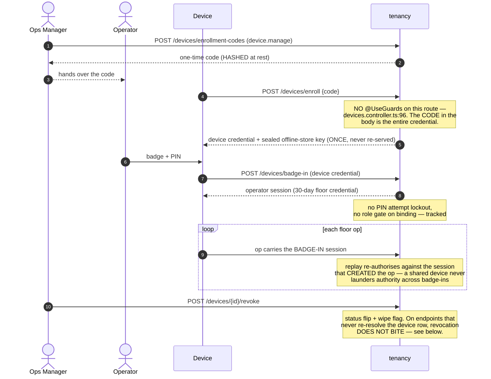
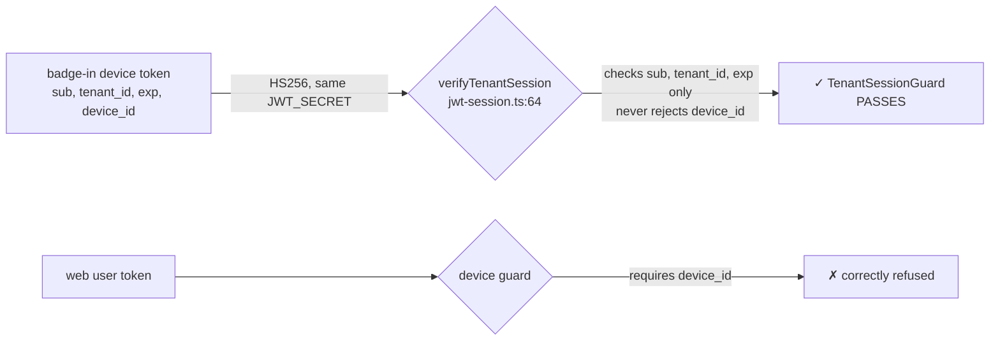

# Tenancy module

> Who a caller is, what they may do, and the physical places they do it in: tenants, sign-in, users and the capability matrix, warehouses, zones, bins, and the floor devices that carry an operator's session.

Paths are relative to `workspace/core/backend/wms-be`. Read [`../IMPLEMENTATION-GUIDE.md`](../IMPLEMENTATION-GUIDE.md) first — the command skeleton, migration checklist and vocabulary pattern below are assumed, not repeated.

This module is the spine every other module calls into. `assertPermission` + `getMemberRoleIn` are the two functions **every** command service in the repo runs at entry, and `permissions.ts` is mirrored by hand into `wms-fe/src/lib/users.ts`.

---

## Owns

| Table | Holds | Key invariants |
|---|---|---|
| `tenants` (`src/shared/db/schema.ts:42`) | One row per customer org | `tenant_id` is stamped **equal to `id`** (`registration.command.ts:93-94`) so the uniform RLS policy scopes the tenant row to itself |
| `users` (`schema.ts:81`) | Owner + team members: email, scrypt hash, role, invite lifecycle | `email` is **globally unique across all tenants** (`users_email_unique`). `role` is the `user_role` pgEnum — the one Postgres enum in the schema. `status` ∈ {`invited`,`active`}. `invite_token_hash` is sha256; the raw token exists only in the invite response |
| `warehouses` (`schema.ts:130`) | Stocking sites | `warehouses_tenant_id_code_unique` |
| `zones` (`schema.ts:159`) | Floor areas | `zones_warehouse_id_code_unique` — scoped to the **warehouse**, not the tenant |
| `bins` (`schema.ts:201`) | Putaway/pick locations | `bins_warehouse_id_code_unique`; `capacity` is milli-units with `bins_capacity_whole_units` (`% 1000 = 0 AND > 0`, `drizzle/0027_uom_vocabulary.sql:360`); 11-5 adds the nullable physical capacity `length_mm`/`width_mm`/`height_mm` (`> 0 AND <= 100000`) and `max_weight_grams` (`<= 100000000`) — integer WYSIWYG, CHECKs only in migration `0034`; 12-4 replaces the loose free-text `type` with the eight-value `LocationType` vocabulary (shelf/pallet/floor/staging/floor-stack/yard/tank/silo) backstopped by `bins_type_check` (CHECK only in migration `0037`); `retired_at`/`retired_by` stamped together (`bins_retired_pairing`, `drizzle/0016_numerous_bloodscream.sql:6`) and never cleared; `system_owned` marks the Receiving/QC-hold bins |
| `devices` (`schema.ts:1099`) | Floor handhelds: enrollment code hash, label, badge PIN hash, operator binding, revocation, and (9-2b) the push registration — Expo token + warehouse | `devices_enrollment_code_hash_unique` is a **partial** index (`where enrollment_code_hash is not null`) — it is what makes redemption single-shot. `devices_status_check` ∈ {`active`,`revoked`} (`drizzle/0012_lonely_the_renegades.sql:40`) |
| `rejected_ops` (`schema.ts:3134`) — **5-6** | One row per dropped terminal op a device's replay pass reported: the op ULID, its type, the `rejected`/quarantined classification and refusal verbatim, the payload as uploaded (the apply arm's re-execution input), the badge-in attribution jsonb, and the resolution columns | `rejected_ops_tenant_id_op_id_unique` — the per-row dedupe that makes at-least-once uploads safe (a re-posted row updates nothing). CHECKs (`classification`/`status`) live **only in migration `0047`** |
| `audit_events` (`schema.ts:104`) | Append-only actor/action/target trail; `reference` carries the idempotency key | No update or delete code path exists anywhere. **Shared with every module that has a keyed command** — it is the one table this module owns that siblings write; since 9-3a every keyed command writes a row (`IMPLEMENTATION-GUIDE.md` §1 step 10), and reporting reads it (the audit trail, its third read-only exception) |
| `audit_exports` (9-3b) | One row per requested export of the audit trail: `requested_by`, `filters` jsonb (the validated body, absent keys omitted, instants canonical UTC), `snapshot_at` (= `created_at`), `status`, `attempts`, `started_at`/`heartbeat_at`/`finished_at`/`expires_at`, `row_count`/`byte_size`/`sha256`, `failure_reason` | Written only by this module (`test/architecture.spec.ts` "the audit exports are tenancy-owned"). CHECKs only in migration `0070`: status/reason vocabularies, `attempts >= 0`, a hex `sha256`, and the **per-status shape** (§The async audit export). Partial unique `audit_exports_active_unique (tenant_id, requested_by) WHERE status IN ('queued','running')` — one active export per member. No FK |
| `audit_export_files` (9-3b) | An export's gzipped CSV bytes (`bytea`), keyed by `export_id` | A table of its own so a list never reads bytes; written and removed only through the `AuditExportStore` port's Postgres implementation. No FK — expiry removes the file explicitly |
| `sign_in_challenges` (6-1b, migration `0075`) | The pending second step of a web sign-in: `user_id`, `purpose` (`totp`\|`enroll`), `secret_hash` (sha256 of the token's secret), `enabled_at_seen` (the user's `mfa_enabled_at` when a `totp` challenge was issued), `failures`, `ip`, `expires_at`, `consumed_at` | CHECKs only in `0075`: the purpose vocabulary, `failures BETWEEN 0 AND 5`, `expires_at > created_at`, `(purpose = 'totp') = (enabled_at_seen IS NOT NULL)`. Indexes `(expires_at)` (the purge) and `(tenant_id, user_id) WHERE consumed_at IS NULL`. RLS. Looked up by id on `AUTH_DATABASE` (the `sessionTenantOf` shape); every write in the tenant's transaction |
| `user_backup_codes` (6-1b, `0075`) | Single-use backup codes: `user_id`, `code_hash` (HMAC-SHA256 under a pepper derived from `MFA_ENCRYPTION_KEY`, HKDF info `backup-codes`, over `user_id ‖ code`), `used_at` | Unique `(user_id, code_hash)`; index `(user_id) WHERE used_at IS NULL`. A set of ten is replaced whole, never appended to. RLS |
| `idempotency_keys` (`schema.ts:238`) | AD-5 storage: `(tenant_id, key)` unique + payload hash + response snapshot | Also written by every other module. Extra `idempotency_keys_key_idx` exists solely for registration's key-only replay lookup |

Every table carries `tenant_id` with a fail-closed `tenant_isolation` RLS policy declared **only** in migration SQL (`drizzle/0001_greedy_scarecrow.sql:55-70`).

`bins.blocked` is owned by **putaway**, not here — story 3.6 re-homed the toggle's logic to `src/modules/putaway/bin-state.command.ts` because a blocked bin is operational state. The URL (`PATCH …/bins/{binId}`) still lands on this module's controller, which delegates (`tenancy.controller.ts:402`). Since 11-5 that one route **dispatches per body**: a `blocked` field goes to putaway's `setBlocked`, capacity attributes (`lengthMm`/`widthMm`/`heightMm`/`maxWeightGrams`) go to this module's `editBinCapacity` under `bin.create`; sending both (or neither) is one 400 `validation-failed` telling the caller to send separate PATCH requests — one idempotency key per request. The two arms never mix a snapshot. **Since 1-5b the structure arm also takes `dedicatedClientId`** (absent = unchanged, `null` = clear, a uuid = dedicate) — `dedicatedClientId !== undefined`, null included, routes the body to `editBinCapacity`; it may combine with other structure attributes, never with `blocked`. `blocked` is strictly boolean — a present-but-non-boolean value (including `null`: class-validator's `@IsOptional` skips null too, which a 500 proved before the review caught it) is a 400 at the controller, before dispatch; the capacity attrs keep their null-means-clear reading.

---

---

## Schema (field level)

### `tenants`
`id` uuid PK · `tenant_id` uuid NOT NULL — **self-referencing**, so RLS is uniform across every table including this one · `name` text NOT NULL.

### `users`

| Column | Type | Null | Default | Guard | Meaning |
|---|---|---|---|---|---|
| `email` | text | NO | — | **globally unique** | Not per-tenant — one tenant per email, by design. Duplicate → `409 duplicate-email` |
| `password_hash` | text | NO | — | — | **scrypt.** Never leaves the row. `DUMMY_HASH` equalises timing so an unknown email and a wrong password are indistinguishable |
| `role` | `user_role` **pgEnum** | NO | `'operator'` | the enum type + `users_client_role_pairing` (0065) | `owner \| ops_manager \| operator \| accountant \| client` (21-7 added `client`, the client-portal persona — no capabilities). **The only `pgEnum` in the schema** — every later vocabulary uses a CHECK instead, because extending an enum needs `ALTER TYPE` (and the new value cannot be used in the migration run that adds it — IMPLEMENTATION-GUIDE §3) |
| `client_id` | uuid | **YES** | — | `users_client_role_pairing`: `(role::text = 'client') = (client_id IS NOT NULL)` | 21-1's persona arm; since 21-7 set exactly for a `client` user, written only by the invite insert, never updated (architecture scan) |
| `status` | text | NO | `'active'` | **NO CHECK — app-layer only** | `invited \| active`, enforced solely by `USER_STATUSES` (`schema.ts:66`). One of the unguarded vocabularies the docs flag elsewhere |
| `invite_token_hash` | text | **YES** | — | — | **sha256 of the one-time token.** The raw value is returned once and also persists in the idempotency snapshot so a replay re-serves it |
| `invite_expires_at` | timestamptz | **YES** | — | — | 7-day TTL |
| `mfa_secret_sealed` / `mfa_enabled_at` (6-1b) | text / timestamptz | **YES** | — | `users_mfa_secret_pairing`: both or neither | The authenticator secret, sealed by `second-factor-secrets.ts` (AES-256-GCM, AAD `tenant_id:user_id`, key id in the blob) — never readable elsewhere |
| `mfa_last_step` (6-1b) | bigint | **YES** | — | `users_mfa_counters_check` (≥ 0) | The last TOTP step accepted; a code is single-use, steps only move forward (a confirm sets it to its matched step unconditionally — a new secret starts its own sequence) |
| `mfa_failures` / `mfa_lock_cycles` / `mfa_failed_since_success` (6-1b) | integer ×3 | NO | 0 | `users_mfa_counters_check` (≥ 0) | Consecutive wrong codes (5 → a lock); consecutive locks without a success (the 3rd is permanent); wrong codes since the last successful sign-in (reported, then zeroed) |
| `mfa_locked_until` (6-1b) | timestamptz | **YES** | — | — | 15 min, or `'infinity'` on the 3rd cycle (only an owner's Unlock or `auth:unlock` clears it) |
| `mfa_pending_secret_sealed` / `mfa_pending_created_at` (6-1b) | text / timestamptz | **YES** | — | `users_mfa_pending_pairing` | An enrolment in progress — reused for 24 h by the sign-in's enrolment step, so a second challenge shows the same QR code; purged after 24 h |
| `mfa_enrol_code_hash` / `mfa_enrol_code_expires_at` (6-1b) | text / timestamptz | **YES** | — | `users_mfa_enrol_code_pairing` | sha256 of the one-time enrolment code an owner's reset (or the CLI) hands over; 72 h. Required at enrolment whenever present; once expired, the password step answers `403 enrolment-code-expired` (spec amendment 2026-10-18) |

### `warehouses` / `zones`
`warehouses`: `code` (unique per tenant), `name`, plus the origin address columns (story 11-1, migration `0030`): `origin_contact_name`, `origin_phone`, `origin_line1`, `origin_line2`, `origin_city`, `origin_state`, `origin_pincode` — text ×7, all nullable, pre-11.1 rows read back `origin: null`. **Set at create only** (`origin` is required on `POST /warehouses`); there is no update endpoint — story 4-6d owns that decision. `pincode` is TEXT, `/^\d{6}$/`.
`zones`: `warehouse_id`, `code` (unique per warehouse), `name`.

### `devices`

| Column | Type | Null | Default | Guard | Meaning |
|---|---|---|---|---|---|
| `operator_user_id` | uuid | **YES** | — | — | Null until badge-in binds an operator |
| `label` | text | **YES** | — | — | |
| `status` | text | NO | `'active'` | `devices_status_check` | `active \| revoked` |
| `revoked_at` / `revoked_by` | timestamptz / uuid | **YES** | — | — | |
| `wipe_flag` | boolean | NO | `false` | — | Set on revoke; the device wipes its cache on next connection |
| `enrollment_code_hash` | text | **YES** | — | **partial unique WHERE NOT NULL** | One-way hash of the mint code |
| `enrollment_code_expires_at` | timestamptz | **YES** | — | — | |
| `enrolled_at` | timestamptz | **YES** | — | — | |
| `pin_hash` | text | **YES** | — | — | **scrypt.** No attempt lockout exists (epic-3 retro a6) |
| `last_seen_at` | timestamptz | **YES** | — | — | |
| `push_token` (9-2b) | text | **YES** | — | partial index `devices_push_token_idx` WHERE NOT NULL | The handheld's Expo push token. **At most one device per tenant holds a token** (the PUT clears it elsewhere); across tenants the latest `push_registered_at` owns it |
| `push_warehouse_id` (9-2b) | uuid | **YES** | — | — | The warehouse the handheld registered with its token — new-work pushes are scoped to it. No FK (the house convention); checked by `assertWarehouseInTenant` at the PUT |
| `push_registered_at` (9-2b) | timestamptz | **YES** | — | — | Stamped by every PUT — the send-time ownership read's "latest registration wins" |

The three push columns are written only by the device's own `PUT`/`DELETE …/devices/push-registration`, cleared together by revoke and by `clearPushTokenIn` (migration `0068_mobile_pushes.sql`).

**No column holds the sealed offline-store key** — it is returned once at enrollment and persists only in `idempotency_keys.response_snapshot`.

### `audit_events`
`actor_user_id` (NOT NULL — `SYSTEM_ACTOR_ID` for schedulers and sweeps) · `action` (usually the outbox event name) · `target_type` (a literal from `AUDIT_TARGET_TYPES`, `shared/primitives/audit.ts`) · `target_id` · `reference` (nullable — the idempotency key; a few pre-9-3a actions keep a composite reference carrying it) · `occurred_at` default `now()` · `created_at` (the server commit stamp — **the audit read orders, pages and windows on it**, because a few writers stamp `occurred_at` from device or command time). **Append-only by convention, not by trigger** — unlike `ledger_events`. **Indexes (0069):** `(tenant_id, created_at DESC, id DESC)`, `(tenant_id, actor_user_id, created_at DESC)`, `(tenant_id, target_type, target_id)`, `(tenant_id, action text_pattern_ops, created_at DESC)` — the audit read's four shapes (`reporting.md` §The audit trail); 0069 dropped the unread `(tenant_id, occurred_at)` index.

### `idempotency_keys`

| Column | Type | Null | Guard | Meaning |
|---|---|---|---|---|
| `key` | text | NO | `unique (tenant_id, key)` | ULID. **Tenant-scoped** — the cross-tenant hijack fixed in 4.3 |
| `payload_hash` | text | NO | — | sha256 over the command's fields. **Convention changed in 10.2** (base units, not milli) — no pre-10.2 key replays |
| `response_snapshot` | jsonb | NO | — | **Durable and re-served on replay. Never put secret material here** — story 3.2 did, and story 4-6b forbids it |

### `rejected_ops` (5-6, `schema.ts:3134`)

| Column | Type | Null | Guard | Meaning |
|---|---|---|---|---|
| `device_id` / `operator_user_id` | uuid ×2 | NO | — | Badge-in attribution ids — **bare uuid, no FK** (the repo convention; scope-validated server-side). `operator_user_id` rides the device session that reported |
| `op_id` | text | NO | **`unique (tenant_id, op_id)`** | The mobile op's own ULID — the per-row dedupe key that makes at-least-once uploads safe. Never `self-test.echo` (not reviewable; the upload refuses it) |
| `op_type` | text | NO | **no CHECK** — validated by the command (verified at 13-2: 0047 has none) | The mobile OpType — the reviewable types (`REJECTED_OP_TYPES`, `sync-report.command.ts`; eight since 13-2's `return.receive`) |
| `classification` | text | NO | CHECK (migration `0047`) | `rejected \| quarantined` — the replay fate the server refused with, carried verbatim |
| `problem_code` / `problem_detail` | text / text | NO / **YES** | — | The replay refusal, verbatim. The queue card's primary display |
| `payload` | jsonb | NO | — | The op's payload as uploaded (base units); the apply arm re-executes it. `binStateEpoch` is stripped at APPLY time, **never at store time** |
| `attribution` | jsonb | NO | — | `{deviceId, deviceLabel, operatorId, operatorEmail, opDeviceLabel, opOperatorEmail}` — the server-verified badge-in identity beside the op's own sealed session |
| `op_enqueued_at` / `op_occurred_at` | timestamptz / nullable | NO / **YES** | — | The op's own timestamps from the device |
| `status` | text | NO | CHECK (migration `0047`) | `open \| applied \| recounted \| discarded` — exactly `open` at upload; the resolve arms own every later state |
| `resolved_by` / `resolved_at` / `resolved_outcome` | uuid / timestamptz / jsonb | **YES** | — | The resolver, the resolution instant, and the arm's outcome (applied snapshot / minted count-task id / the discard marker) — all null while open |

Second index: `rejected_ops_tenant_status_created_at_id_idx` — the review queue's keyset read (status filter first, the pendings-queue keyset shape). RLS policy `rejected_ops_tenant_isolation` (migration `0047`) — the `client-isolation` count pin is 56 since this table.

---

## Public seam

`TenancyModule` exports three providers (`tenancy.module.ts:76`): `TenancyService`, `EnrollmentCommand`, and — since 5-6 — `SyncReportCommand` (so the api shell's `DevicesController` can reach the AD-14 upload/list/resolve routes; its constructor injects the seven op types' owning facades for the apply arm and `InventoryFacade` for the recount arm's advisory lock).

**`TenancyService`** (`tenancy.service.ts:139`) — for siblings and the api shell:

- `getMemberRole(tenantId, userId, tx?)` `:156` — the authority read. Pass `tx` and it runs inside your transaction; omit it and it opens its own. **Every foreign module calls this**, never `users` directly.
- `requireActiveWarehouse(tenantId)` `:170` → `{warehouseId, code, name}` or 422 `no-active-warehouse`. The zero-warehouse invariant guard for stock-record creation.
- `portalWarehouses(tenantId, clientId)` (21-7b) — the client portal's warehouse list (the announce form's picker; decision 1: every warehouse of the tenant): `{warehouseId, warehouseName, city}` (city = `origin_city`, null on a pre-11.1 row — it tells apart two warehouses of one name), ordered `(name, id)`, unpaginated and capped at `MAX_WAREHOUSE_PAGE_SIZE` (200). Never a code, address line, contact or GSTIN. Stamped `{ clientId }` like every portal read (the architecture scan lists it), though `warehouses` is tenant-scoped.
- `listWarehouses` `:200` / `listZones` `:241` / `listBins` `:282` — keyset-paginated reads. `listBins` converts `capacity` out of milli-units (`:330`) and, since 11-5, echoes the four physical-capacity attributes **raw** (integer facts, no `fromMilli`).
- `computeSetupChecklist(tenantId)` `:344` — the four onboarding steps, computed on read from counts. No stored step rows.
- **The async audit export (9-3b)** — called by the api shell's `ReportingController` and the jobs shell's `AuditExportWorker` (§The async audit export):
  - `requestAuditExport(command, key)` → `AuditExportSnapshot` — `AuditExportCommand.request`;
  - `listAuditExports(tenantId, userId)` — the caller's own last 20, newest first (`audit.view`);
  - `openAuditExportFile(tenantId, userId, exportId)` → `{export, gzipped}` — a ready export's stored bytes, for its requester only;
  - `runDueAuditExports(tenantId)` → `AuditExportRunSummary` — one worker pass (`AuditExportRunner.runDue`).

**File-level functions** other modules import directly (they are the shared command-entry pattern, not a facade breach):

- `assertPermission(role, capability)` — `permissions.ts:143`
- `getMemberRoleIn(tx, tenantId, userId)` — `tenancy.service.ts:111`
- `assertWarehouseInTenant(tx, tenantId, warehouseId)` — `tenancy.service.ts:76`
- **The push-target functions (9-2b, `tenancy.service.ts:164-310`)** — the notifications module's only way to `devices`; tenancy owns every read and write of the table:
  - `listPushTargets(tx, tenantId)` `:233` → `PushTarget[]` `{deviceId, token, warehouseId, operatorUserId, role}` — every **base-eligible** handheld, in the caller's tenant transaction: device `active`, `push_token` and `operator_user_id` non-null, the operator's `users` row `active`, `client_id IS NULL`, role a floor role or `accountant` (the badge-in allowlist, `PUSH_TARGET_ROLES`). Ordered by device id.
  - `getPushTargetsIn(tx, tenantId, deviceIds)` `:244` → `Map<deviceId, PushTarget>` — the same predicate over the given devices: the sender's send-time re-check. A device that no longer qualifies is simply absent.
  - `clearPushTokenIn(tx, tenantId, deviceId, token)` `:261` → `boolean` — clears the three push columns **only `WHERE push_token = token`** (compare-and-clear), so a handheld that re-registered a fresh token keeps it.
  - `pushTokenOwners(authDb, tokens)` `:290` → `Map<token, {tenantId, deviceId}>` — for each token, the row with the latest `push_registered_at` (ties by id), **across tenants**, on the BYPASSRLS `AUTH_DATABASE`. Read-only: the caller's resulting clear stays in its own tenant. Not in the spec, which described the read without naming its seam.
- `hashCommandPayload` / `parseRequiredIdempotencyKey` / `IdempotencyKey` — `idempotency-guard.ts`
- `idempotencyKeyReuse()` — `registration.command.ts:147`
- `TenantSessionGuard` / `CurrentSession` / `DeviceSessionGuard` / `CurrentDeviceSession`
- `ensureReceivingBinInTx` / `ensureQcHoldBinInTx` — `receiving-bin.ts:51,114`. Inbound calls these so bin master data stays tenancy-owned even when a GRN or a QC hold creates a bin. `ensureInTransitBinInTx` (5-1, movements) and **`ensureReturnsBinInTx` (13-2, returns)** are the same shape.
- **13-2 — the floor-op guard and the server-raised review row, exported so a module owning no device/user/review table runs them:** `assertDeviceOperatorInTx` / `touchDeviceInTx` (`device-operator.ts` — the `grn.submit` guard moved here unchanged: the device row locked, active and badge-bound → else 403 `device-revoked`; the operator's current role a floor role → else 403 `role-denied`; `receiving.command.ts` now calls it too) and `recordServerRejectedOpInTx(tx, outbox, input)` (`server-rejected-op.ts`; `SyncReportCommand.recordServerRejectedOpInTx` delegates). The returns module reads `userEmailsInTx` for the receipt's operator email. Tenancy never imports returns.

**`EnrollmentCommand`** (`enrollment.command.ts:200`) is exported so the api shell's `DevicesController` can reach it: `mintEnrollmentCode`, `enroll`, `badgeIn`, `revokeDevice`, `list`, `selfTestEcho`, and (9-2b) `registerPush`, `unregisterPush`. `EXPO_PUSH_TOKEN_RE` (`^Expo(nent)?PushToken\[[^\]]{1,200}\]$`) is exported too — the DTO and the command share it.

**`SyncReportCommand`** (`sync-report.command.ts:471`, 5-6) export exists for the same reason: `recordSyncReport` (badge-in), `listRejectedOps` (any member, keyset), `resolveRejectedOp` (`review.decide`).

**`BinLabelsService`** (2-10a, `bin-labels.ts`) is not exported either — only `TenancyController.printBinLabels` calls it. The renderer it calls lives in `src/shared/labels/` (pure, no DB) so 2-10b's LPN labels and later documents reuse it.

**`UsersCommand`** and the bin/zone/warehouse commands are **not** exported — they are reachable only through this module's own controllers.

---

## Flows

### Device onboarding — three credentials, three lifetimes



### The one-way claim-shape hole — closed by 21-7

**Story 21-7 closed it:** `verifyTenantSession` now returns null for any token carrying `device_id`, so a badge-in token no longer opens a web route (401), and `verifyDeviceSession` refuses any token carrying `client_id`. The diagram below is the pre-21-7 state, kept for the record.



The docstring asserts the two families are "mutually exclusive by claim shape". **That holds one direction only.** A 30-day floor credential opens the web surface for its own tenant. Not cross-tenant and not privilege escalation — `sub` is the operator, so capabilities are the operator's — but revocation stops biting wherever the device row is not re-resolved. Verified; tracked.

### Bin administration

`merge` moves stock (emitting `bin.merged`, a two-arm relocation) and `retire` is **terminal and requires empty**. Both live in `bin.command.ts`, not putaway — putaway *directs* placement, tenancy *owns* the bin. `bins` is the one table deliberately shared by column: tenancy owns structure — since 11-5 that includes the four physical-capacity attributes (`editBinCapacity`) — and `retired_at`, putaway owns `blocked`. It has **no architecture-test block**, which makes the shared-ownership case the least-guarded one in the repo.

### The quarantine loop (5-6) — from replay fate to queue resolution

```mermaid
sequenceDiagram
  autonumber
  participant D as Device (offline store)
  participant T as tenancy (sync-report.command)
  participant Op as Ops Manager / Owner (web)

  Note over D,T: a replay pass refused an op — replay-classification case 3<br/>(rejected) or case 4 AD-14 (quarantined); the op is dropped<br/>terminal and RETAINED, never deleted
  loop uploader passes (50-row slices)
    D->>T: POST /devices/sync-reports (badge-in, Idempotency-Key)
    Note over T: per-row dedupe on (tenant, op_id);<br/>each row persists `open`;<br/>body-limit breach → 413 before any row is named
    T-->>D: per-row acks {recorded} — acked rows unmark, refused stay retained
  end
  Op->>T: GET /rejected-ops?status=open (keyset; any member)
  Op->>T: POST /rejected-ops/{id}/resolve {apply|recount|discard} (review.decide)
  Note over T: apply re-executes the payload through the op's OWN<br/>guarded command (idempotency key = the op ULID);<br/>recount mints a count task on the payload's bin;<br/>discard carries the row to the audit trail — no stock write
  T-->>Op: {status: applied|recounted|discarded, outcome}
```

The mobile side owns exactly two behaviors the server does not: the **slicing** (50-row slices; on 413 the uploader *halves the slice and retries this pass* — `sync-report-uploader.ts`, the effective bound is the body limit, not the 200-row DTO ceiling) and the **ack discipline** (acked rows unmark in the store; refused or unreachable reports leave everything retained).

---

## Commands

Every command follows the skeleton in the implementation guide. Only the deviations and the module-specific guards are listed here.

### `RegistrationCommand.register` (`registration.command.ts:61`)

Creates the tenant + its Owner user + the idempotency row in one transaction.

1. Normalize email (`trim().toLowerCase()`), hash the payload over `{name, ownerEmail}` — **never password material** `:68`.
2. Replay lookup **by `key` alone** on `AUTH_DATABASE` `:74-84`. This is the one command with no tenant context, so the normal `(tenant_id, key)` predicate is impossible; a foreign key-holder fails the payload-hash comparison and 422s.
3. `normalizeGstin(gstin)` (8-1; prefix check 8-1d) behind the replay check, then `hashPassword` — a replay must not pay the ~100 ms scrypt round, nor be refused by a rule added after it committed. The optional `gstin` joins the hash in its lenient form (`normalizeGstinInput`, `?? null`).
4. Insert `tenants` (with `tenantId = id`), then `users` with `role: 'owner'`; a `users_email_unique` violation → 409 `duplicate-email` `:107-114`.

Writes: `tenants`, `users`, `audit_events` (**9-3a:** `tenant.registered`, target `tenant` → the new tenant, actor the new owner — no session exists yet; written under the new tenant's scope), `idempotency_keys`. Emits `tenant.registered`.

No capability check — there is no role to read yet.

### `SignInCommand.execute` (`sign-in.command.ts:47`)

Not a state change; **no idempotency key**. Runs entirely on `AUTH_DATABASE` (cross-tenant email lookup).

1. Look up by email.
2. `status === 'invited'` → burn one scrypt round against `DUMMY_HASH`, then 403 `invite-pending` `:61-74`.
3. `verifyPassword(password, user?.passwordHash ?? DUMMY_HASH)` — **always** one scrypt round `:77`.
4. Unknown email and wrong password are one 401 `unauthenticated` with identical text.

**6-1b — the branch after `clearSignInAttempts`:** a staff user (`client_id IS NULL`) with `mfa_enabled_at` set, any owner (`secondFactorRequired(role)`), or — amendment 2026-10-18 — any staff user holding a reset's enrolment code (an expired one → `403 enrolment-code-expired`, nothing written), gets a CHALLENGE instead of a session — `TotpChallengeResponse` (enrolled) or `EnrollChallengeResponse` (an owner not yet enrolled: the pending secret, reused for 24 h, its `otpauthUri`, `enrolmentCodeRequired`) — written in the user's tenant transaction under the user row's lock; no session row, no cookie. The caller must have sent `X-WMS-Second-Factor: 1`, else `409 client-outdated` and nothing is written. Everyone else (and every portal user) gets the 6-1a body unchanged, from `issueWebSessionInTx` (extracted so the second step issues the session in the transaction that consumes its challenge).

Returns the token plus `user {id,email,role,status,clientId}` and (21-7) `client {id,code,name} | null`. The role in that body is **for FE surface gating only** — the command path re-reads it. **21-7:** a client user whose client is not `active` is refused 403 `client-suspended` AFTER the password check (a wrong password stays 401); its token carries `client_id`.

### `WarehouseCommand.create` / `ZoneCommand.create`

Guards in order: `warehouse.create` / `zone.create` → replay → (zone only) `assertWarehouseInTenant` → (warehouse only) `assertAddress(origin)` → `normalizeGstin(gstin)` → insert. Duplicate code → 409 `duplicate-warehouse-code` / `duplicate-zone-code` naming the code. Emits `warehouse.created` / `zone.created`; **9-3a** adds the audit row of the same name (target `warehouse` / `zone`).

Note the ordering difference: `WarehouseCommand` has no parent assert; `ZoneCommand` runs its parent assert **after** the replay lookup (`zone.command.ts:97`).

**The GSTIN gate — `normalizeGstin` (`tenancy.service.ts`).** Trim + uppercase (blank → absent), then refuse `400 validation-failed` on (1) a shape other than `GSTIN_RE` and (2) — **8-1d** — a two-digit prefix that is not a GST registration state code (`GSTIN_STATE_CODES`, `src/shared/primitives/gstin.ts`: `01–24, 26, 27, 29–38, 97`; never 25 (merged into 26), 28 (pre-GST AP) or 99 (Centre Jurisdiction)). It is **synchronous and DB-free on purpose**: registration runs it outside any transaction and seed/adapter paths call it too, so the code list is a pure constant pinned against `gst_state_codes` by `test/issuance-gate-parity.spec.ts`. Every caller runs it behind its replay lookup. The order create command applies the same predicate to `consigneeGstin`. Not validated anywhere: the PAN segment, the entity code and the checksum (PENDING). A warehouse GSTIN whose state differs from its origin state is **accepted** (the web warns; invoices warn `pos-discrepancy`). GSTINs are create-only.

### `BinCommand.createBin` (`bin.command.ts:201`)

Guards: `bin.create` → replay → `assertWarehouseInTenant` → `assertZoneInWarehouse` (inside `insertBin`, `:997`) → `assertWholeUnitCapacity` → (11-5) `assertBinCapacityAttributes` → insert. The four optional physical-capacity attributes (`lengthMm`/`widthMm`/`heightMm`/`maxWeightGrams`) default to NULL = unconstrained when absent or null.

**Bulk-asset creation (12-4):** a `tank`/`silo` requires `maxWeightGrams` — absent AND null both refuse (`assertBulkAssetWeightDefined`, 400 `validation-failed` naming the type); a bulk asset is never gridded (`refuseBulkAssetGrid` backstops the narrowed grid DTO) and `PATCH …/bins/{id}` refuses to clear its weight (`refuseBulkAssetWeightClear`).

**Emits nothing** to the outbox. The spec named `zone.created` / `bins.generated` / `bin.blocked` only, so a manually created bin produces no outbox row (`:218-220`). **9-3a** adds its audit row: `bin.created` (target `bin`). `generateGrid` writes one `bin.grid_generated` row whose target is the **zone** gridded, not each bin.

### `BinCommand.generateGrid` (`bin.command.ts:290`)

Guards: arithmetic size check **before** materializing codes (`:295`; a `Z×99×99` request must not build a 255k array to reject it) → `grid-too-large` 422 above `MAX_BINS_PER_GRID_RUN` = 500 → `bin.create` → replay → warehouse + zone asserts → (11-5) `assertBinCapacityAttributes` → in-transaction collision pre-check naming the first conflicting code (`:358-365`) → one bulk insert. Every generated bin carries the same optional attributes. **12-4:** the grid DTO's `type` enum narrowed to the SIX grid-able types (`GRID_TYPES`, TS type `Exclude<LocationType, BulkAssetType>`); a bulk asset is operator-directed, never gridded — the ValidationPipe refuses one naming the set, the runtime refusal stays as the backstop.

One transaction, one idempotency record, all-or-nothing. Emits `bins.generated`.

### `BinCommand.mergeBin` (`bin.command.ts:462`)

The heaviest command in the module. Guards in exact order (`:474-665`):

1. `bin.retire` capability (Owner + Ops Manager — **not** a `bin.*` capability of its own).
2. Replay.
3. `assertWarehouseInTenant`.
4. **Both bin rows locked `.for('update')`, id-sorted, before any arm is read** (`:508-519`). The `warehouseId` predicate *is* the cross-warehouse gate — a foreign id simply never resolves → 404.
5. Structural: same-bin, source system-owned, target system-owned, source retired, target retired, target blocked. **A blocked *source* is allowed** — it is the only way to empty a blocked bin (`:548`).
6. Open QC hold on either bin → 409 `bin-merge-hold-open` naming bin + hold (`:553-561`).
7. **Conformance gate** (12-1): every moved SKU's `storageClass` must satisfy the target's (`storageClassSatisfies`, `:723`) → else 400 `bin-storage-mismatch`. Read from rows already in hand.
7a. **Dedicated-client gate** (1-5b): every moved SKU must be accepted by the target (`binClientAccepts` — a shared target accepts all) → else 400 `bin-client-mismatch` naming the target, its client and the first offending SKU.
8. **Secure-bin authority gate** (12-3, FR-42): `assertSecureBinAuthority(role, [source, target])` after the class gate, BEFORE any arm moves, both rows already locked (`:742`) → 403 `role-denied` naming `secure.move` when the **source or target** is secure-class and the actor lacks the capability (FR-42 — the (role, bin) question, owner + Ops Manager only). Non-denying today — every `bin.retire` holder holds `secure.move`; the users.spec invariant keeps the subset enforced.
9. **Bulk-asset occupancy gate** (12-4): the ONE predicate `bulkAssetOccupancyHolds` (from `location-type.ts`) rules on target + moved SKU sets — a `tank`/`silo` holds exactly ONE SKU → 400 `bin-occupancy-conflict` naming the holding SKU (`:762-797`). Runs after the secure gate, **before** the hazard gate (order pinned by the review-2 test arm: an incompatible-hazard different-SKU merge answers `bin-occupancy-conflict`, not `bin-segregation-conflict`) and before every capacity arm.
10. **Hazard co-location gate** (12-2, FR-41): the target's occupants come from putaway's `occupantHazardClassesInTx` (the `binBlocked` precedent for importing the helper); per moved SKU, any target occupant **incompatible** with it (`hazardClassesCompatible`, sorted-key pair set) → 400 `bin-segregation-conflict` naming both parties and classes (`:735-785`). **Own-SKU pairs are skipped** (same-SKU consolidation — merging stock into a bin already holding that SKU is legitimate, explosive included); **null-class rows skip** (null carries no rule). **Moved-vs-moved is NOT re-checked** — the source bin already co-locates its own occupants, and the premise holds while `stock.adjust` is the named bypass (the only writer able to form incompatible co-location in a source bin; recorded in PENDING). **1-6b:** the gate runs the goods-type predicate — the target's occupants come back with their segregation profiles (filtered by `EMPTY_PROFILE_SQL`), an empty-profile moved row skips (was: a null class), and each moved row vs occupant asks `goodsConflict`; the refusal is still 400 `bin-segregation-conflict`, detail `Merge refused — target bin "…" holds SKU "…" (facts); moved SKU "…" (facts) <rule>.` built on the primitive's `conflictFacts`.
11. Capacity, all-or-nothing, 11-5 order — unit gate first: `targetLoad.units + movedUnits > target.capacity` → 400 `bin-full`; then the physical gates over the moved milli-loads: `bin-overweight` / `bin-volume-exceeded`, then a per-moved-SKU dim-fit loop → 400 `bin-item-oversize` naming the offending SKU (`:878-923`). The load read is putaway's shared `binOccupancyInTx` (weight/volume as `::numeric` sums), never a re-derivation.

Then: serial refs pre-locked tenant-wide, sorted, before the first append (`:673-679` — the stock-adjustment deadlock rule); one `bin.merged` ledger event per arm through `InventoryFacade`; source retired in the same commit; outbox → audit → idempotency key.

Writes: `ledger_events` (via the facade), `bins` (source retirement), `audit_events`, `idempotency_keys`. Emits `bin.merged`.

### `BinCommand.editBinCapacity` (story 11-5)

Guards in skeleton order: **`bin.create`** (structure is tenancy master data — deliberately not a new capability) → replay → `assertWarehouseInTenant` → bin row locked `.for('update')` limit 1 → unknown bin 404 → `binRetired409` (a retired bin's physical capacity is dead history; **system bins stay editable** — they are tenancy-owned structure, only putaway's `blocked` toggle refuses system bins) → `assertBinCapacityAttributes` **behind the replay lookup** (the `CreateBinDto.capacity` no-`@IsInt`-before-replay rule of gotchas below, applied to the new fields) → UPDATE. Each field is `command.x === undefined ? row.x : command.x` — **absent leaves unchanged, present (even `null`) overwrites**, so `null` clears a limit back to unconstrained. **12-4 bulk-asset guards** (both behind the locked row): `refuseBulkAssetWeightClear` — `null` clears refuse on a `tank`/`silo` (re-valuing stays legal); and the **re-value guard** (review 2): a bulk asset's `maxWeightGrams` cannot be re-valued below the mass it already holds — `binOccupancyInTx`'s weightLoad against `maxWeightGrams × QUANTITY_SCALE`, reusing `binOverweight`. **Scope: bulk assets only** — for the four original types the fail-open philosophy below stands unchanged. Known limit: the guard counts on-hand load only — `qc_holds` carries no quantity, so held mass attributed to an origin bin is not computable from the hold rows; a release that would over-fill a re-valued asset is a PENDING note, not a half-guard.

**The dedication (story 1-5b).** `dedicatedClientId` rides the same command. Order behind the replay: bin lock → retired 409 → **system bin + a non-null value → 400 `validation-failed`** (Receiving, QC-HOLD, In-Transit and Returns are never dedicated; their receipts stay ungated) → **`assertClientTakesWorkInTx`** (only when the value CHANGES to a non-null client: the client row `FOR KEY SHARE` after the bin lock; unknown 404, departed 409 `client-departed`, suspended allowed — so an existing dedication to a since-departed client stays and keeps refusing) → the existing validators and the class guard → **the client guard** (decision 3, the class-edit rule): only a change to a non-null client pays it — the bin's open QC holds are read first, then its on-hand stock; any SKU of another client → 409 `bin-client-conflict` naming up to 10 SKUs (`skuCodeLabelsInTx`). A request changing class and client refuses on the class first. Clearing is always allowed. The QC release locks its origin bin, so the guard and a release serialise. The fingerprint adds `dedicatedClientId` only when present (absent drops out of the JSON — an existing fingerprint is unchanged, pinned in `test/dedicated-bins.spec.ts`). `createBin` and `generateGrid` take it too (absent/null = shared, hashed only when present, the same client checks — the grid can dedicate a whole new run). `bin.capacity_changed` carries `dedicatedClientId`. Every bin shape carries it: `BinSnapshot['bin']`/`binFromRow`, `BinResponse` (and `normalizeBin`'s `?? null` for a stored pre-1.5b snapshot), `listBins`/`BinRow`, the block/unblock response, the device snapshot's bin summaries.

**Accepted (11-5 triage #14):** for an ordinary bin the command does NOT compare the new limits against the bin's live load — limits below what the bin already holds are stored silently, after which every placement/merge into the bin refuses and the suggestion drops it (fail-open philosophy; the operator learns from the next refused placement, not from this write).

Writes `bins.{length_mm,width_mm,height_mm,max_weight_grams}` + `updated_at`. Emits outbox `bin.capacity_changed` with the four (possibly null) values, plus an audit row (`action: 'bin.capacity_changed'`) — same shape as `bin.blocked`. `createBin` still emits nothing.

`assertBinCapacityAttributes` mirrors `assertSkuAttributes`: absent or null skips, anything present must be a positive whole number within its cap — `MAX_BIN_DIMENSION_MM` = 100 000 mm and `MAX_BIN_WEIGHT_GRAMS` = 100 000 000 g, each 100× the SKU-side cap (`MAX_SKU_DIMENSION_MM` = 10 000, `MAX_SKU_WEIGHT_GRAMS` = 1 000 000), so any recordable SKU fits inside any recordable bin — else 400 `validation-failed` ("X is not a recordable bin capacity"). The CHECKs in migration `0034` backstop; they live only in the SQL, never `schema.ts` (the migration-checklist rule).

### `BinCommand.retireBin` (`bin.command.ts:765`)

Guards: `bin.retire` → replay → warehouse assert → row locked → system bin 400 → already retired 409 `bin-retired` (terminal) → open QC hold 409 → empty gate. The empty gate names every offending `(sku, batch, qty)` in the rejection (`:878-889`).

The row is never deleted: `(warehouse_id, code)` keeps the code reserved forever. Emits `bin.retired`.

### `UsersCommand.invite` (`users.command.ts:133`)

Guards: (21-7, above the tx) `clientId` exactly when `role: 'client'` else 400 → `users.invite` (Owner only) → replay (a stored pre-21-7 snapshot is normalised `clientId ?? null`) → (21-7) the client checks: read by tenant AND id (404), not the `self` client (400), `active` (409 `client-not-active`) → global email pre-check on `AUTH_DATABASE` (`:166-173`) → insert with `passwordHash: DUMMY_HASH`, `status: 'invited'`, `clientId` (the ONLY write of `users.client_id`), sha256 invite-token hash, 7-day expiry. The fingerprint adds `clientId` only when present (the 8-1d conditional key, after `role`) — a staff invite hashes as before 21-7 (golden in `test/portal.spec.ts`).

The **raw invite token's only durable store is the idempotency snapshot** (`:54-58`), so a same-key replay re-serves the exact link. Emits `user.invited`, writes an audit row.

### `UsersCommand.setUserRole` (`users.command.ts:254`)

Guards: `users.role_change` (Owner only) → replay (normalised `clientId ?? null`) → target exists in tenant (404) → (21-7) neither the target nor the new role is `client` (400; the DTO's `ASSIGNABLE_ROLES` refuses assigning `client` first).

The last-Owner guard is **atomic**: when demoting an owner, the owner rows are locked `FOR UPDATE` first (`:308-314`), then the UPDATE carries `1 < (select count(*) … role = 'owner')` in its own WHERE (`:324-325`). A demotion matching no rows → 409 `last-owner`. Without the row locks, two concurrent demotions of *different* owners would each count 2 from their own READ COMMITTED snapshot.

Emits `user.role_changed`. Effective on the user's **next command**, not next login.

### `UsersCommand.acceptInvite` (`users.command.ts:402`)

Unauthenticated. Replay lookup on `AUTH_DATABASE` but **scoped to `(tenant_id, key)`** (`:416-425`) — the path always names a tenant, unlike registration. Token must match, belong to this tenant, be `invited`, and be unexpired; all failures are one indistinguishable 400 `invite-invalid`.

The UPDATE re-carries every validity condition including `inviteExpiresAt > now()` (`:459-477`), so two concurrent accepts cannot both win. Emits `user.accepted`.

### Device commands — see **Key algorithms** below

`mintEnrollmentCode` (`device.manage`), `enroll` (unauthenticated), `badgeIn` (device token, no idempotency key), `revokeDevice` (`device.manage`), `selfTestEcho` (badge-in session), `registerPush` / `unregisterPush` (9-2b — badge-in session, no idempotency key). **9-3a:** `selfTestEcho` is the one keyed endpoint exempt from the audit rule (`AUDIT_EXEMPT_ENDPOINTS` in the test guard — it echoes a payload and changes nothing an owner audits); badge-in, sign-in and push registration are unkeyed and outside it.

### `SyncReportCommand` (5-6, `sync-report.command.ts:471`)

**`recordSyncReport` (`:510`, badge-in session required).** The replay pass's durable upload — the report carries the `rejected`/case-4 `quarantined` residents. Guards in order: row shape (`REJECTED_OP_TYPES` + `assertSyncReportRowShape`, per-row — malformed → 400 naming the row, `Sync-report row ${index} (op ${opId}): ${why}`) → replay lookup → device row **locked and re-resolved** (`:540-548`, 403 `device-revoked` — the self-test echo's fail-closed shape) → operator's role re-read from the DB in the same tx (`:553-566`, removed/demoted/`accountant` → 403). Rows insert one by one with `onConflictDoNothing` on `(tenant_id, op_id)` (`:609-627`) — the dedupe acks re-posted rows as `recorded: false` rather than erroring, the exact at-least-once shape. **Attribution is per row** (`:599-606`): the badge-in session's server-verified ids/label/email beside the row's own sealed op session — a batch may mix the op sessions that produced its drops, so a stamp from `rows[0]` would misstamp the rest. Emits nothing to the outbox; the audit row is `device.sync_report.recorded` (whole report, keyed to the device).

The DTO carries a 200-row ceiling, but the **effective bound is the body limit** — 413 before any row can be named. On a 413 the mobile uploader halves that pass's slice and retries (client-side; see the flow above); the server-side `ArrayMaxSize(200)` is the direct-request contract only.

**`listRejectedOps` (`:687`).** One keyset page, `(created_at, id)` desc, status-filtered, `limit` clamped 1–200 after the DTO's own `@IsNumber/@Min/@Max` boundary gate. Cursor validation is this module's `decodeCursor` copy (`:703-725` → 400 `invalid-cursor`). Any tenant member (a read, never capability-gated).

**`resolveRejectedOp` (`:784`, `review.decide` — owner + ops_manager).** Command order is the resolveCountVariance shape, order-for-order: capability (DB role read inside the tx, **before** the replay lookup) → fingerprint → row lock `.for('update')` → 404 → 409 `rejected-op-resolved` → payload shape assert → arm → **conditional** terminal UPDATE `.where(status = 'open')` (another 409 backstop on the settled-under-a-concurrent-resolution race) → audit + outbox `device.rejected_op.resolved` → idempotency LAST. Three arms:

- **apply** — the stored payload re-executed through the op's OWN guarded command facade, `binStateEpoch` stripped (`applyArm` at `:1087`); every other guard is live. The re-execution's idempotency key is the op's own ULID, so an apply-retry after a crash mid-arm replays the settled apply exactly-once. A guard refusal rolls the whole resolution back — the row **stays open** and the refusal surfaces verbatim; the queue keeps showing the original replay refusal. A permanently-refused op closes only via discard — honest, not a defect.
- **recount** — `payload.binId ?? payload.toBinId` (`:882`, a pick's `binId` or a placement's `toBinId`), validated against the payload's **own** `warehouseId`; a toBinId from another warehouse 404s on the bin select. Missing/unshaped `binId`+`warehouseId` → 400 **validation-failed** ("The payload carries no bin") — the arm is hidden client-side for bin-less payloads; this arm is the direct-request backstop, never a served 409. Then canonical order: `assertWarehouseInTenant` → bin SELECT FOR UPDATE → `lockWarehouseInTx` (advisory, LAST) → `movements.mintRecountTaskInTx` — the movement core, no ledger-write shortcut.
- **discard** — no stock write; the row's refusal + attribution carry to the audit trail.

**The per-type decision rule (story 13-2).** `REJECTED_OP_DECISIONS_BY_TYPE` names the decisions each op type admits; the check runs on the locked open row, before the payload probe: a decision the type does not admit → **409 `decision-not-available`** (problem member `decisions`). Every pre-13-2 type keeps all three. **`return.receive` admits only `discard`** (human decision 4): an authorization cannot be amended and the stored request names its original RMA lines, so re-applying it could never match — the remedy is "create a return authorization for these units, then receive them again", and the detail says so. `applyArm` takes an `ApplicableOpType` (`return.receive` excluded), so there is no apply case and tenancy never imports returns. Each list row (and the resolve response's row) carries `decisions` — the web's buttons follow it.

**Server-raised rows (story 13-2).** `recordServerRejectedOpInTx` writes a row exactly an upload's shape from INSIDE another command's transaction (the returns receipt's refused entries): `classification: 'rejected'`, every NOT NULL column set, attribution built from the device and user rows (the op's own session is the reporting session), `opEnqueuedAt`/`opOccurredAt` = the op's business time; `onConflictDoNothing` on `(tenant_id, op_id)` like an upload; raises `device.rejected_op.raised` on a fresh insert. The caller supplies the `op_id` — the returns receipt derives a ULID from its key (never the key itself). `return.receive` joins `REJECTED_OP_TYPES` and `PAYLOAD_FIELDS` (`warehouseId` uuid-or-null, `rmaId` uuid, `rmaCode` string-or-null, `entries` array, `refusals` array-or-absent — a device-uploaded whole-op refusal carries the raw op payload without the last two).

**`grn.licence-refused` (story 1-6d).** The fourth server-raised GRN type (beside `grn.lines-refused`, `grn.shelf-life-refused`, `grn.inactive-sku-received`): it joins `REJECTED_OP_TYPES`, `SERVER_RAISED_ONLY_OP_TYPES` (a device upload naming it is a 400), `REJECTED_OP_DECISIONS_BY_TYPE` (`apply`, `discard`), `PAYLOAD_FIELDS` (the shelf-life row's: `warehouseId` uuid, `poId`/`asnId` uuid-or-null, `blindReasonCode` string-or-null, `lines`/`refusals` arrays), the apply switch and `SKU_NAMING_OP_TYPES` (`client-wind-down.ts` — an open row blocks the client's departure). **Apply is the owner's:** on the locked open row, after the decision rule and **before** the note check, `licences.manage` on top of `review.decide` — an ops manager gets 403 `role-denied` with or without a note, worded `Accepting goods without a valid licence is an owner decision.` (`LICENCE_APPLY_OWNER_ONLY`; the web shows this type's detail verbatim); then a note is required (400, the row stays open). A replayed Apply re-serves its stored answer before the check — a deliberate exception to fail-closed. Discard keeps `review.decide`. Both behave the same whether enforcement is on or off (the row records a refusal that already happened). The apply arm re-runs `submitGoodsReceipt` with the stored header and lines, `licenceWaiver: {byUserId: the resolver, note}`, and — when the row's payload carries `waivers.shelfLife` (raised during a shelf-life-waived re-run) — that `shelfLifeWaiver` too (`storedShelfLifeWaiver`), marked `carried: true` — the receipt writes no second `goods_receipt.shelf_life_waived` row (it was audited when granted; `carried` is never hashed) — so the two rows never loop; the key is the row's op id.

**`gate-in.unload` (story 2-3a).** The dock handheld's gate-in unload, DEVICE-uploaded when its replay was refused (an unknown gate-in 404, a malformed body 400, a role that lost `gate.manage` 403). It joins `REJECTED_OP_TYPES`, `PAYLOAD_FIELDS` (`gateInId` and `phase` plain strings — a malformed id still files, to be discarded) and `REJECTED_OP_DECISIONS_BY_TYPE` as **Discard only**; it is excluded from `ApplicableOpType`, so the apply switch has no case and tenancy never imports the gate-in command. A late duplicate never reaches here — it settles `200 applied: false`. 2-3a also adds `gateInId` to the `grn.submit` (`string-or-null`), `grn.shelf-life-refused` and `grn.licence-refused` (`uuid-or-null`) payload fields, and the three apply arms pass it on only when it is a string (absent stays absent — the receipt hashes it only when present), so an accepted re-run links to the same gate-in. `client-wind-down.ts` is untouched (it lists only SKU-bearing types).

The 404 on the row is **ambiguous by design** — it also covers an inner command's re-executed refusal (an applied putaway whose bin vanished names the bin), so the FE's not-found arm prefers the server `detail` verbatim over its fallback copy.

---

## Key algorithms

### The capability model (`permissions.ts`) — read this before touching any module

**One tuple, one matrix, one assert.**

- `CAPABILITIES` (`:9-87`) is the closed `as const` tuple of machine names. Each entry carries the story that added it and why that role set.
- `ROLE_CAPABILITIES` (`:100-131`) maps each of the four roles to a `ReadonlySet`:
  - `owner` — everything.
  - `ops_manager` — everything except `users.invite` and `users.role_change`.
  - `operator` — the floor verbs: `putaway.execute`, `picks.execute`, `pack.execute`, `dispatch.execute`, `labels.execute`, `excursion.record`, `transfers.execute`, `counts.execute` and (2-3a) `gate.manage` — the gate desk and the dock record the vehicle visit. The floor executes; it does not plan.
  - `accountant` — `eway.manage`, `rates.manage`, `billing.invoice`.
- `client` (21-7) — the empty set in 21-7; **exactly `asn.announce` since 21-7b** (the portal's one write — a client user announces its own shipment; owner holds it too, through "everything", harmlessly: the fence keeps owner tokens off portal routes and `AsnCommand.announce` re-checks that the actor's `client_id` is the session client, refusing an owner 403). A client-portal user is fenced off every operator route at the guard and uses only `portal/` routes. The FE mirror lists `asn.announce` in `OPS_EXCLUDED_CAPABILITIES` (ops_manager is derived by exclusion there).
- `assertPermission(role, capability)` (`:143`) throws 403 `role-denied` naming both the role and the capability.
- `assertSecureBinAuthority(role, bins)` (`:191`, story 12-3 / FR-42) composes it for the (role, bin) authority question: the five movement writers (placement target, merge source AND target, pick draw, QC-hold origin, QC-release origin-return) call it beside their class gates — it 403s only when an involved bin is `secure`-class (`SECURE_STORAGE_CLASS`, story 12-3) and the actor lacks `secure.move`. The matrix-invariant test in `test/users.spec.ts` keeps `bin.retire`/`qc.manage`/`stock.adjust` holders inside the `secure.move` set.

**Reads are never gated.** Any tenant member may list warehouses, SKUs, users, devices, carrier connections, the checklist. Only command services consult the matrix, and only at entry.

**Where the role is re-read.** Never from a JWT claim. `assertPermission(await getMemberRoleIn(tx, tenantId, actorUserId), '…')` runs **inside the command's own tenant transaction**, so the DB read *is* the authority epoch — a role change applies to that user's next command with no re-login. A missing member row fails closed with the same 403 (`tenancy.service.ts:121-129`). Foreign modules get the same read through `TenancyService.getMemberRole(tenantId, userId, tx)` so they never touch `users`.

**Adding a capability is a four-file change:** the tuple here, the role sets here, the command that asserts it, and `wms-fe/src/lib/users.ts`. CI's `check:capability-mirror` reads this file and fails naming the drift.

### Auth model and token shapes (`jwt-session.ts`)

Hand-rolled HS256 over `node:crypto` HMAC — no JWT library. Secret is `JWT_SECRET` (≥16 chars); every family shares it. **Story 6-1a:** every token carries an explicit `kind`, and the three session kinds carry `sid` — the server-side `sessions.id` the guards re-read. The 21-7 claim-shape exclusions stay as a second check.

| | Web / portal access token | Device credential | Badge-in session |
|---|---|---|---|
| Minted by | `signTenantSession(input, secret)` — sign-in, refresh | `signDeviceToken` — enroll, **re-issued at every badge-in** (a rolling 30 days) | `signBadgeInSession(input, secret)` — badge-in |
| Claims (in order) | `sub`, `tenant_id`, `client_id` (portal only), `kind` (`web`/`portal`), `sid`, `iat`, `exp` | `device_id`, `tenant_id`, `kind: 'device'`, `iat`, `exp` | `device_id`, `tenant_id`, `sub`, `kind: 'badge'`, `sid`, `iat`, `exp` |
| TTL | 15 min (`SESSION_TTL_SECONDS`), capped at the session's absolute end | 30 days (`DEVICE_SESSION_TTL_SECONDS`) | 12 h (`BADGE_SESSION_TTL_SECONDS` — one shift) |
| Verified by | `verifyTenantSessionDetailed` → `invalid` / `expired` / `legacy` | `verifyDeviceSessionDetailed` | `verifyDeviceSessionDetailed` |
| Session row | yes (`web`/`portal`) | none — authority is the device row each command re-reads | yes (`badge`) |

**Legacy shapes (one TTL after the 6-1a deploy):** a no-`kind` token with `device_id` and no `sub` is still a device credential (it lives its 30 days; badge-in renews it); a no-`kind` badge token or a no-`sid` web token is `legacy` → the session-ended 401. Pinned by `test/sessions.spec.ts`.

There is **no role claim** — that is the point; capabilities stay a per-command DB read. **AD-4 amended by 21-7, for the fence only:** a portal token carries `client_id`, used solely to refuse operator routes and to admit portal routes.

### Sessions (story 6-1a — `sessions.ts`, `auth-attempts.ts`, `session-cookie.ts`, `session.command.ts`)

**The `sessions` table** (0074, RLS on `tenant_id`): one row per web, portal and badge session — `kind`, `user_id`, `device_id?` (badge), `client_id?` (portal), `refresh_hash` / `prev_refresh_hash` / `rotated_at` (web/portal), `last_used_at`, `idle_expires_at`, `absolute_expires_at`, `revoked_at` / `revoked_reason`. CHECKs: the kind vocabulary, the kind shape (a badge row names a device and no refresh; a portal row a client; a web row neither), the revoke reason vocabulary (`SESSION_REVOKE_REASONS`), `idle ≤ absolute`. Every time comparison is the database's `now()`.

**Limits (decision 1, constants in `SESSION_LIMITS`):** web idle 2 h / absolute 12 h; portal idle 2 h / absolute 7 days; badge absolute 12 h, no idle limit.

**The guards re-read per request.** `TenantSessionGuard`, `PortalSessionGuard`, `AnySessionGuard` and `DeviceSessionGuard` (badge tokens) now inject `DATABASE` and call `checkSessionInTx` in a tenant transaction: the session row and the user's status, in order revoked → user not `active` (`deactivated`) → `absolute` → `idle`. A live session's idle window slides forward at most once a minute (`UPDATE … WHERE last_used_at < now() - 60 s`). **Refresh never extends the idle window** — only a guarded request does. Answers:
- web: no/malformed token 401 `unauthenticated`; expired access token 401 **`token-expired`** (a refresh fixes it); an ended session or a legacy token 401 **`session-ended`** with `reason` (`signed-out`, `deactivated`, `role-changed`, `client-suspended`, `refresh-reuse`, `idle`, `absolute`, `legacy`); the 21-7 fences (403) run before the database read.
- device / badge: the code stays **`unauthenticated`** (handhelds in the field keep their queue only on that code) with the additive `reason`; a session ended by device revoke keeps the existing **403 `device-revoked`** (the handheld quarantines on it).

**Refresh (`POST /tenants/session/refresh`) and sign-out (`POST /tenants/session/sign-out`)** are cookie-only: `wms_refresh=<sid>.<secret>`, httpOnly, `SameSite=Strict`, `Path=/api/v1/tenants/session`, `Secure` unless `COOKIE_SECURE=false` (dev). Both require an allow-listed `Origin` (`CORS_ORIGIN`) and `X-WMS-Session: 1`; CORS sends credentials to the allow-list only. The session's tenant is looked up by id on `AUTH_DATABASE` (`sessionTenantOf` — the request carries no tenant); every write runs in that tenant's transaction. Rotation under the row lock: the current secret rotates (the old hash kept as `prev`); the previous secret within 30 s of the rotation is a **tab race** (a new access token, no new cookie — the browser's jar already holds the rotated one); after 30 s it is **reuse** → the session is revoked `refresh-reuse`; an unknown secret ends nothing (the `sid` is readable from any access token). Sign-out names the session by the cookie, else by the bearer's `sid` read without the expiry check, and is idempotent.

**Revocation seam:** `revokeSessionsInTx(tx, tenantId, filter, reason)`. Callers: sign-out (`signed-out`); a role change (the user's `web` sessions, `role-changed`); deactivation (all of the user's sessions, `deactivated`); client suspend (portal sessions by `client_id`, `client-suspended` — clients module); device revoke (`device-revoked`); badge-out (`signed-out`); Release device and a re-badge on the same device (`released`).

**Offboarding:** `users.status` gains `deactivated` (0074's first `users_status_check`, plus `status_before_deactivation` paired by CHECK). `POST /users/{id}/deactivate | reactivate` (`users.role_change`, keyed, `arm` in the hash, audited `user.deactivated|reactivated`; a no-op stores the key — the audit guard's declared no-op arms): deactivation ends every session, releases the user's device bindings and push registrations, cancels a pending invite; reactivation restores the prior status, and a never-accepted invitee gets a fresh invite token. **The last-owner guards count ACTIVE owners only** (demotion and deactivation, under the same owner-row lock); self-deactivation is allowed only beside another active owner. A deactivated user's sign-in is the wrong-password 401; badge-in is `badge-invalid`.

**Lockout and attempt limits (`auth-attempts.ts`), all in Postgres.** Each attempt is COUNTED in its own committed statement — an atomic `insert … on conflict … returning` — **before** the scrypt check, so a refusal never rolls the count back and a parallel burst never reaches scrypt.
- Password (A3): keyed on (sha256 of the normalised email, client IP) in `signin_attempts`, whether or not the account exists — an unknown email locks exactly like a real one. 5 consecutive failures → 15 min, 423 **`sign-in-locked`** with `retryAfterSeconds`, for any password. A success resets. Unlock: `POST /users/{id}/unlock` (`users.role_change`, audited `user.unlocked`) or, with every owner locked out, `bun run auth:unlock <email>`.
- PIN (A1): keyed on the device (`devices.failed_badge_ins`, `badge_locked_until`) — the PIN is the device's. 423 **`badge-locked`**. Unlock: `POST /devices/{id}/unlock` (`device.manage`, audited `device.unlocked`).
- Attempt limits (A2), fixed one-minute windows in `auth_rate_limits`: sign-in 300 a minute per client IP; badge-in 30 a minute per device (never per IP — every handheld shares the warehouse's NAT address). 429 **`rate-limited`**. The client IP honours `X-Forwarded-For` only through `TRUSTED_PROXY_HOPS` (default 0 = the socket address).

**Handheld sessions:** `BadgeInResponse` adds `deviceToken` + `deviceTokenExpiresInSeconds` (the renewed credential; the old one stays valid until its own expiry). `POST /devices/badge-out` (badge token) revokes the session, unbinds the operator and drops the push registration — the handheld refuses while scans are queued; `POST /devices/{id}/release` (`device.manage`, keyed, audited `device.released`) frees a device whose operator has left mid-shift. **A binding with no live badge session is free** (code review E1, `hasLiveBadgeSessionInTx`): once the bound operator's 12 h session has ended or been revoked, the next operator badges in without a release — the old operator's queued scans are held on the device for review (A4). **Only a wrong PIN counts toward the device lock**; a right PIN refused for the binding or the role clears the count (code review C3). Sign-out by cookie ends the session only when the cookie's SECRET matches (C1). A badge request whose `X-Op-Operator` header names another user than the session's is **409 `operator-mismatch`** (A4 — a queued op never replays under another operator; an absent header is accepted for older builds).

**Security events in the audit trail (code review C11):** `session.reuse_detected` (target the user, actor the system, reference the session id — the token-theft signal), `session.signed_out` (the user, by the user, the session id), `user.sign_in_locked` (the account, by the system, `ip:<address>` — once, when the lock is set, and only for an email that is an account), `device.badge_locked` (the device, by the system), `device.badged_out` (the device, by the operator, the session id), and the CLI's `user.unlocked` (the account, by the system, reference `cli`). Written by `auditSecurityEventInTx` in the same transaction as the change; pinned by `expectAuditRow` in `test/sessions.spec.ts`.

**Purge:** `SessionPurgeWorker` (env `SESSION_PURGE_POLL_MS`, OFF when unset — daily in production) deletes session rows ended over 30 days ago (each tenant in its own transaction, tenants found on `AUTH_DATABASE`) and stale attempt counters.

Guards stay transport plus the session check; ownership of the path is still `assertOwnTenant(session, tenantId)` at each controller method — 403 `permission-denied`.

### Second factor (story 6-1b — `second-factor.ts`, `second-factor-secrets.ts`, `second-factor.command.ts`)

**What it is.** Web sign-in takes a second step for an enrolled user: a 6-digit RFC 6238 code (SHA-1, 30 s, 20-byte secret; steps t−1…t+1 accepted, each step once) from an authenticator app, or one of ten single-use backup codes. **Owners must use it** (decision 1: `secondFactorRequired(role)` is `role === 'owner'`); `ops_manager`, `operator` and `accountant` may opt in on My account → Security. **The portal and the handheld are untouched** (decision 4 — an owner's badge-in stays PIN + email, an accepted risk: the badge session is fenced off every web route). No SMS, email, WebAuthn or "remember this browser"; no second factor on refresh.

```mermaid
sequenceDiagram
  autonumber
  actor U as Owner (web)
  participant T as tenancy
  participant PG as Postgres
  U->>T: POST /sign-in {email,password} + X-WMS-Second-Factor: 1
  T->>PG: 6-1a lockout + password (unchanged)
  T->>PG: tenant tx: lock user → pending secret (reuse < 24 h) → INSERT sign_in_challenges
  T-->>U: 200 {challenge: enroll|totp, challengeToken} — no session, no cookie
  U->>T: POST /sign-in/second-factor {challengeToken, code, enrolmentCode?}
  T->>PG: rate limit; tx1: challenge FOR UPDATE, validate, user lock?, COUNT (challenge + user), COMMIT
  T->>T: check the code (no transaction open)
  T->>PG: tx2: user FOR UPDATE → challenge FOR UPDATE → re-check → advance mfa_last_step | spend backup code → consume → reset counters → (enroll: activate, 10 backup codes, audit) → session
  T-->>U: 200 session (+ backupCodes once, + secondFactorFailedAttempts) + refresh cookie
```

**The one verifier** (`verifySecondFactorInput` → `withCommittedFactor`/`commitSecondFactorInTx`), run by the sign-in step and every self-service route, in this order: the per-IP attempt limit → **tx1, committed before any check** (lock the USER row, then the challenge — tx2's order; the secret must open first, else `503 second-factor-unavailable`, logged, nothing counted; unknown / wrong secret / expired / consumed / 5 failures → `401 challenge-ended`; a live lock → `423 second-factor-locked`; increment `challenge.failures`, `users.mfa_failures`, `users.mfa_failed_since_success`) → check the code with no transaction open (a wrong code: `second-factor-invalid` with `attemptsLeft` — **401 at sign-in, 422 on Security**, where a 401 would sign the web user out) → **tx2, the caller's** (user `FOR UPDATE`, then the challenge; re-check unspent, `active`, and the factor tx1 read — `mfa_enabled_at = enabled_at_seen` for `totp`, `IS NULL` for `enroll`; advance `mfa_last_step` to the MATCHED step only if greater, 0 rows = a reuse, which rolls back and settles exactly like a wrong code (the 5th locks); or spend the backup code `WHERE used_at IS NULL`, audited `user.backup_code_used`; consume; reset the counters; then the route's work). Why count first: a count made in the transaction that refuses rolls back with the refusal (the `countBadgeInAttemptInTx` precedent); counting on a second connection under a lock drains the pool.

**Lockout, escalating, per user** (whoever reaches the second step has the password, so it is not per IP): the 5th consecutive wrong code sets a 15-minute lock and increments `mfa_lock_cycles`, audited once as `user.second_factor_locked` (system actor, reference `ip:<address>`); the **3rd** cycle without a success sets `mfa_locked_until = 'infinity'`, which only an owner's Unlock (`clearSecondFactorLockInTx`, inside the existing `unlockUser` transaction) or `bun run auth:unlock` clears. The user list's `lockedUntil` is the later of the two locks (a permanent one reads `9999-12-31T23:59:59.999Z`). The successful sign-in reports `secondFactorFailedAttempts` (the web shows "N failed two-factor attempts since your last sign-in").

**Enrolment.** At sign-in (an owner's first sign-in after the deploy, or after a promotion — no code needed, audited with the client IP) and on Security (`setup` → `confirm`). The **reset** by another owner (`POST …/users/{id}/second-factor/reset`, `users.role_change`, keyed `arm: 'second-factor-reset'`, skeleton order with the replay under the target lock, self → `409 self-reset`, nothing to reset → the named no-op arm `users.resetSecondFactor:not-enrolled`) clears the factor, the backup codes, the counters and the open challenges, ends the target's web sessions (`second-factor-reset`) and sets an 8-character enrolment code (sha256, 72 h) that the next enrolment needs; the response — and the stored snapshot, the invite-token precedent — carries the code. `bun run auth:reset-2fa <email>` does the same for the sole owner (audited, reference `cli`).

**Self-service** (`/tenants/{t}/me/second-factor[/setup|/confirm|/backup-codes|/disable]`, staff web sessions only, the caller on themselves): unkeyed (the answers carry secrets or codes, never stored in `idempotency_keys`; a lost answer is recovered by regenerating); audit reference a fresh uuidv7 per call. `setup` needs the password when off (counted on `signin_attempts`, wrong → `422 password-invalid`) and a code when on. `confirm` sets `mfa_last_step` to the matched step unconditionally. Replace, regenerate and disable end the caller's OTHER web sessions (`second-factor-changed`). Disable for a required role → `409 second-factor-required`.

**Clearing open challenges:** reset, disable, confirm, enrolment, deactivation and a role change delete the user's open challenges (`clearOpenChallengesInTx`).

**Secrets.** `second-factor-secrets.ts` is the ONLY reader of `MFA_ENCRYPTION_KEY` / `_PREVIOUS` (architecture pin): AES-256-GCM with associated data `tenant_id:user_id` (a secret copied to another row will not open), a key id in the blob (`v1:<kid>:<iv>:<tag>:<ct>`) so the previous key still opens old blobs during a rotation, and the backup-code pepper (HKDF). It does its own GCM — `envelope.ts` (whose `seal`/`open` default to the device key) is untouched; tenancy's envelope importers stay `enrollment.command.ts`. **The API refuses to boot** without a key of ≥ 32 characters (`assertSecondFactorKeyConfigured`, called by `main.ts` before `createApp`).

**Purge.** `SessionPurgeWorker.tick` has its own block (`purgeSecondFactorState`): tenants found on `AUTH_DATABASE`, a try/catch per tenant; challenges expired over a day ago are deleted and pending secrets older than 24 h cleared.

**Security events** (both `SecurityAuditAction` and `AUDIT_NEW_ACTIONS`, each pinned by `expectAuditRow` in `test/second-factor.spec.ts`): `user.second_factor_enabled` (sign-in: `challenge:<id>@<ip>`; Security: a uuidv7), `user.second_factor_disabled`, `user.backup_codes_regenerated`, `user.backup_code_used` (`backup-code:<row id>`), `user.second_factor_locked` (`ip:<address>`), `user.second_factor_reset` (the key; the CLI: `cli`).

**Tests.** A suite that needs a session but is not testing sign-in mints one (`test/support/sign-in.ts` `mintSessionToken` / `mintSignIn` — the same `createSessionInTx` + `signTenantSession`, no bypass in production code); a suite testing sign-in itself uses `signInAs`, which completes the challenge with the exported `totpAt`, using step max(now−1, last+1) and waiting for the clock when it has spent them. Scripts (the demo seed, the load tests) use `scripts/lib/two-step-sign-in.ts`; the seed prints the owner's `otpauthUri` and backup codes.

### Password and PIN handling (`passwords.ts`)

`scrypt:<salt hex>:<key hex>`, 16-byte salt, 64-byte key, `timingSafeEqual` compare. The same primitive hashes account passwords **and** device badge PINs — a device never sees an account password.

`DUMMY_HASH` (`:39`) is a precomputed valid-format hash of an unguessable random value. It exists so sign-in, invite and badge-in all pay **exactly one scrypt round on every path**: unknown email, wrong password, pending invite and unknown operator are indistinguishable in body *and* in time. It is also the sentinel `passwordHash` an invited user carries until they accept (`users.command.ts:189`).

### Device enrollment and badge-in (`enrollment.command.ts`)

**Mint** (`:215`). `device.manage` → replay → insert a **pending-redemption `devices` row** carrying only `enrollment_code_hash` (sha256 of a 32-byte base64url code) and a 15-minute `enrollment_code_expires_at`. Creating the row at mint time is what makes redemption a single conditional UPDATE. The raw code lives only in the response and its idempotency snapshot.

**Enroll** (`:320`, unauthenticated). Order matters:

1. Replay lookup on `AUTH_DATABASE` **scoped to `(tenant_id, key)`** (`:338-347`). The comment at `:329-337` is the reason: the snapshot is a device credential *plus a sealed offline-store key*, and a key-only lookup would hand it to a caller enrolling on another tenant's path. Pinned by `test/devices.spec.ts:703`.
2. PIN shape (4–6 digits) and label length.
3. Read the pending row by code hash; wrong tenant / expired / absent → one 400 `enrollment-code-invalid`, **checked before the burn** so the code survives for its real tenant (`:379-388`).
4. Generate the offline-store key and seal it under `DEVICE_ENCRYPTION_KEY`; a missing key is mapped to 503 `device-encryption-unavailable` rather than a raw 500 (`:397-411`).
5. The redemption UPDATE re-carries **every** validity condition — id, tenant, code hash, `status = 'active'`, `expires_at > now()` (`:428-436`). Two concurrent redemptions cannot both succeed. It nulls `enrollment_code_hash`/`_expires_at` and sets `label`, `pin_hash`, `enrolled_at`.
6. **The audit row (9-3a, `:482-516`).** Enrollment is unauthenticated, so there is no requesting user: the actor is **the user who minted the code**, read from this device's own `device.enrollment_code_minted` audit row (`tenant`, `action`, `target_id` = the pending device — the mint has always written it in the same transaction as the pending row). Then `device.enrolled` (target `device`, `reference` = the key, server time). **A missing mint row refuses `400 enrollment-code-invalid`** — the one indistinguishable 400 — and the rollback un-burns the code; never an untyped 500, never an actorless row. Unreachable through the API; pinned in `test/devices.spec.ts` by deleting the mint row by hand. **Consequence for retention (9-3d):** the enroll's actor is resolvable only while the mint row exists, so a retention job must keep the mint row of any device whose enrollment row it keeps (PENDING).

Returns the device token, the TTL, and `offlineStoreKeySealed` — delivered exactly once; the server never needs it again.

**Badge-in** (`:491`). **21-7:** binding is an allowlist — a floor role (`isFloorRole`) or, keeping its pre-21-7 behaviour, the accountant; anyone else (the `client` user) is refused 403 `role-denied` AFTER the PIN + binding check and BEFORE the device update (a wrong PIN stays 401, a refused badge-in binds nothing); the three per-command device role re-checks (`enrollment.command.ts`, `receiving.command.ts`, `sync-report.command.ts`) are the floor-role allowlist `isFloorRole` (`owner | ops_manager | operator`) instead of `=== 'accountant'` denylists. Not a state change beyond the binding + last-seen, so **no idempotency key** (the sign-in pattern). Device row locked `.for('update')`; unknown / revoked / not-yet-enrolled → 403 `device-revoked` (all identical). PIN verified against `device.pinHash ?? DUMMY_HASH` — one scrypt round always. `bound` (`:513-516`) requires an **active** user in this tenant and either an unbound device or the *same* operator: a device is single-operator until re-enrollment. Wrong operator or wrong PIN → one 401 `badge-invalid`.

**Revoke** (`:589`). Status flip + `revoked_at`/`revoked_by` + `wipe_flag` + audit + `device.revoked`, one transaction. **Since 9-2b it also nulls `push_token`, `push_warehouse_id` and `push_registered_at`** in the same UPDATE — a revoked handheld is never pushed to again. A re-revoke of an already-revoked device re-serves the state with **no second audit row and no second outbox event** (`:595-613`) while still writing its idempotency row — a named no-op arm in the audit guard (`devices.revoke:already-revoked`, `AUDIT_NO_OP_ARMS`).

**Push registration (9-2b).** `PUT …/devices/push-registration` → `registerPush` (`:725`); `DELETE` → `unregisterPush` (`:761`). The controller runs `assertOwnTenant` (403 `permission-denied`) and `requireBadgeIn` — a bare enrollment credential has `userId = null` → **401 `unauthenticated`** (`DeviceSessionGuard` alone would accept it). The command, in one tenant transaction:

1. (PUT) the token must match `EXPO_PUSH_TOKEN_RE` — the DTO refuses first (400 `validation-failed`); the command re-asserts the invariant it owns.
2. `lockOwnBoundDevice` (`:777`, the `selfTestEcho` model): the device row `FOR UPDATE`; it must be `active`, enrolled (`pin_hash` set) and bound to **this session's** operator, else **403 `device-revoked`** — a device revoked or rebound since the session was minted cannot register. Unlike `selfTestEcho` there is no role re-read: whether the operator may receive a push is decided at enqueue and again at send (the push-target predicate).
3. (PUT) `assertWarehouseInTenant` → 404 `not-found`.
4. (PUT) clear the same token from every **other** device row of the tenant (a token belongs to one device).
5. Write the three columns (DELETE: null them), stamping `push_registered_at` and `last_seen_at`.

Both answer **204** and take **no `Idempotency-Key`**: they are natural upserts — a retry writes the same values (the `notifications/opened` exception family, API-SURFACE). No audit row and no outbox event: a registration is transport configuration, not a business state change.

**Fail-closed re-authorization.** `selfTestEcho` (`:848`) is the model every device-authenticated command follows: re-resolve the device row (403 `device-revoked`) and re-read the operator's role from the DB (not a floor role → 403 `role-denied`) **before** the replay lookup. Revocation is therefore effective on the device's next request — that is what buys the 30-day token its long TTL.

### Bin grid generation (`bin.command.ts:142-174`)

Code shape is `<aisle letter>-<2-digit bay>-<2-digit level>`, e.g. `A-01-01`. `aisleRangeCount` (`:150`) rejects a descending or out-of-`A–Z` span as 400 `validation-failed` rather than producing an empty grid. `buildGridCodes` iterates aisle → bay → level, so `firstCode`/`lastCode` in the snapshot bracket the run in that order. Aisle letters are uppercased *before* hashing the payload (`:308-318`) so a case-variant replay still replays.

### Bin capacity (`bin.command.ts:974`)

Capacity is the one quantity in the system with **no unit at all** — a bin holds many SKUs measured many ways. `assertWholeUnitCapacity` therefore refuses anything that is not a whole integer ≥ 1, then converts to milli-units. Three aligned gates: the DTO documents `minimum: 1` (`tenancy.dto.ts:232-247` — deliberately *not* `@IsInt`, see gotchas), this function enforces, `bins_capacity_whole_units` backstops.

**The physical capacity (11-5) is a different animal.** `lengthMm`/`widthMm`/`heightMm`/`maxWeightGrams` are plain integers with real units (mm, g) and **no milli scaling** — the WYSIWYG principle applied to a different scale: what the API takes is what the column holds is what the gate compares. The gates live in putaway (`candidateFitsSku`) and compare milli-loads against `limit × 1000`; `assertBinCapacityAttributes` is the only input gate and the `0034` CHECKs the backstop. The whole-unit and physical capacities coexist deliberately and conservatively: a dimmed SKU counts against the unit gate *and* the physical gates — see the putaway module doc.

### System bins (`receiving-bin.ts`)

`ensureReceivingBinInTx` / `ensureQcHoldBinInTx` create the fixed-code `RECEIVING` and `QC-HOLD` zone+bin pairs idempotently **inside the caller's transaction**: insert `onConflictDoNothing`, then re-select. A concurrent first receipt races on the unique index and the loser re-selects the winner's rows. Both are `system_owned`, type `staging`, capacity 1,000,000 base units — intake is never capacity-gated.

**The RETURNS bin (story 13-2).** `ensureReturnsBinInTx` is the fourth copy (zone + bin `RETURNS`, `system_owned`, `staging`, the 1M sentinel), lazily ensured by the first return receipt that applies anything. It is the epic's "received, awaiting disposition" state: inventory's `returnsAwaitingUnits` subtracts it from ATP (code + system-owned identity). It is **stricter** than its siblings about the code: zone and bin create (and grid generation) refuse the code `RETURNS` with 409 `reserved-location-code` (`assertNotReservedLocationCode`); for a collision that predates that rule, a user **bin** coded `RETURNS` → 409 `returns-bin-conflict` (the `transfer-in-transit-bin-conflict` precedent), and a user **zone** coded `RETURNS` → the same 409, never adopted. Zones carry no system flag, so the system zone is recognised by what the ensure creates: this call inserted the zone, or the zone already held the system bin before this call (a concurrent first receipt's zone insert waits on the winner's row and then finds both); a pre-existing zone into which this call would insert the bin is a user's zone (the throw rolls the insert back). Count, transfer, merge, pick, replan and putaway exclude it as system-owned; the adjustment and the QC-hold origin refuse it by code.

**The DAMAGED bin (story 2-4a).** `ensureDamagedBinInTx` is the RETURNS ensure's twin — both now share `ensureReservedSystemBinInTx` (zone + bin code `DAMAGED`, zone name `Damaged`, `system_owned`, `staging`, the 1M sentinel), lazily ensured by the first receipt whose settling lines carry damage (never on a good-only receipt, so a pre-rule collision blocks only damage). Inventory's `damagedUnits` subtracts it from ATP. `assertNotReservedLocationCode` reserves `DAMAGED` beside `RETURNS` (`RESERVED_LOCATION_CODES`; zone create, bin create and grid generation answer 409 `reserved-location-code`, the detail naming the system location); migration 0087 **re-codes** every pre-rule user zone and bin coded `DAMAGED` (retired included) to `DAMAGED-<first 8 of its id>`, naming each in a NOTICE — nothing in the product could free the code (codes cannot be renamed, a retired bin keeps its code, zones cannot be retired; code review CR1). `damaged-bin-conflict` (a user bin or zone coded `DAMAGED`) is therefore a defensive arm only; its detail names the location's id for an administrator to re-code, never a retire. Proved by `test/receipt-condition-migration.spec.ts`. Count, transfer, merge, retire, pick, replan and putaway exclude it as system-owned; the QC-hold origin refuses it by code; the adjustment allows only a write-off.

The QC-hold re-select additionally requires `systemOwned = true` (`:169`): adopting a user-created bin named `QC-HOLD` would park stock where the ATP hook counts zero.

### Bin labels (story 2-10a — `bin-labels.ts`, `src/shared/labels/`)

`POST …/warehouses/{w}/bins/labels` prints bin labels as **ZPL** (203-dpi Zebra) or **PDF** — a file download, served through the IMPLEMENTATION-GUIDE §6 binary pattern (`@Res()`, every refusal thrown first, then `Content-Type`, `Content-Length`, `Content-Disposition`, `Cache-Control: no-store`, `res.end`). It is a **read**: no idempotency key, no audit row, no outbox event; capability `labels.execute` (owner, ops_manager, operator).

```mermaid
sequenceDiagram
  participant W as Web (BinLabelsDialog)
  participant C as TenancyController.printBinLabels
  participant S as BinLabelsService.render
  participant DB as Postgres (one tenant tx)
  participant L as shared/labels
  W->>C: POST {binIds | zoneId, format, layout, size}
  C->>C: assertOwnTenant
  C->>S: assertCanPrint (labels.execute, 403 before any 400)
  C->>C: uuid warehouseId, xor (null = absent) / case-only duplicate ids / a4 rules (400)
  C->>S: render
  S->>DB: assertPermission(labels.execute) → warehouse code (404)
  S->>DB: bins by id (lower-cased; each in this warehouse, else 404) | zone (404) → its printable bins, ONE read limited to 1001 (0 → 404 no-bins-to-print, >1000 → 422)
  S->>DB: zone codes; dedicated clients' codes via listClientsInTx (clients facade, AD-6)
  S->>S: refusals: retired → system → barcodable → fit (422 + binCodes)
  S->>S: sort (numeric collation, code, id)
  S->>L: renderBinLabelsZpl / renderBinLabelsPdf
  C-->>W: 200 file (the web names it: bin-labels-<WH>-<YYYYMMDD>.<ext>)
```

- **The label.** The code in large text, a **Code 128 start-B of exactly the code** (`code128.ts`, in-house — no barcode library; ZPL `^BCN,h,N,N,N,N` with `>:` and `>` escaped `><`, so the symbol is exactly `11·n + 35` modules), `<ZONE> - <WAREHOUSE>`, and a small line with the storage class when not `ambient` and `CLIENT <code>` when dedicated. Every string is `asciiFold`ed (non-ASCII → `?`) before ZPL or PDF; ZPL text goes through `^FH` with `_5E`/`_7E`/`_5F`. No printer configuration commands.
- **Sizes.** `label` layout 4x2 in (812 × 406 dots / 288 × 144 pt) or 2x1 in (406 × 203 / 144 × 72); `a4` (PDF only) is a fixed 3 × 8 grid of 70 × 36 mm cells. Bars are ≥ 2 units (2 dots, or 2 × 0.127 mm) with 10-module quiet zones, which caps a code at **28 characters (4x2), 11 (2x1), 18 (A4)** — `layout.spec.ts` pins them; a longer code is `422 bin-code-too-long-for-label`.
- **Printable bins.** Non-retired, non-system bins. A listed retired or system bin is refused (`422 bin-retired` / `bin-not-printable`); a zone print skips them silently. Bin create is **not** tightened: a code outside printable ASCII is accepted at create and refused here (`422 bin-code-not-barcodable`; PENDING).
- **Handheld: no change.** Every bin scan matches `value.trim()` exactly against the bin code, and the camera reads `code128` — so the printed symbol, which is the code byte for byte, is what the scan resolves.
- **Tests.** `src/shared/labels/*.spec.ts` (the encoder, escaping, folding, the fit limits, a byte-for-byte ZPL golden, PDF bars decoded back); `test/bin-labels.spec.ts` (every refusal arm, the sort, the portal fence, tenant isolation, route order, 1000 labels as A4 PDF in < 15 s). `test/support/labels.ts` reads a ZPL or PDF label back to its payload.

---

## The async audit export (story 9-3b, FR-28)

**What it is.** The owner exports the audit trail — the 9-3a read's filters — to a gzipped CSV of up to 1,000,000 events, written asynchronously; completion or failure notifies **the requester only**, and the file is kept 7 days. **Tenancy owns it** because it owns `audit_events` and `users`: the export reads only its own tables, so no new read exception exists. Reporting stays read-only and holds no export code; the three routes sit in the api shell's `ReportingController`, which calls `TenancyService`. Files: `audit-export.command.ts` (the request, the vocabularies, the events), `audit-export.runner.ts` (the worker's pass, `auditExportLimits`), `audit-export.store.ts` (the port), `audit-export.csv.ts` (the writer).

```mermaid
sequenceDiagram
  participant W as web /reports (owner)
  participant C as ReportingController
  participant T as TenancyService
  participant PG as Postgres
  participant J as AuditExportWorker (jobs)
  participant N as notifications (outbox subscriber)

  W->>C: POST reporting/audit/exports {filters} + Idempotency-Key
  C->>T: requestAuditExport
  T->>PG: tx: advisory lock (tenant, requester) → replay → audit.view → one active? → INSERT queued (snapshot_at = now()) → audit row → key
  C-->>W: 202 AuditExportDto (queued)
  J->>PG: AUTH_DATABASE: tenants with queued / stale running / expired-due rows
  J->>T: runDueAuditExports(t)
  T->>PG: reclaim stale runs; expire finished ones (file removed, audit_export.expired)
  T->>PG: oldest queued: now() ≥ snapshot_at + 5 s AND no open xact older than snapshot_at (§7d) → claim running
  loop each page (its own tx, 30 s statement budget)
    T->>PG: audit rows created_at < snapshot_at, keyset on created_at::text, LEFT JOIN users; heartbeat
  end
  T->>PG: tx: ready (if still ours) + store.put + audit_export.ready — or failed + audit_export.failed
  N->>PG: panel entry for the requester only (recipient_user_id)
  W->>C: GET reporting/audit/exports/{id}/file (bearer)
  C-->>W: 200 gzip bytes (Content-Encoding: gzip)
```

**The request** (`AuditExportCommand.request`). In one transaction, in this order: `pg_advisory_xact_lock(hashtext('audit-export:' ‖ tenant ‖ ':' ‖ requester))` → the replay lookup **under the lock** (a same-key duplicate parked on the lock re-serves the winner's 202, `queued` included, whatever the export has become) → `assertPermission(…, 'audit.view')` (403 `role-denied`) → an active (`queued`/`running`) export of the requester's is 409 `export-in-progress` → insert `queued` with `snapshot_at = now()`, the audit row `audit_export.requested` (target `audit_export`), the key last. The partial unique index's 23505 maps to the same 409. The hash is `{arm: 'audit-export', tenantId, requestedBy, ...filters}` with the filters in a fixed key order, absent keys omitted and `from`/`to` canonical UTC (`canonicalAuditFilters`), so key order and zone spelling never change a fingerprint. Always 202.

**The filter is shared, never copied.** `src/shared/db/audit-filter.ts` (`auditFilterSql`, `escapeLikePrefix`, `AUDIT_ACTION_PREFIX_RE`, `AuditFilters`) is the one definition both readers use; reporting's `audit.ts` calls it and re-exports the moved names. It is held to the audit read's guard rules (only `auditEvents`, no other table, no join, no role read).

**The row shape** (`audit_exports_shape_check`, one implication per status so an unknown status is refused by its own vocabulary CHECK):

| Status | `started_at` | `heartbeat_at` | `finished_at` / `expires_at` | `row_count`, `byte_size`, `sha256` | `failure_reason` |
|---|---|---|---|---|---|
| `queued` | null | null | null | null | null |
| `running` | set | set | null | null | null |
| `ready` | — | — | set | set | null |
| `failed` | — | — | set | — | set |
| `expired` | — | — | set | kept | kept |

**The runner** (`AuditExportRunner.runDue`, per tenant, in order):

1. **Reclaim** — a `running` row whose `heartbeat_at` is older than 15 minutes goes back to `queued` while `attempts < 3`; otherwise it fails `interrupted` (`finished_at`, `expires_at = now() + 7 days`, `audit_export.failed` in the same transaction).
2. **Expire** — each `ready`/`failed` row past `expires_at`, one transaction each (≤ 100 a tick): `store.remove`, `expired`, `audit_export.expired`. The row stays as history.
3. **Prove the snapshot** — `audit_events.created_at` is the writing transaction's start, so a transaction that began before the request but commits after it carries an earlier stamp. The oldest `queued` row is claimable only when `now() ≥ snapshot_at + auditExportLimits.snapshotGraceMs` (5 s) **and** the §7d probe (`shared/db/open-transactions.ts`, moved from billing) finds no other client backend with `xact_start ≤ snapshot_at`. A hidden session refuses (logged `AUDIT EXPORT WAITING … hidden`). `runDue` reports `waiting: 'grace' | 'open-transaction' | 'session-visibility'`.
4. **Claim** — `FOR UPDATE SKIP LOCKED`, `running`, `attempts + 1`, `started_at = heartbeat_at = now()`; committed before any work. The claimed `attempts` is remembered.
5. **Write** — pages of `auditExportLimits.pageSize` (5,000) rows matching `auditFilterSql(filters)` with `created_at < snapshot_at`, ordered `created_at DESC, id DESC`, keyset on the **full-precision** `created_at::text` (`fullPrecisionInstant` — a millisecond cursor skips a tie group's tail). Each page is its own tenant transaction under a 30 s `statement_timeout`, left-joins `users` for the email, and ends with a heartbeat conditional on `(running, claimed attempts)` — zero rows means the run was reclaimed: discard, write nothing. Rows stream through `zlib.createGzip` into memory with a SHA-256 over the uncompressed bytes. Reading row `maxRows + 1` (1,000,000) fails `too-many-events`.
6. **Finish** — one transaction, conditional on `(running, claimed attempts)`: ready → the row, then `store.put`, then `audit_export.ready` `{exportId, requestedBy, rowCount}`; any failure → `failed` with its reason and `audit_export.failed` `{exportId, requestedBy, reason}`. An unexpected throw (a page's 57014 included) is `export-error`, logged. A reclaimed run's finish updates zero rows and writes nothing — not even the file. **Nothing throws out of a tick.**

`auditExportLimits = {pageSize, maxRows, snapshotGraceMs}` is an exported mutable object (the `pushClock` precedent) so suites can cross a page boundary and the cap with a handful of rows. `snapshotGraceMs` is not in the spec's list — added so a suite need not sleep 5 s per export (Implementation Notes).

**The CSV** (`audit-export.csv.ts`): RFC 4180, `\r\n`, UTF-8 with a BOM. Header `recorded_at,occurred_at,actor_kind,actor_user_id,actor_email,action,target_type,target_id`. Instants IST, ISO-8601 with milliseconds and `+05:30`. `actor_kind` `system` for `SYSTEM_ACTOR_ID` (email empty); an unknown user's email is empty. A cell starting `=` `+` `-` `@` TAB or CR gets a leading `'` (21-5b's rule); a cell holding `,` `"` CR or LF is quoted. `reference` is never exported.

**The store port** (`AuditExportStore {put, open, remove}`, token `AUDIT_EXPORT_STORE`) — every method takes the caller's transaction. `PostgresAuditExportStore` keeps the bytes in `audit_export_files`. 9-3c's object storage replaces the binding.

**The reads.** `listAuditExports` — the caller's own last 20, newest first, unpaged (a named exception to cursor paging). `openAuditExportFile` — `audit.view` **and** `requested_by = caller`: another member's export and an unknown id are the same 404 `export-not-found`; `queued`/`running`/`failed` → 409 `export-not-ready`; `expired` → 409 `export-expired`. A download writes nothing (no download audit — PENDING).

**The worker** — `AuditExportWorker` (`jobs/jobs.module.ts`), env-gated by `AUDIT_EXPORT_POLL_MS` (unset/`0` = off: rows stay `queued`, the web reads "Preparing…"). Discovery on `AUTH_DATABASE`: `status = 'queued'`, or `running` with a stale heartbeat, or `ready`/`failed` past `expires_at`. Single-flight, per-tenant `try/catch`. **Its role must see every app session** (§7d) — the app role must hold `pg_read_all_stats`; the provisioning script grants it; otherwise every export waits `session-visibility` (the log prints the exact `GRANT`, and the worker warns once at boot).

**Load** (`bun scripts/loadtest-audit-export.ts`, reported, not gated). Measured 2026-10-14 on local compose Postgres 18: **100,000 events, no filters → `ready` in ~1.2 s** (20 pages of 5,000), **`byte_size` 3,412,846 bytes (3.3 MB gzipped; 18.3 MB uncompressed)**, sha256 verified over the download, the requester's panel showing `Audit export ready — 1,00,000 events`. The seed uses ~20 action stems and random target ids (two random uuids per row dominate the size); at the 1M cap expect ~33 MB gzipped held in memory per running export.

---

## Invariants

| Invariant | Enforced by |
|---|---|
| A capability check never reads a token claim | `assertPermission` takes a `UserRole`; the only producer is `getMemberRoleIn`, which reads `users` inside the caller's tx |
| A non-member has no capabilities | `getMemberRoleIn` throws 403 `role-denied` on a missing row (`tenancy.service.ts:121`) |
| A tenant always has ≥ 1 Owner | Atomic last-Owner guard (`users.command.ts:308-331`) |
| One account per email, system-wide | `users_email_unique` + the `AUTH_DATABASE` pre-check in invite |
| An `invited` user cannot sign in | 403 `invite-pending` (`sign-in.command.ts:68`), and their `passwordHash` is `DUMMY_HASH` |
| An invite/enrollment code is redeemable exactly once | The redemption UPDATE carries every validity condition; the partial unique index backs the code hash |
| No web session exists for an owner (or an enrolled user) until a valid second factor (6-1b) | The sign-in branch issues a challenge, never `createSessionInTx`; the session is issued in the transaction that consumes the challenge |
| A TOTP step is accepted once per user; a backup code once (6-1b) | `mfa_last_step` advanced only when greater (`… WHERE mfa_last_step IS NULL OR < $matched`); `used_at IS NULL` on the spend — both in tx2 under the user row lock |
| A wrong second-factor code always counts (6-1b) | tx1 counts and COMMITS before the code is checked; pinned by `test/second-factor.spec.ts` ("ALREADY COMMITTED") |
| A session cannot act on another tenant's path | `assertOwnTenant` at every controller method + RLS |
| Bin retirement is terminal and code-reserving | `bins_retired_pairing` CHECK, `bin-retired` 409, no delete path, `(warehouse_id, code)` unique |
| System bins are never blocked, merged or retired | `systemOwned` guards in `mergeBin` `:532-541`, `retireBin` `:820`, `bin-state.command.ts` |
| A merge moves stock only through real ledger events | `BinCommand` injects `InventoryFacade`; `test/architecture.spec.ts` bans direct stock-table writes outside inventory |
| A bin's capacity is a whole number of units | Three gates (above) |
| A bin's physical capacity (11-5) is positive and bounded — or unconstrained | `assertBinCapacityAttributes` on create/grid/edit; the four `0034` CHECKs backstop; NULL = unconstrained |
| `bins.type` is a controlled vocabulary (12-4): 8 values, the four originals first | TS tuple `LOCATION_TYPES` (`location-type.ts`), DTO `@IsIn` (create vocab via the `BIN_TYPES` re-export; the grid DTO narrows to `GRID_TYPES`), DB CHECK `bins_type_check` (`0037`) |
| A bulk asset (tank, silo) holds exactly ONE SKU (12-4) | `bulkAssetOccupancyHolds` — the ONE predicate behind the placement guard, `candidateFitsSku` and `mergeBin` (the SYNC HAZARD list); 400 `bin-occupancy-conflict` |
| A bulk asset's capacity is weight-defined (12-4): required at create, never cleared, never re-valued below held mass, never suggested, never gridded | `assertBulkAssetWeightDefined` / `refuseBulkAssetWeightClear` / the re-value guard in `editBinCapacity`; `binCandidatesInTx` WHERE excludes the type; `GRID_TYPES` + `refuseBulkAssetGrid` |
| Zone/bin codes are unique per **warehouse**, warehouse codes per **tenant** | The three unique indexes |
| A revoked device is dead on its next request | Every device command re-resolves the row before acting |
| A sync-report row is recorded at most once per (tenant, op_id) — at-least-once uploads are safe | `rejected_ops_tenant_id_op_id_unique` + `onConflictDoNothing` (`sync-report.command.ts:609`) |
| A rejected op resolves exactly once, in one terminal state | Row lock `.for('update')` + the conditional UPDATE `.where(status = 'open')` (`:967`) — a concurrent resolution races to the same 409 `rejected-op-resolved` |
| A rejected op's apply can never launder a stale epoch | `binStateEpoch` is stripped at APPLY time — the re-executed command's own binStateEpoch guard is live and current |
| One active (queued/running) audit export per member (9-3b) | the active check under the per-requester advisory lock; `audit_exports_active_unique` as the backstop (23505 → the same 409) |
| An audit export's file is "the trail as of the request" (9-3b) | `created_at < snapshot_at` + the §7d proof before the claim; the full-precision keyset |
| A reclaimed export run writes nothing (9-3b) | every heartbeat and finish is conditional on `(status = 'running', attempts = claimed)` |
| Only the requester can read an export, or be told about it (9-3b) | `requested_by = caller` on the list and the download (an unknown and another's id are the same 404); the notification's `recipient_user_id` |

---

## Security notes

**Cross-tenant access** is stopped in three independent layers, and all three are load-bearing:

1. **`assertOwnTenant`** at the controller — the session's `tenant_id` must equal the path's (`tenancy.controller.ts:529`, `users.controller.ts:202`, `api/devices.controller.ts:268`). This is what makes a valid token for tenant A useless against tenant B's URL.
2. **App-layer `WHERE tenant_id`** on every query — the authoritative filter.
3. **RLS** — `tenant_isolation` with `NULLIF(current_setting('app.tenant_id', true), '')::uuid`, set transaction-locally by `withTenantTransaction` (`src/shared/db/tenant-scope.ts:27`). The `NULLIF` makes an unscoped session see **zero rows** rather than error.

Warehouse ownership is *not* an RLS dimension — RLS stays single-dimension and `assertWarehouseInTenant` catches a foreign warehouse as 404 inside the command transaction.

**The client-portal fence (21-7).** A client user's token carries `client_id`; `TenantSessionGuard` and `AnySessionGuard`'s web arm refuse it (403 `role-denied`, `This is an operator surface.`) on every operator route, and `PortalSessionGuard` (clients module) admits only such a token, re-reading the user and the client per request on `DATABASE` in a client-stamped transaction — never `AUTH_DATABASE`. See `clients.md` → *The client portal*.

**`AUTH_DATABASE` is the deliberate hole.** It is a BYPASSRLS connection (`src/shared/db/db.ts:35-51`) used by exactly four paths that have no tenant scope yet: sign-in, registration's replay lookup, invite's global email pre-check, accept-invite's and enroll's lookups. Two rules govern it: **reads only**, and **scope the predicate to a tenant wherever a tenant is known**. Registration is the only key-only lookup, and only because it genuinely has no tenant.

**Password/PIN handling.** scrypt only, never reversible, never in a response, never in an idempotency payload hash (registration `:68`, accept-invite `:404` both deliberately exclude it — a leaked idempotency row must not become an offline password oracle, and a salted hash could not be replay-deterministic anyway). Enumeration is closed by the `DUMMY_HASH` round on every rejection path.

**Session expiry (6-1a).** Access tokens live 15 minutes and are refreshed through the cookie; the session itself ends at its idle or absolute limit, or when revoked — all server-checked per request. See *Sessions* above.

~~**A badge-in token satisfies `TenantSessionGuard`.**~~ **Closed by 21-7** — `verifyTenantSession` refuses a token carrying `device_id` (401 on every web route). Pre-21-7 record: Both families are HS256 under the same `JWT_SECRET`, and `verifyTenantSession` checks only `sub`/`tenant_id`/`exp` — all of which a badge-in token carries. A floor operator's 30-day device session therefore also opens the web surface for its own tenant, with whatever capabilities that operator's role grants. Not exploitable across tenants (`assertOwnTenant` and RLS still hold) and not a privilege escalation (the role is re-read per command either way), but it does hand a 30-day credential to a surface designed around a 15-minute one, and revocation only bites on endpoints that re-resolve the device row — which the web endpoints do not. Not recorded in `../PENDING.md`; verify before relying on the 15-minute TTL as a control.

**Known gaps** (`../PENDING.md` → tenancy): no role gate on the operator *binding* — any `active` user of the tenant with the device's PIN can become its bound operator (the role gate exists only on the commands themselves). The PIN lockout closed in 6-1a; owner 2FA closed in 6-1b (owner badge-in deliberately stays PIN-only — decision 4); password reset (needs email) is open.

---

## Events

All appended in-transaction through `OUTBOX_SINK` (AD-7); a replayed command appends nothing because the replay returns before the append.

| Type | Emitted by | Payload |
|---|---|---|
| `tenant.registered` | `register` | `{name, ownerEmail}` |
| `warehouse.created` | `WarehouseCommand.create` | `{warehouseId, code, name}` |
| `zone.created` | `ZoneCommand.create` | `{zoneId, warehouseId, code}` |
| `bins.generated` | `generateGrid` | `{warehouseId, zoneId, count, firstCode, lastCode}` |
| `bin.merged` | `mergeBin` | `{mergeId, tenantId, warehouseId, source*/target* ids and codes, moved, retiredAt, retiredBy}` |
| `bin.retired` | `retireBin` | `{binId, binCode, warehouseId, retiredAt, retiredBy}` |
| `user.invited` / `user.role_changed` / `user.accepted` | `UsersCommand` | ids, email, role |
| `device.enrollment_code_minted` / `device.enrolled` / `device.revoked` | `EnrollmentCommand` | `{deviceId, …}` — **never** the code, PIN or sealed key |
| `bin.blocked` | putaway's `BinStateCommand` | — |
| `bin.capacity_changed` (11-5) | `editBinCapacity` | `{binId, warehouseId, lengthMm, widthMm, heightMm, maxWeightGrams, storageClass, dedicatedClientId}` (12-1 added the class, 1-5b the dedicated client) |
| `device.rejected_op.raised` (9-2) | `recordSyncReport` — **only for a row that entered the queue** (`inserted.length > 0`; a re-posted row the `(tenant, op_id)` unique absorbed raises nothing), in the same transaction as the insert | `{rejectedOpId, opId, opType, problemCode, deviceId, operatorUserId}` — the notification panel's `rejected-op` raise (`REJECTED_OP_RAISED_EVENT`, `sync-report.command.ts:257`) |
| `device.rejected_op.resolved` (5-6) | `resolveRejectedOp` | `{rejectedOpId, opId, opType, classification, problemCode, decision, status, deviceId, deviceLabel, operatorId, operatorEmail, resolvedAt}` |
| `device.sync_report.recorded` (5-6) | `recordSyncReport` | **audit-only** (per report; the per-row `device.rejected_op.raised` above is the outbox event) — an `audit_events` row (action = the event name, `target_type` = `device`), no outbox row: the per-row dedupe + `rejected_ops` rows carry the durable facts |
| `audit_export.ready` / `audit_export.failed` / `audit_export.expired` (9-3b) | `AuditExportRunner` — **outbox only, never an audit row** (the worker is unkeyed) | `{exportId, requestedBy, rowCount}` / `{exportId, requestedBy, reason}` / `{exportId, requestedBy}` — the panel's per-user `audit-export` source (raise on ready or failed, resolve `expired`) |

`createBin` emits nothing (see Commands). The export request writes the audit row `audit_export.requested` (target `audit_export`) and appends no outbox event.

**Read by notifications (9-2b):** the mobile pushes reach `devices` only through the four push-target functions above, and the cross-tenant ownership read runs on the `AUTH_DATABASE` handle the sender passes in (`pushTokenOwners(authDb, …)`) — a read, never a write. See `notifications.md` §Mobile pushes.

**Consumed by notifications (9-2):** `device.rejected_op.raised` raises the panel's `rejected-op` entry and `device.rejected_op.resolved` resolves it with its `status` (`applied`, `recounted` or `discarded` — derived from `REJECTED_OP_STATUSES` minus `open`), keyed by `rejectedOpId` and routed to `review.decide`. See `notifications.md`.

---

## Gotchas

**`UsersCommand.invite` opens a second pooled connection inside an open transaction.** `this.authDb.select()` at `users.command.ts:166` runs while the `DATABASE` tenant transaction is held. postgres.js queues connection requests with **no timeout**, so this is the exact shape documented as having deadlocked a catalog endpoint (`catalog.facade.ts:88-94`). It has not bitten here — the auth read is short — but do not copy the pattern, and do not add a second one.

**`assertOwnTenant` is copy-pasted into ten controllers.** `tenancy.controller.ts:529`, `users.controller.ts:202`, `catalog/catalog.controller.ts:239`, and every controller in `src/api/` (devices, carriers, inbound, receiving, outbound, inventory, putaway) — each with its own private `function assertOwnTenant`. Two of them take a `TenantSession`, the rest take a bare `tokenTenantId: string`. A new controller that forgets the call has no compile-time or test-time signal. Grep before adding a route.

**`CreateBinDto.capacity` deliberately has no `@IsInt()`.** `tenancy.dto.ts:238-247`: a validator-level refusal fires in the `ValidationPipe`, **in front of the idempotency replay lookup**, which would answer 400 to a queued device op that already committed. The whole-unit rule lives in the command instead. The same reasoning governs every quantity edge in the repo — do not "tighten" the DTO.

**The bin payload-hash break is intentional and pinned.** Story 10.2 moved capacity scaling into the command, so a key written by a pre-10.2 build now 422s `idempotency-key-reuse` instead of replaying (`bin.command.ts:202-216`). `test/picking.spec.ts` asserts this as EXPECTED. Do not "fix" it with a compatibility branch.

**Pre-3.6 idempotency snapshots lack `systemOwned`/`retiredAt`/`retiredBy`.** `normalizeBin` (`tenancy.controller.ts:516-527`) fills the absent fields on replay. Pinned by `test/bin-admin.spec.ts:838`. Any new nullable bin field needs the same treatment — 11-5 followed it, and `normalizeBin` now defaults the four capacity attributes to `null` so a pre-11.5 snapshot replays through the new response shape; 1-5b defaults `dedicatedClientId` to `null` the same way.

**`retireBin`'s empty gate reads `stock_on_hand` and `batch_on_hand` only** (`bin.command.ts:844-877`). `../PENDING.md` records the missing serial-arm gate: a serial the ledger locates in the bin while its projection reads zero would not block retirement. `mergeBin` *does* cross-check (`:601-609`) and refuses on disagreement.

**`mergeBin`'s lock order is load-bearing and acyclic**: both bin rows (id-sorted) → serial locks (sorted, all arms together) → the warehouse advisory lock taken inside `appendLedgerEventInTx`. Reordering any of these reintroduces the stock-adjustment deadlock.

**Minted-but-never-redeemed device rows are immortal.** `mintEnrollmentCode` inserts a row; nothing expires or deletes it, and `list` hides it forever via `isNull(enrollmentCodeHash)` (`enrollment.command.ts:686-689`). They accumulate. Harmless today, but a cleanup job must not simply delete by `status`.

**`computeSetupChecklist` calls `catalogFacade.getImportSummary` after its own transaction closes** (`tenancy.service.ts:345-364`), not inside it — two sequential transactions, deliberately. Moving that call inside would nest connections.

**`decodeCursorSafe` exists in eleven private copies across the repo**, three of them in this module (`tenancy.service.ts:425`, `users.command.ts:632`, `enrollment.command.ts:822`). They are not identical — carriers' additionally pins the instant shape with a regex. A crafted cursor that skips validation reaches the `::uuid`/`::timestamptz` cast and surfaces as a 500, which is exactly what these exist to prevent (`test/tenancy.spec.ts:521`).

**`../PENDING.md` records that the enroll replay lookup was missing its `tenantId` predicate** (epic-3 retro a6). The code at `enrollment.command.ts:338-347` now carries it and `test/devices.spec.ts:703` pins it — that arm is closed; the PIN-lockout and binding-role-gate arms are not.

**5-6: the 200-row sync-report ceiling is not the effective bound — the body limit is.** A report that exceeds it is refused 413 before any row is named, the row-level shape assert never runs, so the client (and only the client — `wms-mobile/src/state/sync-report-uploader.ts`) recovers by halving that pass's slice. The DTO's `ArrayMaxSize(200)` exists for direct requests only. If the server's body limit ever drops below a single 32 KB-capped row's worst case, the uploader's halving would loop — unreachable today and pinned by the mobile suite's convergence test, but re-check that pin when touching the body limit.

**5-6: the recount arm's bin comes from the payload alone (`binId ?? toBinId`, `:882`).** The server does not consult bin master data or the original op's context to find "the" bin — a `transfer.confirm` payload's `destBinId` is outside this vocabulary on both sides (the queue hides the recount arm for it client-side, and the server 400s a direct request). Any new op type that should be recountable must name its bin in the payload and join `REJECTED_OP_TYPES` with its `assertPayloadShape` branch — the exhaustive switch at `:1242` forces that branch into existence.

**5-6: a refused apply leaves the row open, deliberately.** The re-executed command's refusal rolls the whole resolution transaction back — the queue keeps showing the row's ORIGINAL replay refusal, not the fresh one. Do not "help" a reviewer by surfacing the inner refusal into `problem_*.code`/`detail`: those columns are the replay history, and the 404-style ambiguity resolution in FE (`review-queue.ts`'s not-found arm preferring the server `detail`) already leans on that distinction.
